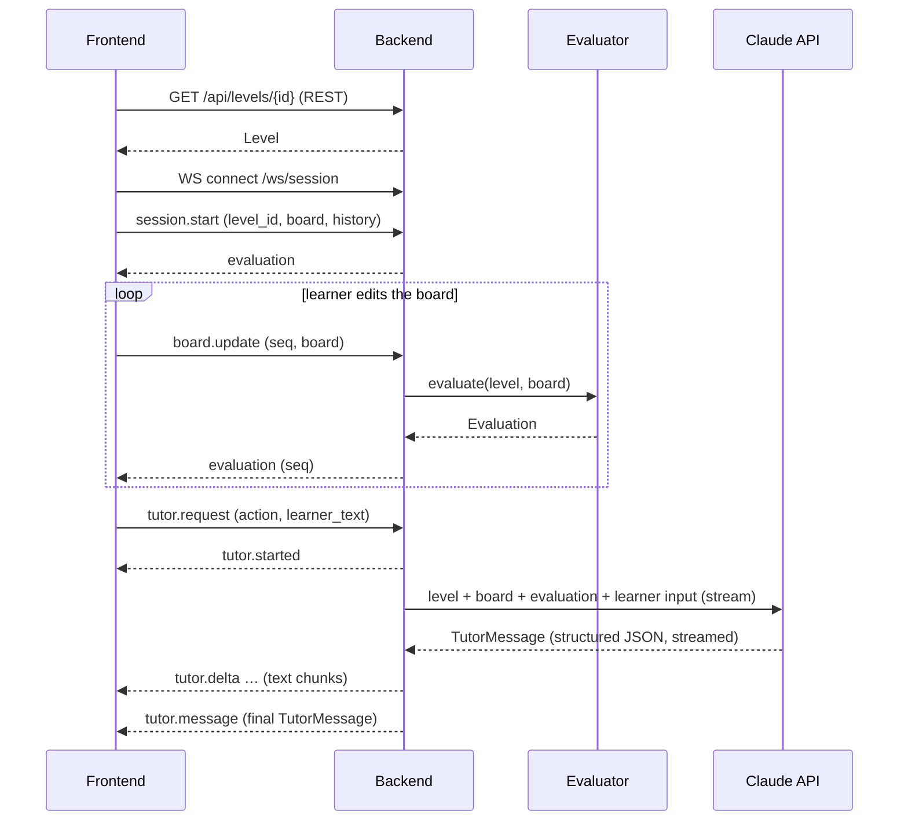

# Contracts

The interfaces between the frontend and the backend, and between the backend and the Claude API. The architecture is in [design.md](design.md).



## 1. Frontend ↔ Backend

The frontend and backend talk over two channels:

| Channel | Used for | Why |
|---|---|---|
| **REST** (JSON over HTTP, under `/api`) | Static, cacheable resources: the level list and level definitions | Simple, cacheable, debuggable |
| **WebSocket** (`/ws/session`) | The interactive learning session: board updates, live evaluation, tutor requests, streamed tutor replies | Live meter readings on every edit without per-request overhead; the tutor's reply streams in as Claude writes it |

### REST endpoints

| Method | Path | Response |
|---|---|---|
| `GET` | `/api/levels` | `LevelSummary[]` |
| `GET` | `/api/levels/{id}` | `Level` |
| `GET` | `/api/health` | `{ "status": "ok" }` |

Errors: `404` for an unknown level, `429` when the rate limit is exceeded.

### WebSocket session

One connection is one learning session on one level.

- The server keeps the session state in memory for the life of the connection: the level, the latest board, the conversation history and the hint level reached.
- The client also keeps the history. On reconnect it sends `session.start` again with its board and history, so the server stays free of storage and any instance can serve the session.

Every message is a JSON object with a `type` field.

**Client → server**

| `type` | Payload | Effect |
|---|---|---|
| `session.start` | `level_id`, `board?`, `history?` | Starts or resumes a session; the server replies with `evaluation` |
| `board.update` | `seq`, `board` | Re-evaluates; the server replies with `evaluation` carrying the same `seq` |
| `tutor.request` | `request_id`, `action` (`"check"`, `"hint"` or `"message"`), `learner_text?` | Runs the evaluator and then Claude on the latest board |

**Server → client**

| `type` | Payload | Notes |
|---|---|---|
| `evaluation` | `seq`, `evaluation: Evaluation` | The client ignores any `seq` older than the last one it applied |
| `tutor.started` | `request_id` | The UI shows "tutor is thinking" |
| `tutor.delta` | `request_id`, `text` | An incremental chunk of `TutorMessage.text`, for live display |
| `tutor.message` | `request_id`, `evaluation`, `message: TutorMessage` | Final and authoritative; replaces the streamed text |
| `error` | `code`, `message`, `request_id?` | Codes: `bad_message`, `unknown_level`, `rate_limited`, `tutor_unavailable` |

**Rules**

- `board.update` is debounced by the client (about 150 ms while dragging).
- Only one `tutor.request` may be in flight per session. A second one gets `error: rate_limited`.
- The `evaluation` in `tutor.message` always comes from a fresh server-side evaluator run, never from the client.
- If Claude fails, the learner still has the latest `evaluation`, and the server sends `error: tutor_unavailable` with the `request_id`.

### Data model

The board format (the `grid` document) and its validation rules are defined in [schematics.md](schematics.md#1-board-format-the-grid-document). The shapes below fix the contract.

```ts
type Point = [number, number];   // [col, row], 1-based, row 1 at the top

type ComponentType = "voltage_source" | "resistor" | "voltmeter" | "ammeter";
type Orientation = "N" | "E" | "S" | "W";

interface Component {
  id: string;
  type: ComponentType;
  value?: number;                // volts for voltage_source, ohms for resistor
  fixed: boolean;                // the learner cannot move or remove it
  orientation: Orientation;      // direction of the first pin
  pins: Record<string, Point>;   // positive/negative, or a/b for a resistor
}

interface InventoryItem {
  id: string;
  type: ComponentType;
  value?: number;
}

type Segment = [Point, Point];   // orthogonal neighbors
type Wire = Segment[];           // straight (1), corner (2), T (3), + (4)

interface Board {                // the `grid` document
  grid: { columns: number; rows: number };
  components: Component[];
  inventory: InventoryItem[];
  wires: Wire[];
  targets: Record<string, number>;  // meter id -> target reading (V or A)
}

interface LevelSummary {
  id: string;
  order: number;
  title: string;
  concept: string;               // e.g. "Series resistors"
}

interface Level extends LevelSummary {
  intro: string;                 // learner-facing task text
  board: Board;                  // the starting board; fixed parts, inventory and targets included
}

type IssueCode =
  | "short_circuit"        // source terminals connected with ~0 Ω
  | "open_circuit"         // no closed loop through the source
  | "bypassed"             // both pins of a component on the same node
  | "floating_component"   // a lead not connected to anything
  | "no_source";

interface Issue {
  code: IssueCode;
  component_ids: string[];
  points: Point[];
}

interface Measurement {
  component_id: string;    // meters and resistors
  voltage: number;         // V across the component
  current: number;         // A through the component
}

interface Evaluation {
  valid: boolean;          // false if the circuit can't be solved, e.g. a short
  goal_met: boolean;                     // every target within tolerance
  readings: Record<string, number>;      // meter id -> reading, for every placed meter
  measurements: Measurement[];
  issues: Issue[];
}

interface ChatTurn {
  role: "learner" | "tutor";
  text: string;
}

interface TutorMessage {
  kind: "feedback" | "hint" | "question" | "praise";
  text: string;                    // learner-facing, plain language
  hint_level: 0 | 1 | 2 | 3;       // 0 if this isn't a hint
  focus: { component_ids: string[]; points: Point[] };  // what three.js should highlight
  misconception: string | null;    // internal label, e.g. "current is used up"; not shown
}
```

## 2. Backend ↔ Claude API

### Call settings

| Setting | Value | Why |
|---|---|---|
| SDK | Official `anthropic` Python SDK | |
| Endpoint | Messages API, streamed; one call per `tutor.request` | Single-turn tutoring, not an agent loop; streaming feeds `tutor.delta` |
| Model | `claude-opus-5-5` | Current default model |
| Effort | `output_config.effort: "low"`, set explicitly | Interactive latency; tune upward if feedback quality is weak |
| Output | Structured output: `output_config.format` with the `TutorMessage` JSON schema | Guaranteed parseable responses for the UI |
| `max_tokens` | 16000 | Must cover thinking plus the response; not a quality lever |
| Refusals | Server-side `fallbacks: "default"` (beta `server-side-fallback-2026-07-01`); check `stop_reason` before reading content | Recommended default for this model |
| Caching | `cache_control` on the static system prompt | It is identical across all requests. Below the model's minimum cacheable size it simply won't cache, which is harmless. |
| Timeout and retries | SDK defaults (2 retries), 30 s request timeout | On failure, send `error: tutor_unavailable` |

### Prompt layout

The order runs from most stable to least stable, so the cached prefix stays valid.

1. **System prompt (static, cached).** The tutor's role and teaching rules:
   - never give the solution
   - never state a number that isn't in the evaluation
   - escalate hints one level at a time
   - write in plain language for beginners
   - set `focus` to the relevant parts
2. **Messages.** The session's history turns as alternating user and assistant text, then the current user turn with tagged JSON blocks:
   - `<level>`: concept, targets and intro text
   - `<board>`: the learner's components
   - `<evaluation>`: the evaluator's result, which is the only source of electrical values
   - `<request>`: the `action`, the next allowed hint level and `learner_text`

### Response handling

- Parse the structured output into `TutorMessage`.
- Stream the `text` field of the partial JSON to the client as `tutor.delta`. Send the parsed `TutorMessage` as `tutor.message`.
- Enforce `hint_level` server-side: the session tracks the highest hint given. Claude may go at most one level higher, and anything beyond that is clamped.
- Check that `focus` IDs exist on the board, and drop any that don't.
- The returned `evaluation` always comes from the evaluator, never from Claude.

## Open points

- The hint ladder's content per level, defined in the tutor design
