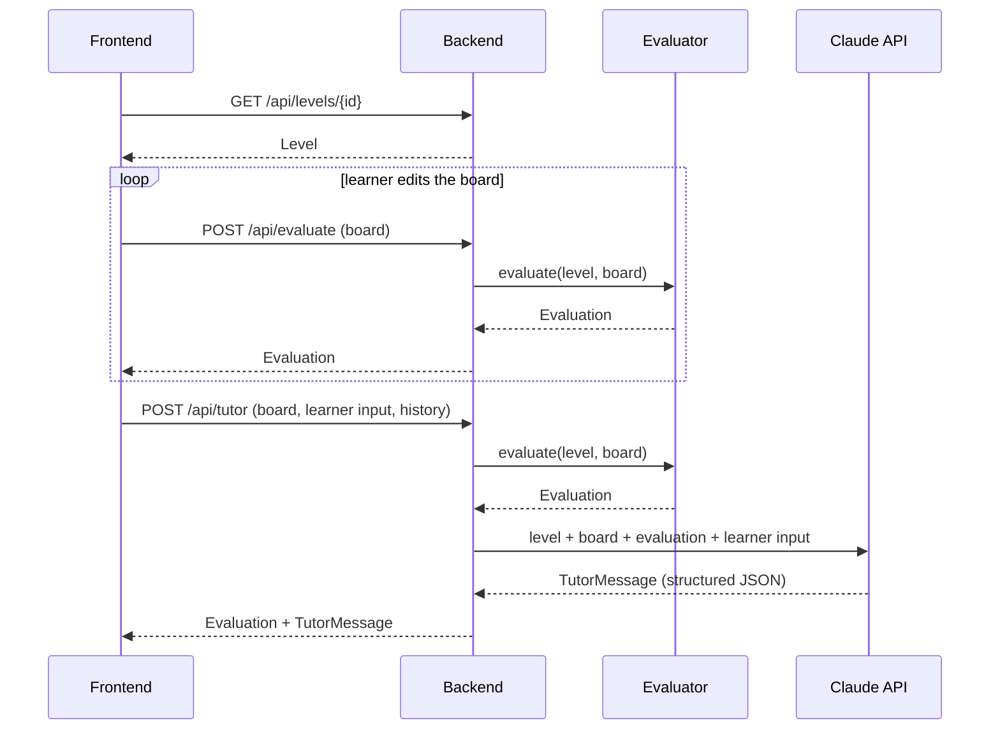

# Contracts

The interfaces between the frontend and the backend, and between the backend and the Claude API. The architecture is in [design.md](design.md).



## 1. Frontend ↔ Backend

A JSON-over-HTTP REST API under `/api`.

The backend is **stateless**: the frontend owns the session (current level, board, conversation history) and sends what is needed with each request. This keeps the backend horizontally scalable and needs no database for the prototype.

### Endpoints

| Method | Path | Request | Response | Calls Claude |
|---|---|---|---|---|
| `GET` | `/api/levels` | — | `LevelSummary[]` | No |
| `GET` | `/api/levels/{id}` | — | `Level` | No |
| `POST` | `/api/evaluate` | `EvaluateRequest` | `Evaluation` | No |
| `POST` | `/api/tutor` | `TutorRequest` | `TutorResponse` | Yes |

**Why `/evaluate` and `/tutor` are separate:**
- `/evaluate` is cheap and deterministic, so the frontend can call it on every edit to update meter readings live.
- `/tutor` costs an LLM call and runs only on a learner action ("Check" or "Hint").
- `/tutor` always re-runs the evaluator server-side and never trusts an evaluation sent by the client.

### Data model

The exact breadboard geometry (hole naming, rails) is pinned down in the domain design. The shapes below fix the contract.

```ts
// A hole on the breadboard, e.g. "a12" (terminal strip) or "top+:5" (rail).
type HoleId = string;

type ComponentType = "battery" | "resistor" | "wire" | "voltmeter";

interface Component {
  id: string;              // unique within the board
  type: ComponentType;
  pins: [HoleId, HoleId];  // for battery and voltmeter, pins[0] is "+"
  value?: number;          // ohms for resistor, volts for battery
}

interface Board {
  components: Component[];
}

interface Goal {
  kind: "voltage" | "current";
  target: number;
  tolerance: number;       // absolute, in unit
  unit: "V" | "A";
  // Where the goal is measured: the reading of a specific meter, or between two holes.
  at: { component_id: string } | { between: [HoleId, HoleId] };
  description: string;     // learner-facing, e.g. "Get 3 V across R2"
}

interface LevelSummary {
  id: string;
  order: number;
  title: string;
  concept: string;         // e.g. "Series resistors"
}

interface Level extends LevelSummary {
  intro: string;                     // learner-facing task text
  initial_board: Board;
  locked_component_ids: string[];    // parts the learner cannot move or remove
  palette: { type: ComponentType; values?: number[] }[];  // parts the learner may add
  goal: Goal;
}

type IssueCode =
  | "short_circuit"        // source terminals connected with ~0 Ω
  | "open_circuit"         // no closed loop through the source
  | "same_strip"           // both leads of a component in one strip (bypassed)
  | "floating_component"   // a lead not connected to anything
  | "no_source";

interface Issue {
  code: IssueCode;
  component_ids: string[];
  holes: HoleId[];
}

interface Measurement {
  component_id: string;    // meters and resistors
  voltage: number;         // V across the component
  current: number;         // A through the component
}

interface Evaluation {
  valid: boolean;          // false if the circuit can't be solved, e.g. a short
  goal_met: boolean;
  goal_actual: number | null;
  measurements: Measurement[];
  issues: Issue[];
}

interface EvaluateRequest {
  level_id: string;
  board: Board;
}

interface ChatTurn {
  role: "learner" | "tutor";
  text: string;
}

interface TutorRequest {
  level_id: string;
  board: Board;
  action: "check" | "hint" | "message";
  learner_text?: string;    // the learner's question, prediction or explanation
  hint_level: 0 | 1 | 2 | 3; // highest hint already given; the backend serves the next one
  history: ChatTurn[];      // capped by the frontend (e.g. last 10 turns)
}

interface TutorMessage {
  kind: "feedback" | "hint" | "question" | "praise";
  text: string;                    // learner-facing, plain language
  hint_level: 0 | 1 | 2 | 3;       // 0 if this isn't a hint
  focus: { component_ids: string[]; holes: HoleId[] };  // what three.js should highlight
  misconception: string | null;    // internal label, e.g. "current is used up"; not shown
}

interface TutorResponse {
  evaluation: Evaluation;
  tutor: TutorMessage | null;      // null if Claude is unavailable
  error?: string;
}
```

### Errors

| Status | When |
|---|---|
| `400` | The request doesn't match the schema, or the board references unknown holes |
| `404` | Unknown `level_id` |
| `429` | Rate limit exceeded |
| `200` with `tutor: null` | The evaluator succeeded but the Claude call failed. The frontend still shows the verdict. |

## 2. Backend ↔ Claude API

### Call settings

| Setting | Value | Why |
|---|---|---|
| SDK | Official `anthropic` Python SDK | |
| Endpoint | Messages API, one call per `/api/tutor` request | Single-turn tutoring, not an agent loop |
| Model | `claude-opus-5-5` | Current default model |
| Effort | `output_config.effort: "low"`, set explicitly | Interactive latency; tune upward if feedback quality is weak |
| Output | Structured output: `output_config.format` with the `TutorMessage` JSON schema | Guaranteed parseable responses for the UI |
| `max_tokens` | 16000 | Must cover thinking plus the response; not a quality lever |
| Refusals | Server-side `fallbacks: "default"` (beta `server-side-fallback-2026-07-01`); check `stop_reason` before reading content | Recommended default for this model |
| Caching | `cache_control` on the static system prompt | It is identical across all requests. Below the model's minimum cacheable size it simply won't cache, which is harmless. |
| Timeout and retries | SDK defaults (2 retries), 30 s request timeout | On failure, return `tutor: null` |

### Prompt layout

The order runs from most stable to least stable, so the cached prefix stays valid.

1. **System prompt (static, cached).** The tutor's role and teaching rules:
   - never give the solution
   - never state a number that isn't in the evaluation
   - escalate hints one level at a time
   - write in plain language for beginners
   - set `focus` to the relevant parts
2. **Messages.** The prior `history` turns as alternating user and assistant text, then the current user turn with tagged JSON blocks:
   - `<level>`: concept, goal and intro text
   - `<board>`: the learner's components
   - `<evaluation>`: the evaluator's result, which is the only source of electrical values
   - `<request>`: the `action`, the requested hint level and `learner_text`

### Response handling

- Parse the structured output into `TutorMessage`.
- Enforce `hint_level` server-side: if Claude returns a higher level than the one requested, clamp it.
- Check that `focus` IDs exist on the board, and drop any that don't.
- The returned `evaluation` always comes from the evaluator, never from Claude.

## Open points

- The exact hole naming and rail layout, defined in the domain design
- The hint ladder's content per level, defined in the tutor design
- Whether a current goal needs an ammeter component or reads from `Measurement.current`
