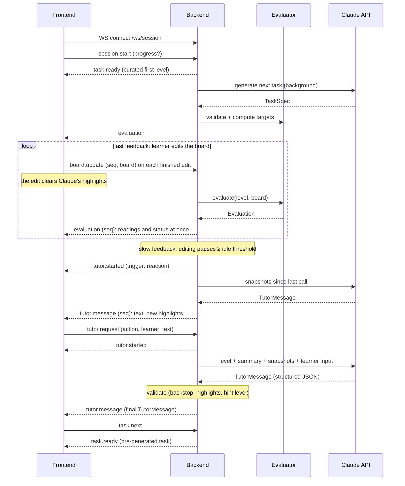

# Contracts

The interfaces between the frontend and the backend, and between the backend and the Claude API. The architecture is in [design.md](design.md).



## 1. Frontend ↔ Backend

The frontend and backend talk over two channels:

| Channel | Used for | Why |
|---|---|---|
| **REST** (JSON over HTTP, under `/api`) | Static, cacheable resources: the curated levels | Simple, cacheable, debuggable |
| **WebSocket** (`/ws/session`) | The interactive learning session: task delivery, board updates, live evaluation, tutor reactions and requests, validated tutor replies | Live meter readings on every edit without per-request overhead; the server can push tutor reactions unprompted |

### REST endpoints

| Method | Path | Response |
|---|---|---|
| `GET` | `/api/levels` | `LevelSummary[]`: the curated levels, each tagged with a skill level |
| `GET` | `/api/levels/{id}` | `Level` |
| `GET` | `/api/health` | `{ "status": "ok" }` |
| `POST` | `/api/tasks/generate` | `{ level: Level, welcome, difficulty, rationale, attempts }`. The request body is `{ skill_level, history: TaskSummary[], profile?: LearnerProfile }`. `welcome` is the tutor's chat message for the new task, composed like a tutor reply (`kind`, `icon`, `title`, `text`, `terms`; [design.md](design.md#welcome-message)). |

**`POST /api/tasks/generate`** is the task generation pipeline (backend → Claude → backend), exposed directly. The WebSocket `task.next` flow will call the same service. It returns `503` when no API key is configured and `502` when generation fails after retries. Target values in the returned board are computed by the evaluator from the complete board.

Curated levels are the very first task and the fallback when generation fails. Most tasks are generated by Claude and delivered over the WebSocket.

> **Build status.** Implemented: `GET /api/health` and `POST /api/tasks/generate`, which the client calls for every task, the first one included. The endpoint serves pre-generated tasks from a cache keyed by progress, with a pool of first tasks, and then generates the next task in the background ([design.md](design.md#3-system-architecture)); this replaces the planned WebSocket `task.next` / `task.ready` delivery for now. Curated levels and `/api/levels` are not built yet, so a generation failure reaches the learner as an error with a retry button.

Errors: `404` for an unknown level; `429` with a `detail` message when a limit is exceeded: generations per IP (with `Retry-After`), the daily Claude budget, or REST requests per IP ([design.md](design.md#rate-limits)).

### WebSocket session

> **Build status.** Implemented: `session.start`, `board.update` → `evaluation`, idle-triggered reactions, `tutor.request` with `action: "message"` → `tutor.started` → `tutor.message`, and `error`. The server keeps generated levels' reference solutions in memory by level ID for the tutor. The editor sends `board.update` on every drop. The UI shows the chat text and draws the highlights on the grid. `tutor.request` with `action: "hint"` follows the hint ladder. Still to come: `task.next` / `task.ready`.

One connection is one learning session, and it can span several tasks.

- **Server state.** The server keeps the session state in memory for the life of the connection:
  - the current task, including its complete reference board, which is never sent to the client
  - the latest board, the conversation history and the hint level reached
  - the learner's `Progress`: skill level and task history
  - the pre-generated next task
- **Reconnect.** The client keeps the current `Level`, its board, the conversation history and its `Progress`, plus the chat, the `LearnerProfile` and the research consent, all in `localStorage` ([gui.md](gui.md#session-persistence)), so a reload or a later visit resumes. On reconnect it sends them with `session.start`, so the server stays free of storage. Progress therefore lives in one browser, which is accepted for the prototype. If the reconnect lands on a different instance, the reference board is lost. Grading is unaffected because it uses readings only; the tutor just works without the reference.

Every message is a JSON object with a `type` field.

**Client → server**

| `type` | Payload | Effect |
|---|---|---|
| `session.start` | `progress?`, `level?`, `board?`, `history?`, `hint_level?`, `profile?`, `research?` | Starts a session (the server sends `task.ready` with the curated level for the skill level) or resumes one (`level` given). The server also replies with `evaluation`, which carries the `LearnerProfile` with the task's topics joined. `profile` is the learner profile the browser saved ([design.md](design.md#learner-profile)); the server checks it and drops bad entries. `research` is the learner's consent for this session, `{ consent, learner_id?, name?, active_s?, last_ts? }`; with `consent: true` and a UUID `learner_id`, the server records the session, and its active-time count continues from `active_s` and the time of the last activity, `last_ts` ([design.md](design.md#5-learner-experience-research)). With `progress` and `level`, the server pre-generates the task after this one ([design.md](design.md#3-system-architecture)). `hint_level` is the hint level reached in this task (0–3), so a resumed session continues the ladder. |
| `task.next` | — | Asks for the next task, usually after the current one is solved |
| `summary.request` | — | Bonus: asks for the learner's skill summary (Learning Path screen) |
| `board.update` | `seq`, `board` | Sent on each finished edit (a part dropped, a wire piece placed or removed). The server records a snapshot, re-evaluates and replies with `evaluation` carrying the same `seq`. |
| `tutor.request` | `request_id`, `action` (`"message"` or `"hint"`), `learner_text?` | Runs the evaluator and then Claude on the latest board. `"message"` needs `learner_text`. `"hint"` asks for the next level of the hint ladder ([tutor.md](tutor.md#3-hint-ladder)); the server picks the level. |

**Server → client**

| `type` | Payload | Notes |
|---|---|---|
| `task.ready` | `level: Level`, `source` (`"curated"` or `"generated"`), `progress: Progress` | A new task. The client replaces its board with `level.board` and stores `progress`. |
| `task.generating` | — | Sent when `task.next` arrives before the pre-generated task is ready |
| `summary.ready` | `summary: SkillSummary` or `error` | Bonus: the reply to `summary.request` |
| `evaluation` | `seq`, `evaluation: Evaluation`, `profile?: LearnerProfile`, `research?` | The client ignores any `seq` older than the last one it applied. The reply to `session.start` carries the profile; the client saves it. With research consent, `research: { active_s, last_ts }` is the active time since the last 🔔 prompt and the time of the last activity (Unix seconds); the client saves it with the consent and sends it back with the next `session.start`. |
| `tutor.started` | `request_id`, `trigger` (`"reaction"` or `"request"`) | The UI shows "tutor is thinking". Reactions get a server-generated `request_id`. |
| `tutor.message` | `request_id`, `seq`, `evaluation`, `message: TutorMessage`, `hint_offered`, `profile: LearnerProfile` | The complete reply, sent only after the backend has validated and composed it. With research consent, the 🔔 feedback prompt and the feedback conversation's replies arrive as `tutor.message`s too, with `chat.kind: "experience"` and empty `meta`: the prompt after an 8 s pause in editing, without `tutor.started`. While that conversation is open, the learner's messages go to it; one meant for the tutor is handed off and answered as a normal tutor reply. Board edits and reactions go on as usual. A hint request, the end of the conversation, or 3 active minutes without a reply close it. `profile` is the learner profile after the reply's changes; the client saves it. `hint_offered` is true when the reply offers a hint, so the UI highlights the Hint button. `seq` is the board the reply is about (0: the `session.start` board); when the learner has edited since, the client shows the text but drops the highlights and the evaluation, which are out of date. |
| `error` | `code`, `message`, `request_id?` | Codes: `bad_message`, `unknown_level`, `rate_limited`, `tutor_unavailable`, `no_session` (a request arrived before `session.start`, e.g. after a server restart: the client re-sends `session.start` and repeats the request), `session_rejected` (the saved level or board can't be resumed: the client offers a new task). `tutor_unavailable` also answers a request over the daily Claude budget. A connection over the per-IP session limit gets `rate_limited` and is closed with code `1008`; the client then waits 30 s before reconnecting. Limits are in [design.md](design.md#rate-limits). Generation failures never surface: they fall back to a curated level. |

**Rules**

- The server starts generating the next task in the background as soon as a task is delivered, so `task.next` is usually instant.
- The client sends `board.update` only on finished edits. Dragging stays local to three.js until the drop.
- **Two feedbacks per edit.** *Fast:* the evaluator's `evaluation` comes back at once (no Claude call), so readings and status update within a split second, and the edit clears Claude's highlights, which described the previous board. *Slow:* after the idle pause, Claude's reaction brings new text and highlights; if the learner edited during the call, its `seq` is out of date and only the text is shown.
- **Reactions.** The server starts an idle timer on every `board.update`. When editing pauses for at least the **idle threshold** (`tutor.idle_threshold_ms`, default 1.5 s), the server calls Claude with the snapshots recorded since the previous Claude call.
  - A burst of quick edits, each within a split second of the last, produces one reaction, not one per edit.
  - If edits arrive while a reaction is running, they wait for the next pause.
  - **An out-of-date reaction is dropped.** When a reaction's call finishes after a newer edit, the server doesn't send it: it describes a board that's gone, and the reaction to the newer board follows. Replies to the learner's messages and hints are always sent.
  - **No reaction when nothing changed.** If the board's graph (parts, values, connections) is the same as the one Claude last replied about, the pause gets no reaction: the evaluation is the same too, so there's nothing new to say. Moving a wire along the same connections or dropping a stray piece are such edits. After `tutor.react_after_unchanged` such pauses in a row (default 4), the server calls Claude anyway, with `"unchanged_moves": N` in the request: the learner is trying things without progress and needs more direct guidance. Skipped pauses keep their snapshots, so Claude sees what was tried, and they count toward the hint offer like reactions without progress.
- An explicit `tutor.request` cancels the pending idle timer and takes priority. Its call also includes the unsent snapshots.
- Only one Claude tutor call, either a reaction or a request, may be in flight per session.
- A second `tutor.request` while one is in flight gets `error: rate_limited`.
- The `evaluation` in `tutor.message` always comes from a fresh server-side evaluator run, never from the client.
- If Claude fails, the learner still has the latest `evaluation`, and the server sends `error: tutor_unavailable`: with the `request_id` for a request, without one for a reaction, so the client only stops "thinking" and shows no error.
- A reaction over the rate limit or the daily Claude budget is skipped silently.
- `board.update`s faster than the limit (20 per second) are coalesced: the latest one is evaluated as soon as the limit allows, and the ones in between get no `evaluation`.

### Data model

The board format (the `grid` document) and its validation rules are defined in [schematics.md](schematics.md#1-board-format-the-grid-document). The `graph` document is defined in [schematics.md](schematics.md#2-graph-format-the-graph-document). The frontend sends and receives only grids; graphs are internal to the backend and its Claude calls. The shapes below fix the contract.

```ts
type Point = [number, number];   // [col, row], 1-based, row 1 at the top

type ComponentType = "voltage_source" | "resistor" | "voltmeter" | "ammeter";
type Orientation = "N" | "E" | "S" | "W";

interface Component {
  id: string;
  type: ComponentType;
  value?: number;                // volts for voltage_source, ohms for resistor
  fixed: boolean;                // the learner cannot move or remove it
  orientation: Orientation;      // direction of the first pin
  pins: Record<string, Point>;   // positive/negative, or a/b for a resistor
}

interface InventoryItem {
  id: string;
  type: ComponentType;
  value?: number;
}

type Segment = [Point, Point];   // orthogonal neighbors
interface Wire {
  id: string;                    // "W1", "W2", …; assigned when placed
  segments: Segment[];           // straight (1), corner (2), T (3), + (4)
}

interface Board {                // the `grid` document
  grid: { columns: number; rows: number };
  components: Component[];
  inventory: InventoryItem[];
  wires: Wire[];
  targets: Record<string, { value: number; tolerance?: number }>;  // meter id -> target (V or A)
}

type PinRef = string;            // "<componentId>.<pinName>", e.g. "R1.a"

interface Graph {                // the `graph` document: connectivity only
  components: { id: string; type: ComponentType; value?: number; pins: string[] }[];
  inventory: InventoryItem[];
  edges: [PinRef, PinRef][];     // pin pairs joined by wires; order carries no meaning
  targets: Board["targets"];
}

interface TaskSummary {          // one line of task history
  title: string;
  concept: string;
  shape: string;                 // e.g. "series: V + 2R + AM"
  difficulty: number;            // 1–5, from the TaskSpec
  hints_used: number;
  misconceptions: Misconception[];  // fixed tutor labels (tutor.md §5)
  signature: string;             // Level.signature: circuit fingerprint for the repeat check
  final_grid?: Board;            // bonus: the solved grid, for read-only review
}

interface Progress {
  skill_level: number;           // starts at 1; +1 per solved task, backend only
  history: TaskSummary[];        // solved tasks, oldest first
}

interface LevelSummary {
  id: string;
  order: number;
  title: string;
  concept: string;               // e.g. "Series resistors"
}

interface Level extends LevelSummary {
  curriculum?: { level: number; task: number; tasks: number; concept: string };  // generated levels
  intro: string;                 // learner-facing task text
  welcome?: string;              // generated levels: the tutor's chat message for the task
  board: Board;                  // the starting board; fixed parts, inventory and targets included
  difficulty?: number;           // generated levels: 1–5, from the TaskSpec
  shape?: string;                // generated levels: parts summary, e.g. "V + 2R + VM"
  signature?: string;            // generated levels: circuit fingerprint, kept in TaskSummary
}

// One overall status: the most severe finding wins. Detection and precedence:
// schematics.md §6.
type Status =
  | "short_circuit"              // a source is shorted; readings unavailable
  | "no_source"                  // no voltage source; nothing can flow
  | "overcurrent"                // a resistor dissipates more than its power rating
  | "meter_misuse"               // ammeter across a part, or voltmeter blocking the loop
  | "open_circuit"               // the loop isn't closed; no current flows
  | "floating_part"              // a part has a lead connected to nothing
  | "bypassed"                   // a part's pins are joined, so it does nothing
  | "misplaced"                  // circuit works, but a target is off by more than near_target_ratio
  | "near_target"                // every target within near_target_ratio, one outside tolerance
  | "solved";                    // every target within tolerance

type IssueCode =
  | "short_circuit" | "no_source" | "overcurrent"
  | "ammeter_parallel" | "voltmeter_series"     // both map to status "meter_misuse"
  | "open_circuit" | "floating_part" | "bypassed"
  | "unused_wire";                              // a leftover wire piece; changes no status

interface Issue {
  code: IssueCode;
  component_ids: string[];
  wire_ids?: string[];           // unused_wire only: the leftover piece
  pins: PinRef[];                // the pins involved, from the graph
  points: Point[];               // the same pins mapped to grid points (unused_wire: the piece's ends), for highlighting
  open_ends?: Point[];           // open_circuit only: where the loop is broken (schematics.md §6)
}


interface Evaluation {
  status: Status;
  // Every placed voltmeter and ammeter, not only target meters, rounded to
  // meter resolution. null when it can't be computed (short circuit); the UI
  // shows "--".
  readings: Record<string, number | null>;
  issues: Issue[];               // every finding, not only the one behind `status`
}

interface ChatTurn {
  role: "learner" | "tutor";
  text: string;
}

interface Snapshot {               // recorded by the server on every board.update
  seq: number;
  t_ms: number;                      // milliseconds since the session started, so Claude sees the pace
  grid?: Board;                      // in the tutor context, only on the current board
  graph: Graph;
  evaluation: Evaluation;
}

// Claude's feedback has two parts: `chat`, shown in the chat panel, and
// `meta`, which drives the grid UI and the backend and is never shown as text.
// Field order matters: Claude writes fields in schema order, so `meta`
// (including `principle`) comes first and the text then explains that principle.
interface TutorMessage {
  meta: {
    principle: Principle;          // the physics this message teaches (tutor.md §5)
    highlights: Highlight[];       // draws the learner's attention on the grid
    hint_level: 0 | 1 | 2 | 3;     // 0 if this isn't a hint
    misconception: Misconception | null;  // fixed label (tutor.md §5)
    topic_updates: TopicUpdate[];  // score changes for the learner profile (design.md §4)
    new_topic: NewTopic | null;    // a topic Claude adds to this learner's profile
  };
  chat: {
    kind: "feedback" | "nudge" | "hint" | "question" | "praise" | "knowledge"
        | "experience";            // the 🔔 feedback conversation (research), never from the tutor
    text: string;                  // learner-facing, plain language
    // Added by the reply composer, not by Claude:
    icon?: string;                 // the kind's icon, e.g. "📘"
    title?: string | null;         // a knowledge message's topic name
    terms?: [number, number][];    // [start, end) of each profile topic's first mention, shown in bold;
                                   // UTF-16 offsets, as JavaScript strings count
  };
}

interface TopicUpdate {
  topic: string;                   // a topic id in the profile, or in the catalog (it joins)
  understanding: number;           // -1, 0 or +1; clamped by the composer
  explained: number;               // 0 or +1; one topic per reply
}

interface NewTopic {
  id: string;                      // snake_case, new to the profile
  name: string;
  type: "principle" | "term";
  definition: string;              // one line
}

// The learner's knowledge list (design.md §4). Kept by the browser,
// checked and updated by the backend.
interface LearnerProfile {
  topics: {
    id: string;
    name: string;
    type: "principle" | "term";
    definition: string;
    introduced: number;            // skill level at which the learner met it
    understanding: 0 | 1 | 2 | 3;  // what the learner has shown
    explained: 0 | 1 | 2 | 3;      // how much the tutor has explained it
    source: "catalog" | "claude";
  }[];
}

type Principle =
  | "closed_loop" | "ohms_law" | "series_voltage_division"
  | "parallel_branches" | "meter_usage" | "power_safety";

type Misconception =
  | "single_wire_enough" | "current_used_up" | "bigger_r_more_current"
  | "full_voltage_each_resistor" | "parallel_reduces_current"
  | "meter_in_series_like_wire" | "ammeter_across_part" | "short_is_harmless";

interface Highlight {
  target:
    | { component: string }        // a component id, e.g. "R1"
    | { wire: string }             // a wire id, e.g. "W2"
    | { point: Point };            // a single grid point, e.g. a dangling wire end
  style: "attention" | "error" | "success";  // amber, red, green outline
}
```

**Highlights**
- three.js draws each highlight on the referenced component, wire piece or point.
- **Lifetime:** a highlight stays until the next tutor message or the learner's next edit, whichever comes first.
- **Style:** a nudge typically uses `attention` or `error` on the problem, and praise uses `success` on what was just done right.
- **Connections:** a missing or misplaced connection is shown as two `point` highlights, the grid points that should be connected ([tutor.md](tutor.md#2-reactions-by-status)).

## 2. Backend ↔ Claude API

The backend makes three kinds of Claude calls: **tutoring** (2.1), **task generation** (2.2) and, as a bonus, the **skill summary** (2.3). Models, effort and limits are read from the root `config.yaml` ([design.md](design.md#7-configuration)); the values below are the defaults.

### 2.1 Tutor call

#### Call settings

| Setting | Value | Why |
|---|---|---|
| SDK | Official `anthropic` Python SDK | |
| Endpoint | Messages API; one call per reaction or `tutor.request` | Not an agent loop. Everything goes through the backend: it receives Claude's complete reply, validates it, and only then sends it to the browser. Nothing is streamed to the browser. |
| Model | `claude-opus-5-5`, configured separately for reactions and requests | Current default model; reactions may switch to a cheaper model by config |
| Effort | Set explicitly from `config.yaml`: `low` for reactions, `medium` for learner requests | Reactions are frequent and need low latency; requests are rarer and matter more |
| Output | Structured output: `output_config.format` with the `TutorMessage` JSON schema | Guaranteed parseable responses for the UI |
| `max_tokens` | 16000 | Must cover thinking plus the response; not a quality lever |
| Refusals | Check `stop_reason` before reading content. Today a refusal gets the safe generic message for the status; server-side `fallbacks` are a plan item. | The learner always gets a reply |
| Caching | `cache_control` on the static system prompt | It is identical across all requests. Below the minimum cacheable size it simply won't cache, which is harmless. |
| Timeout and retries | SDK defaults (2 retries), 30 s request timeout | On failure, send `error: tutor_unavailable` |

#### Prompt layout

The order runs from most stable to least stable, so the cached prefix stays valid.

1. **System prompt (static, cached).** The tutor's role, principles, reaction rules, free-chat rules, guardrails and the output rules. The live text is `SYSTEM_PROMPT` in `backend/app/tutor.py`; the design draft is in [tutor.md](tutor.md#8-system-prompt-draft).
2. **One user turn per call.** Each call is self-contained; there is no multi-turn conversation. The turn contains:
   - `<level>`: concept, targets and intro text
   - `<reference>`: the reference solution's `graph` when available, so hints can point toward a solution without revealing it
   - `<summary>`: a one-line circuit description written by the backend, e.g. `parts: V1 12 V, R1 40 Ω, VM1; status: meter_misuse; readings: VM1=12.0`
   - `<snapshots>`: the `Snapshot`s recorded since the previous call, up to the last `tutor.max_snapshots`, oldest first. Earlier ones carry the graph and evaluation; the last is the current board (`"current": true`) and also carries its grid, labeled "for highlight references only". They show Claude what the learner did and how the circuit changed. The evaluations are the only source of electrical values.
   - `<profile>`: the learner's skill level and up to 8 focus topics from the `LearnerProfile`, each with its scores and `tasks_ago` ([design.md](design.md#learner-profile))
   - `<history>`: the last `tutor.history_turns` tutor and learner chat turns, for continuity
   - `<request>`: either `trigger: "reaction"`, or the learner's `action`, the next allowed hint level and `learner_text`

#### Response handling

- Parse the structured output into `TutorMessage`.
- **Location-talk backstop** ([tutor.md](tutor.md#6-guardrails-physics-not-placement)): scan `chat.text` for coordinates, pin references and the words "row", "column" and "point".
  - On a match, regenerate once with the problem named.
  - If it fails again, send a safe generic message for the status.
- Enforce `meta.hint_level` server-side: the session tracks the highest hint given and decides each hint's level (one higher, at most 3). Claude's value is overwritten with it; replies that aren't hints get 0. A level-1 hint's highlights are dropped.
- **Highlight wire format.** In Claude's structured output, each highlight has `component`, `wire` and `point` fields, with the unused ones `null`, plus `style`. The backend converts each into a `Highlight` (`{ target, style }`).
- Check every highlight against the latest snapshot: the component ID exists, the wire ID exists, and the point is inside the grid. Drop any that fail.
- The returned `evaluation` always comes from the evaluator, never from Claude.
- **Reply composer** ([design.md](design.md#reply-composer)): apply `meta.topic_updates` and `meta.new_topic` to the learner profile within bounds, then add `chat.icon` and, for a `knowledge` message, `chat.title`. Refused changes go to the run log as `profile_dropped`.
- Only then send the validated `TutorMessage` to the browser as `tutor.message`, with the updated profile.

### 2.2 Task generation call

Claude proposes a task. The backend validates it and turns it into a `Level`; the full flow is in [schematics.md](schematics.md#3-task-flow).

#### Call settings

| Setting | Value | Why |
|---|---|---|
| Model | `claude-opus-5-5` | Spatial layout on a grid is hard; use the strongest default |
| Effort | `output_config.effort: "high"` | Runs in the background, so quality matters more than latency |
| Tools | `validate_grid` (custom, `strict: true`) | Claude checks its own draft and fixes errors before answering |
| Loop | SDK tool runner, at most 5 `validate_grid` calls | Bounded self-correction |
| Output | Structured output: the `TaskSpec` JSON schema | Parseable; validated again by the backend |
| Refusals | Same as the tutor call | Not yet implemented: a refusal currently counts as a failed attempt |

#### Input

The prompt has two parts: **task context**, which is the same for every request and cached, and **learner context**, which changes per request.

**System prompt (task context, static, cached):**

1. **Role and rules.** Claude designs one small DC circuit task. The rules:
   - choose the concept and complexity from the learner context
   - keep circuits small and the removed parts meaningful
   - from level 4, with 3 or more wire pieces removed, neighboring pieces of one run may go together, leaving a part-sized gap: the learner decides whether it needs a wire or a resistor
   - no repeats of recent tasks
   - never compute target values
   - write `intro` in plain language for beginners
   - write `welcome`, the tutor's chat message for the task: link to recent tasks, name the new idea, no solution, no location talk
2. **Format.** The `grid` document rules from [schematics.md](schematics.md#1-board-format-the-grid-document), plus the `TaskSpec` fields and their meaning.
3. **Examples.** 2–3 complete `TaskSpec` examples at different difficulty levels.
   - They are stored as files in `backend/` and loaded into the prompt.
   - The test suite runs them through the validator, so they can't drift from the format.

**User turn (learner context):**

```json
{
  "skill_level": 4,
  "curriculum": { "level": 2, "task": "2 of 2", "concept": "Ohm's law, picking a resistor",
                  "goal": "Current depends on voltage and resistance (I = V / R).",
                  "circuit": "a source, one resistor and a meter; the learner picks the resistor",
                  "grid": { "columns": 11, "rows": 7 }, "removed": { "wires": [1, 1], "parts": [1, 1] },
                  "decoys": [1, 2], "targets": [1, 1] },
  "grid": { "columns": 11, "rows": 7 },
  "recent_tasks": [
    { "title": "Close the loop", "concept": "closed circuit", "shape": "V + R + VM",
      "difficulty": 1, "hints_used": 0, "misconceptions": [] },
    { "title": "Find the current", "concept": "Ohm's law", "shape": "V + R + AM",
      "difficulty": 2, "hints_used": 2, "misconceptions": ["bigger_r_more_current"] }
  ],
  "older_tasks": { "count": 1, "concepts": ["closed circuit"] },
  "variation": { "seed": 4821, "layout": "put the voltage source on the right edge",
                 "source": "use a 9 V source", "resistors": "use resistors between 47 and 220 Ω" }
}
```

- `recent_tasks` holds the last 10 solved tasks as one-line summaries, not full grids, so the prompt stays small. Anything older is summarized in `older_tasks`.
- The backend maps the skill level to a curriculum level and task, and picks the grid size within the level's range. `curriculum` carries the level's rules, which the backend also checks.
- **`variation`** is chosen at random per request (a layout, a source voltage and a resistor range), so identical learner contexts, such as every fresh start at skill level 1, still get different tasks. The rules tell Claude never to copy the examples' layouts or values.
- **No learner free text.** Only structured data the system produced is included: statistics and the tutor's misconception labels. Chat text never reaches the generation prompt, which closes off prompt injection from the chat.

#### Tool: `validate_grid`

| Input | Output |
|---|---|
| A `TaskSpec` draft | `{ "ok": boolean, "errors": string[], "readings": { [meterId]: number } }` |

It runs the backend's validation stages (format, working circuit, reconstruction, not already solved) and returns the meter readings of the complete board, so Claude can see what its circuit actually does.

#### Output: `TaskSpec`

```ts
interface TaskSpec {
  concept: string;
  title: string;
  intro: string;                    // learner-facing task text, with no numbers that depend on the solve
  welcome: string;                  // the tutor's chat message when the task appears; no location talk
  complete_board: {                 // the solved circuit; no inventory, no targets
    grid: { columns: number; rows: number };
    components: Component[];
    wires: Wire[];
  };
  removed_ids: string[];            // parts the backend removes; they become inventory
  decoys: InventoryItem[];          // extra inventory parts that are not needed
  target_meter_ids: string[];       // meters whose readings become targets
  difficulty: number;               // 1–5, Claude's judgment relative to the learner
  rationale: string;                // one sentence: why this task fits this learner now
}
```

Claude never supplies target values. The backend computes them by solving `complete_board`.

**Wire format.** The structured-output schema lists every pin name (`positive`, `negative`, `a`, `b`) on every component, with the unused ones `null`, and `value` is `null` for meters. The backend strips these nulls, giving the grid format.

#### Retries and fallback

1. If the final `TaskSpec` fails backend validation, including the repeat check, the call is retried once with the errors appended, for at most 2 calls in total.
2. If it still fails, the backend serves the curated level for the learner's skill level. *(Not built yet: today it returns `502` and the client offers a retry.)*
3. Every failure is logged with its errors, to improve the prompt.

### 2.3 Skill summary call (bonus)

Produces the Learning Path screen's summary ([gui.md](gui.md#9-learning-path-screen-bonus)).

- **Model and effort:** from `claude.skill_summary` in `config.yaml`.
- **Input:** the `Progress` history only: concepts, difficulty, hints used and misconception labels per task. No grids, no chat text.
- **Output:** structured output with this schema:

```ts
interface SkillSummary {
  strengths: string[];           // learner-facing, plain language
  needs_attention: string[];
  trends: string[];
}
```

- **Caching and limits:** the backend caches the summary per session until the next task is solved, and the call counts toward the per-session tutor rate limit.
