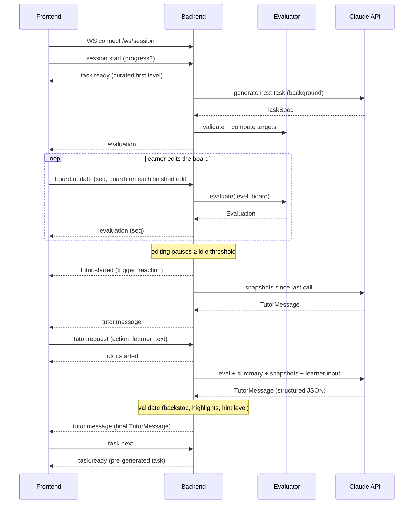

# Contracts

The interfaces between the frontend and the backend, and between the backend and the Claude API. The architecture is in [design.md](design.md).



## 1. Frontend ↔ Backend

The frontend and backend talk over two channels:

| Channel | Used for | Why |
|---|---|---|
| **REST** (JSON over HTTP, under `/api`) | Static, cacheable resources: the curated levels | Simple, cacheable, debuggable |
| **WebSocket** (`/ws/session`) | The interactive learning session: task delivery, board updates, live evaluation, tutor reactions and requests, validated tutor replies | Live meter readings on every edit without per-request overhead; the server can push tutor reactions unprompted |

### REST endpoints

| Method | Path | Response |
|---|---|---|
| `GET` | `/api/levels` | `LevelSummary[]`: the curated levels, each tagged with a skill level |
| `GET` | `/api/levels/{id}` | `Level` |
| `GET` | `/api/health` | `{ "status": "ok" }` |

Curated levels are the very first task and the fallback when generation fails. Most tasks are generated by Claude and delivered over the WebSocket.

Errors: `404` for an unknown level, `429` when the rate limit is exceeded.

### WebSocket session

One connection is one learning session, and it can span several tasks.

- **Server state.** The server keeps the session state in memory for the life of the connection:
  - the current task, including its complete reference board, which is never sent to the client
  - the latest board, the conversation history and the hint level reached
  - the learner's `Progress`: skill level and task history
  - the pre-generated next task
- **Reconnect.** The client keeps the current `Level`, its board, the conversation history and its `Progress`. On reconnect it sends them with `session.start`, so the server stays free of storage. Progress therefore lives in one browser, which is accepted for the prototype. If the reconnect lands on a different instance, the reference board is lost. Grading is unaffected because it uses readings only; the tutor just works without the reference.

Every message is a JSON object with a `type` field.

**Client → server**

| `type` | Payload | Effect |
|---|---|---|
| `session.start` | `progress?`, `level?`, `board?`, `history?` | Starts a session (the server sends `task.ready` with the curated level for the skill level) or resumes one (`level` given). The server also replies with `evaluation`. |
| `task.next` | — | Asks for the next task, usually after the current one is solved |
| `board.update` | `seq`, `board` | Sent on each finished edit (a part dropped, a wire piece placed or removed). The server records a snapshot, re-evaluates and replies with `evaluation` carrying the same `seq`. |
| `tutor.request` | `request_id`, `action` (`"check"`, `"hint"` or `"message"`), `learner_text?` | Runs the evaluator and then Claude on the latest board |

**Server → client**

| `type` | Payload | Notes |
|---|---|---|
| `task.ready` | `level: Level`, `source` (`"curated"` or `"generated"`), `progress: Progress` | A new task. The client replaces its board with `level.board` and stores `progress`. |
| `task.generating` | — | Sent when `task.next` arrives before the pre-generated task is ready |
| `evaluation` | `seq`, `evaluation: Evaluation` | The client ignores any `seq` older than the last one it applied |
| `tutor.started` | `request_id`, `trigger` (`"reaction"` or `"request"`) | The UI shows "tutor is thinking". Reactions get a server-generated `request_id`. |
| `tutor.message` | `request_id`, `evaluation`, `message: TutorMessage` | The complete reply, sent only after the backend has validated it |
| `error` | `code`, `message`, `request_id?` | Codes: `bad_message`, `unknown_level`, `rate_limited`, `tutor_unavailable`. Generation failures never surface: they fall back to a curated level. |

**Rules**

- The server starts generating the next task in the background as soon as a task is delivered, so `task.next` is usually instant.
- The client sends `board.update` only on finished edits. Dragging stays local to three.js until the drop.
- **Reactions.** The server starts an idle timer on every `board.update`. When editing pauses for at least the **idle threshold** (`tutor.idle_threshold_ms`, default 1.5 s), the server calls Claude with the snapshots recorded since the previous Claude call.
  - A burst of quick edits, each within a split second of the last, produces one reaction, not one per edit.
  - If edits arrive while a reaction is running, they wait for the next pause.
- An explicit `tutor.request` cancels the pending idle timer and takes priority. Its call also includes the unsent snapshots.
- Only one Claude tutor call, either a reaction or a request, may be in flight per session.
- A second `tutor.request` while one is in flight gets `error: rate_limited`.
- The `evaluation` in `tutor.message` always comes from a fresh server-side evaluator run, never from the client.
- If Claude fails, the learner still has the latest `evaluation`, and the server sends `error: tutor_unavailable` with the `request_id`.

### Data model

The board format (the `grid` document) and its validation rules are defined in [schematics.md](schematics.md#1-board-format-the-grid-document). The `graph` document is defined in [schematics.md](schematics.md#2-graph-format-the-graph-document). The frontend sends and receives only grids; graphs are internal to the backend and its Claude calls. The shapes below fix the contract.

```ts
type Point = [number, number];   // [col, row], 1-based, row 1 at the top

type ComponentType = "voltage_source" | "resistor" | "voltmeter" | "ammeter";
type Orientation = "N" | "E" | "S" | "W";

interface Component {
  id: string;
  type: ComponentType;
  value?: number;                // volts for voltage_source, ohms for resistor
  fixed: boolean;                // the learner cannot move or remove it
  orientation: Orientation;      // direction of the first pin
  pins: Record<string, Point>;   // positive/negative, or a/b for a resistor
}

interface InventoryItem {
  id: string;
  type: ComponentType;
  value?: number;
}

type Segment = [Point, Point];   // orthogonal neighbors
interface Wire {
  id: string;                    // "W1", "W2", …; assigned when placed
  segments: Segment[];           // straight (1), corner (2), T (3), + (4)
}

interface Board {                // the `grid` document
  grid: { columns: number; rows: number };
  components: Component[];
  inventory: InventoryItem[];
  wires: Wire[];
  targets: Record<string, { value: number; tolerance?: number }>;  // meter id -> target (V or A)
}

type PinRef = string;            // "<componentId>.<pinName>", e.g. "R1.a"

interface Graph {                // the `graph` document: connectivity only
  components: { id: string; type: ComponentType; value?: number; pins: string[] }[];
  inventory: InventoryItem[];
  edges: [PinRef, PinRef][];     // pin pairs joined by wires; order carries no meaning
  targets: Board["targets"];
}

interface TaskSummary {          // one line of task history
  title: string;
  concept: string;
  shape: string;                 // e.g. "series: V + 2R + AM"
  difficulty: number;            // 1–5, from the TaskSpec
  hints_used: number;
  misconceptions: string[];      // tutor labels, e.g. "current is used up"
}

interface Progress {
  skill_level: number;           // starts at 1; +1 per solved task, backend only
  history: TaskSummary[];        // solved tasks, oldest first
}

interface LevelSummary {
  id: string;
  order: number;
  title: string;
  concept: string;               // e.g. "Series resistors"
}

interface Level extends LevelSummary {
  intro: string;                 // learner-facing task text
  board: Board;                  // the starting board; fixed parts, inventory and targets included
}

// One overall status: the most severe finding wins. Detection and precedence:
// schematics.md §6.
type Status =
  | "short_circuit"              // a source is shorted; readings unavailable
  | "no_source"                  // no voltage source; nothing can flow
  | "overcurrent"                // a resistor dissipates more than its power rating
  | "meter_misuse"               // ammeter across a part, or voltmeter blocking the loop
  | "open_circuit"               // the loop isn't closed; no current flows
  | "floating_part"              // a part has a lead connected to nothing
  | "bypassed"                   // a part's pins are joined, so it does nothing
  | "misplaced"                  // circuit works, but a target is off by more than near_target_ratio
  | "near_target"                // every target within near_target_ratio, one outside tolerance
  | "solved";                    // every target within tolerance

type IssueCode =
  | "short_circuit" | "no_source" | "overcurrent"
  | "ammeter_parallel" | "voltmeter_series"     // both map to status "meter_misuse"
  | "open_circuit" | "floating_part" | "bypassed";

interface Issue {
  code: IssueCode;
  component_ids: string[];
  pins: PinRef[];                // the pins involved, from the graph
  points: Point[];               // the same pins mapped to grid points, for highlighting
}

interface Evaluation {
  status: Status;
  // Every placed voltmeter and ammeter, not only target meters, rounded to
  // meter resolution. null when it can't be computed (short circuit); the UI
  // shows "--".
  readings: Record<string, number | null>;
  issues: Issue[];               // every finding, not only the one behind `status`
}

interface ChatTurn {
  role: "learner" | "tutor";
  text: string;
}

interface Snapshot {               // recorded by the server on every board.update
  seq: number;
  t_ms: number;                      // milliseconds since the task started, so Claude sees the pace
  grid: Board;
  graph: Graph;
  evaluation: Evaluation;
}

// Claude's feedback has two parts: `chat`, shown in the chat panel, and
// `meta`, which drives the grid UI and the backend and is never shown as text.
// Field order matters: Claude writes fields in schema order, so `meta`
// (including `principle`) comes first and the text then explains that principle.
interface TutorMessage {
  meta: {
    principle: Principle;          // the physics this message teaches (tutor.md §5)
    highlights: Highlight[];       // draws the learner's attention on the grid
    hint_level: 0 | 1 | 2 | 3;     // 0 if this isn't a hint
    misconception: Misconception | null;  // fixed label (tutor.md §5)
  };
  chat: {
    kind: "feedback" | "nudge" | "hint" | "question" | "praise";
    text: string;                  // learner-facing, plain language
  };
}

type Principle =
  | "closed_loop" | "ohms_law" | "series_voltage_division"
  | "parallel_branches" | "meter_usage" | "power_safety";

type Misconception =
  | "single_wire_enough" | "current_used_up" | "bigger_r_more_current"
  | "full_voltage_each_resistor" | "parallel_reduces_current"
  | "meter_in_series_like_wire" | "ammeter_across_part" | "short_is_harmless";

interface Highlight {
  target:
    | { component: string }        // a component id, e.g. "R1"
    | { wire: string }             // a wire id, e.g. "W2"
    | { point: Point };            // a single grid point, e.g. a dangling wire end
  style: "attention" | "error" | "success";  // pulse, red outline, green outline
}
```

**Highlights**
- three.js draws each highlight on the referenced component, wire piece or point.
- **Lifetime:** a highlight stays until the next tutor message, or until the learner edits the highlighted element.
- **Style:** a nudge typically uses `attention` or `error` on the problem, and praise uses `success` on what was just done right.

## 2. Backend ↔ Claude API

The backend makes two kinds of Claude calls: **tutoring** (2.1) and **task generation** (2.2). Models, effort and limits are read from `backend/config.yaml` ([design.md](design.md#5-configuration)); the values below are the defaults.

### 2.1 Tutor call

#### Call settings

| Setting | Value | Why |
|---|---|---|
| SDK | Official `anthropic` Python SDK | |
| Endpoint | Messages API; one call per reaction or `tutor.request` | Not an agent loop. Everything goes through the backend: it receives Claude's complete reply, validates it, and only then sends it to the browser. Nothing is streamed to the browser. |
| Model | `claude-opus-5-5`, configured separately for reactions and requests | Current default model; reactions may switch to a cheaper model by config |
| Effort | `output_config.effort: "low"`, set explicitly | Interactive latency; tune upward if feedback quality is weak |
| Output | Structured output: `output_config.format` with the `TutorMessage` JSON schema | Guaranteed parseable responses for the UI |
| `max_tokens` | 16000 | Must cover thinking plus the response; not a quality lever |
| Refusals | Server-side `fallbacks: "default"` (beta `server-side-fallback-2026-07-01`); check `stop_reason` before reading content | Recommended default for this model |
| Caching | `cache_control` on the static system prompt | It is identical across all requests. Below the minimum cacheable size it simply won't cache, which is harmless. |
| Timeout and retries | SDK defaults (2 retries), 30 s request timeout | On failure, send `error: tutor_unavailable` |

#### Prompt layout

The order runs from most stable to least stable, so the cached prefix stays valid.

1. **System prompt (static, cached).** The tutor's role, principles, reactions by status, hint ladder and guardrails. The draft is in [tutor.md](tutor.md#8-system-prompt-draft).
2. **One user turn per call.** Each call is self-contained; there is no multi-turn conversation. The turn contains:
   - `<level>`: concept, targets and intro text
   - `<reference>`: the reference solution's `graph` when available, so hints can point toward a solution without revealing it
   - `<summary>`: a one-line circuit description written by the backend, e.g. `V1 → R1 → (gap) → V1; VM1 across R1; status open_circuit`
   - `<history>`: the last `tutor.history_turns` tutor and learner chat turns, for continuity
   - `<snapshots>`: every `Snapshot` (grid, graph, evaluation) recorded since the previous call, up to the last `tutor.max_snapshots`. Each grid is labeled "for highlight references only". They show Claude what the learner did and how the circuit changed. The evaluations are the only source of electrical values.
   - `<request>`: either `trigger: "reaction"`, or the learner's `action`, the next allowed hint level and `learner_text`

#### Response handling

- Parse the structured output into `TutorMessage`.
- **Location-talk backstop** ([tutor.md](tutor.md#6-guardrails-physics-not-placement)): scan `chat.text` for coordinates, pin references and the words "row", "column" and "point".
  - On a match, regenerate once with the problem named.
  - If it fails again, send a safe generic message for the status.
- Enforce `meta.hint_level` server-side: the session tracks the highest hint given. Claude may go at most one level higher, and anything beyond that is clamped.
- Check every highlight against the latest snapshot: the component ID exists, the wire ID exists, and the point is inside the grid. Drop any that fail.
- The returned `evaluation` always comes from the evaluator, never from Claude.
- Only then send the validated `TutorMessage` to the browser as `tutor.message`.

### 2.2 Task generation call

Claude proposes a task. The backend validates it and turns it into a `Level`; the full flow is in [schematics.md](schematics.md#3-task-flow).

#### Call settings

| Setting | Value | Why |
|---|---|---|
| Model | `claude-opus-5-5` | Spatial layout on a grid is hard; use the strongest default |
| Effort | `output_config.effort: "high"` | Runs in the background, so quality matters more than latency |
| Tools | `validate_grid` (custom, `strict: true`) | Claude checks its own draft and fixes errors before answering |
| Loop | SDK tool runner, at most 5 `validate_grid` calls | Bounded self-correction |
| Output | Structured output: the `TaskSpec` JSON schema | Parseable; validated again by the backend |
| Refusals | Same as the tutor call | |

#### Input

The prompt has two parts: **task context**, which is the same for every request and cached, and **learner context**, which changes per request.

**System prompt (task context, static, cached):**

1. **Role and rules.** Claude designs one small DC circuit task. The rules:
   - choose the concept and complexity from the learner context
   - keep circuits small and the removed parts meaningful
   - no repeats of recent tasks
   - never compute target values
   - write `intro` in plain language for beginners
2. **Format.** The `grid` document rules from [schematics.md](schematics.md#1-board-format-the-grid-document), plus the `TaskSpec` fields and their meaning.
3. **Examples.** 2–3 complete `TaskSpec` examples at different difficulty levels.
   - They are stored as files in `backend/` and loaded into the prompt.
   - The test suite runs them through the validator, so they can't drift from the format.

**User turn (learner context):**

```json
{
  "skill_level": 4,
  "grid": { "columns": 12, "rows": 8 },
  "recent_tasks": [
    { "title": "Close the loop", "concept": "closed circuit", "shape": "V + R + VM",
      "difficulty": 1, "hints_used": 0, "misconceptions": [] },
    { "title": "Find the current", "concept": "Ohm's law", "shape": "V + R + AM",
      "difficulty": 2, "hints_used": 2, "misconceptions": ["bigger resistor means more current"] }
  ],
  "older_tasks": { "count": 1, "concepts": ["closed circuit"] }
}
```

- `recent_tasks` holds the last 10 solved tasks as one-line summaries, not full grids, so the prompt stays small. Anything older is summarized in `older_tasks`.
- The backend picks the grid size.
- **No learner free text.** Only structured data the system produced is included: statistics and the tutor's misconception labels. Chat text never reaches the generation prompt, which closes off prompt injection from the chat.

#### Tool: `validate_grid`

| Input | Output |
|---|---|
| A `TaskSpec` draft | `{ "ok": boolean, "errors": string[], "readings": { [meterId]: number } }` |

It runs exactly the backend's four validation stages and returns the meter readings of the complete board, so Claude can see what its circuit actually does.

#### Output: `TaskSpec`

```ts
interface TaskSpec {
  concept: string;
  title: string;
  intro: string;                    // learner-facing task text, with no numbers that depend on the solve
  complete_board: {                 // the solved circuit; no inventory, no targets
    grid: { columns: number; rows: number };
    components: Component[];
    wires: Wire[];
  };
  removed_ids: string[];            // parts the backend removes; they become inventory
  decoys: InventoryItem[];          // extra inventory parts that are not needed
  target_meter_ids: string[];       // meters whose readings become targets
  difficulty: number;               // 1–5, Claude's judgment relative to the learner
  rationale: string;                // one sentence: why this task fits this learner now
}
```

Claude never supplies target values. The backend computes them by solving `complete_board`.

#### Retries and fallback

1. If the final `TaskSpec` fails backend validation, including the repeat check, the call is retried once with the errors appended, for at most 2 calls in total.
2. If it still fails, the backend serves the curated level for the learner's skill level.
3. Every failure is logged with its errors, to improve the prompt.
