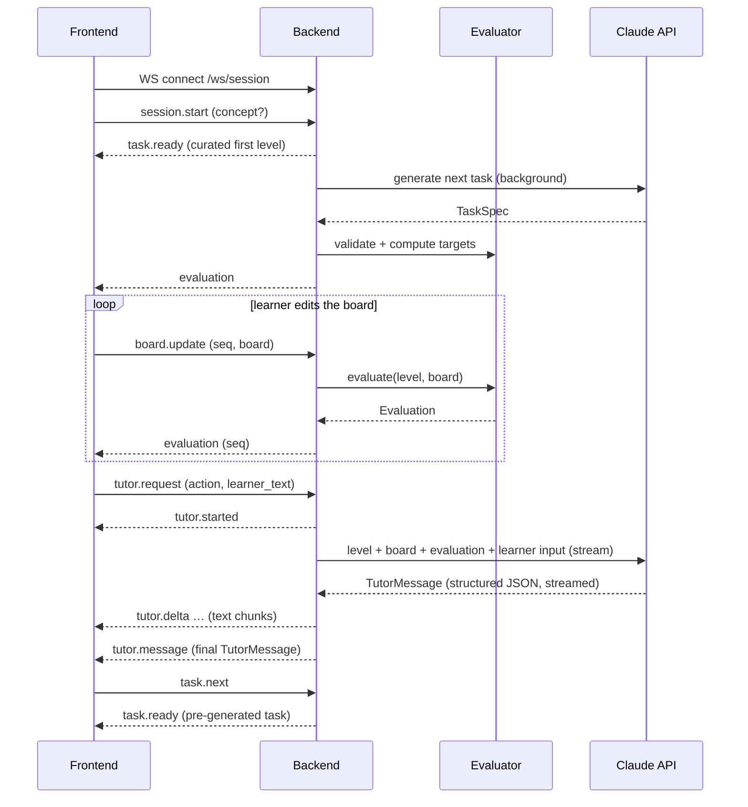

# Contracts

The interfaces between the frontend and the backend, and between the backend and the Claude API. The architecture is in [design.md](design.md).



## 1. Frontend ↔ Backend

The frontend and backend talk over two channels:

| Channel | Used for | Why |
|---|---|---|
| **REST** (JSON over HTTP, under `/api`) | Static, cacheable resources: the curated levels | Simple, cacheable, debuggable |
| **WebSocket** (`/ws/session`) | The interactive learning session: task delivery, board updates, live evaluation, tutor requests, streamed tutor replies | Live meter readings on every edit without per-request overhead; the tutor's reply streams in as Claude writes it |

### REST endpoints

| Method | Path | Response |
|---|---|---|
| `GET` | `/api/levels` | `LevelSummary[]`: the curated levels, one or more per concept |
| `GET` | `/api/levels/{id}` | `Level` |
| `GET` | `/api/health` | `{ "status": "ok" }` |

Curated levels are the first task of each concept and the fallback when generation fails. Most tasks are generated by Claude and delivered over the WebSocket.

Errors: `404` for an unknown level, `429` when the rate limit is exceeded.

### WebSocket session

One connection is one learning session, and it can span several tasks.

- **Server state.** The server keeps the session state in memory for the life of the connection:
  - the current task, including its complete reference board, which is never sent to the client
  - the latest board, the conversation history and the hint level reached
  - the learner's progress: concepts completed and misconceptions seen
  - the pre-generated next task
- **Reconnect.** The client keeps the current `Level`, its board and the history. On reconnect it sends them with `session.start`, so the server stays free of storage. If the reconnect lands on a different instance, the reference board is lost. Grading is unaffected because it uses readings only; the tutor just works without the reference.

Every message is a JSON object with a `type` field.

**Client → server**

| `type` | Payload | Effect |
|---|---|---|
| `session.start` | `concept?`, `level?`, `board?`, `history?` | Starts a session (the server sends `task.ready` with the concept's curated first level) or resumes one (`level` given). The server also replies with `evaluation`. |
| `task.next` | — | Asks for the next task, usually after the current one is solved |
| `board.update` | `seq`, `board` | Re-evaluates; the server replies with `evaluation` carrying the same `seq` |
| `tutor.request` | `request_id`, `action` (`"check"`, `"hint"` or `"message"`), `learner_text?` | Runs the evaluator and then Claude on the latest board |

**Server → client**

| `type` | Payload | Notes |
|---|---|---|
| `task.ready` | `level: Level`, `source` (`"curated"` or `"generated"`) | A new task. The client replaces its board with `level.board`. |
| `task.generating` | — | Sent when `task.next` arrives before the pre-generated task is ready |
| `evaluation` | `seq`, `evaluation: Evaluation` | The client ignores any `seq` older than the last one it applied |
| `tutor.started` | `request_id` | The UI shows "tutor is thinking" |
| `tutor.delta` | `request_id`, `text` | An incremental chunk of `TutorMessage.text`, for live display |
| `tutor.message` | `request_id`, `evaluation`, `message: TutorMessage` | Final and authoritative; replaces the streamed text |
| `error` | `code`, `message`, `request_id?` | Codes: `bad_message`, `unknown_level`, `rate_limited`, `tutor_unavailable`. Generation failures never surface: they fall back to a curated level. |

**Rules**

- The server starts generating the next task in the background as soon as a task is delivered, so `task.next` is usually instant.
- `board.update` is debounced by the client (about 150 ms while dragging).
- Only one `tutor.request` may be in flight per session. A second one gets `error: rate_limited`.
- The `evaluation` in `tutor.message` always comes from a fresh server-side evaluator run, never from the client.
- If Claude fails, the learner still has the latest `evaluation`, and the server sends `error: tutor_unavailable` with the `request_id`.

### Data model

The board format (the `grid` document) and its validation rules are defined in [schematics.md](schematics.md#1-board-format-the-grid-document). The `graph` document is defined in [schematics.md](schematics.md#2-graph-format-the-graph-document). The frontend sends and receives only grids; graphs are internal to the backend and its Claude calls. The shapes below fix the contract.

```ts
type Point = [number, number];   // [col, row], 1-based, row 1 at the top

type ComponentType = "voltage_source" | "resistor" | "voltmeter" | "ammeter";
type Orientation = "N" | "E" | "S" | "W";

interface Component {
  id: string;
  type: ComponentType;
  value?: number;                // volts for voltage_source, ohms for resistor
  fixed: boolean;                // the learner cannot move or remove it
  orientation: Orientation;      // direction of the first pin
  pins: Record<string, Point>;   // positive/negative, or a/b for a resistor
}

interface InventoryItem {
  id: string;
  type: ComponentType;
  value?: number;
}

type Segment = [Point, Point];   // orthogonal neighbors
type Wire = Segment[];           // straight (1), corner (2), T (3), + (4)

interface Board {                // the `grid` document
  grid: { columns: number; rows: number };
  components: Component[];
  inventory: InventoryItem[];
  wires: Wire[];
  targets: Record<string, { value: number; tolerance?: number }>;  // meter id -> target (V or A)
}

type PinRef = string;            // "<componentId>.<pinName>", e.g. "R1.a"

interface Graph {                // the `graph` document: connectivity only
  components: { id: string; type: ComponentType; value?: number; pins: string[] }[];
  inventory: InventoryItem[];
  edges: [PinRef, PinRef][];     // pin pairs joined by wires; order carries no meaning
  targets: Board["targets"];
}

interface LevelSummary {
  id: string;
  order: number;
  title: string;
  concept: string;               // e.g. "Series resistors"
}

interface Level extends LevelSummary {
  intro: string;                 // learner-facing task text
  board: Board;                  // the starting board; fixed parts, inventory and targets included
}

type IssueCode =
  | "short_circuit"        // source terminals connected with ~0 Ω
  | "open_circuit"         // no closed loop through the source
  | "bypassed"             // both pins of a component on the same node
  | "floating_component"   // a lead not connected to anything
  | "no_source";

interface Issue {
  code: IssueCode;
  component_ids: string[];
  pins: PinRef[];                // the pins involved, from the graph
  points: Point[];               // the same pins mapped to grid points, for highlighting
}

interface Measurement {
  component_id: string;    // meters and resistors
  voltage: number;         // V across the component
  current: number;         // A through the component
}

interface Evaluation {
  valid: boolean;          // false if the circuit can't be solved, e.g. a short
  goal_met: boolean;                     // every target within tolerance
  readings: Record<string, number>;      // meter id -> reading, rounded to meter resolution
  measurements: Measurement[];
  issues: Issue[];
}

interface ChatTurn {
  role: "learner" | "tutor";
  text: string;
}

interface TutorMessage {
  kind: "feedback" | "hint" | "question" | "praise";
  text: string;                    // learner-facing, plain language
  hint_level: 0 | 1 | 2 | 3;       // 0 if this isn't a hint
  focus: { component_ids: string[]; points: Point[] };  // what three.js should highlight
  misconception: string | null;    // internal label, e.g. "current is used up"; not shown
}
```

## 2. Backend ↔ Claude API

The backend makes two kinds of Claude calls: **tutoring** (2.1) and **task generation** (2.2).

### 2.1 Tutor call

#### Call settings

| Setting | Value | Why |
|---|---|---|
| SDK | Official `anthropic` Python SDK | |
| Endpoint | Messages API, streamed; one call per `tutor.request` | Single-turn tutoring, not an agent loop; streaming feeds `tutor.delta` |
| Model | `claude-opus-5-5` | Current default model |
| Effort | `output_config.effort: "low"`, set explicitly | Interactive latency; tune upward if feedback quality is weak |
| Output | Structured output: `output_config.format` with the `TutorMessage` JSON schema | Guaranteed parseable responses for the UI |
| `max_tokens` | 16000 | Must cover thinking plus the response; not a quality lever |
| Refusals | Server-side `fallbacks: "default"` (beta `server-side-fallback-2026-07-01`); check `stop_reason` before reading content | Recommended default for this model |
| Caching | `cache_control` on the static system prompt | It is identical across all requests. Below the model's minimum cacheable size it simply won't cache, which is harmless. |
| Timeout and retries | SDK defaults (2 retries), 30 s request timeout | On failure, send `error: tutor_unavailable` |

#### Prompt layout

The order runs from most stable to least stable, so the cached prefix stays valid.

1. **System prompt (static, cached).** The tutor's role and teaching rules:
   - never give the solution
   - never state a number that isn't in the evaluation
   - escalate hints one level at a time
   - write in plain language for beginners
   - set `focus` to the relevant parts
2. **Messages.** The session's history turns as alternating user and assistant text, then the current user turn with tagged JSON blocks:
   - `<level>`: concept, targets and intro text
   - `<reference>`: the reference solution's `graph` when available, so hints can point toward a solution without revealing it
   - `<graph>`: the learner's board as a `graph`, which is compact and placement-free
   - `<evaluation>`: the evaluator's result, which is the only source of electrical values
   - `<request>`: the `action`, the next allowed hint level and `learner_text`

#### Response handling

- Parse the structured output into `TutorMessage`.
- Stream the `text` field of the partial JSON to the client as `tutor.delta`. Send the parsed `TutorMessage` as `tutor.message`.
- Enforce `hint_level` server-side: the session tracks the highest hint given. Claude may go at most one level higher, and anything beyond that is clamped.
- Check that `focus` IDs exist on the board, and drop any that don't.
- The returned `evaluation` always comes from the evaluator, never from Claude.

### 2.2 Task generation call

Claude proposes a task. The backend validates it and turns it into a `Level`; the full flow is in [schematics.md](schematics.md#3-task-flow).

#### Call settings

| Setting | Value | Why |
|---|---|---|
| Model | `claude-opus-5-5` | Spatial layout on a grid is hard; use the strongest default |
| Effort | `output_config.effort: "high"` | Runs in the background, so quality matters more than latency |
| Tools | `validate_grid` (custom, `strict: true`) | Claude checks its own draft and fixes errors before answering |
| Loop | SDK tool runner, at most 5 `validate_grid` calls | Bounded self-correction |
| Output | Structured output: the `TaskSpec` JSON schema | Parseable; validated again by the backend |
| Refusals | Same as the tutor call | |

#### Input

- **System prompt (static, cached):**
  - the grid format rules from [schematics.md](schematics.md#1-board-format-the-grid-document)
  - the task design rules: one concept per task, small circuits, meaningful removed parts
  - one worked example
- **User turn:**
  - the target `concept`
  - the learner's progress and recent misconceptions
  - the grid size
  - the IDs of recent tasks, to avoid repeats

#### Tool: `validate_grid`

| Input | Output |
|---|---|
| A `TaskSpec` draft | `{ "ok": boolean, "errors": string[], "readings": { [meterId]: number } }` |

It runs exactly the backend's three validation stages and returns the meter readings of the complete board, so Claude can see what its circuit actually does.

#### Output: `TaskSpec`

```ts
interface TaskSpec {
  concept: string;
  title: string;
  intro: string;                    // learner-facing task text, with no numbers that depend on the solve
  complete_board: {                 // the solved circuit; no inventory, no targets
    grid: { columns: number; rows: number };
    components: Component[];
    wires: Wire[];
  };
  removed_ids: string[];            // parts the backend removes; they become inventory
  decoys: InventoryItem[];          // extra inventory parts that are not needed
  target_meter_ids: string[];       // meters whose readings become targets
}
```

Claude never supplies target values. The backend computes them by solving `complete_board`.

#### Retries and fallback

1. If the final `TaskSpec` fails backend validation, the call is retried once with the errors appended, for at most 2 calls in total.
2. If it still fails, the backend serves a curated level for the same concept.
3. Every failure is logged with its errors, to improve the prompt.

## Open points

- The hint ladder's content per level, defined in the tutor design
