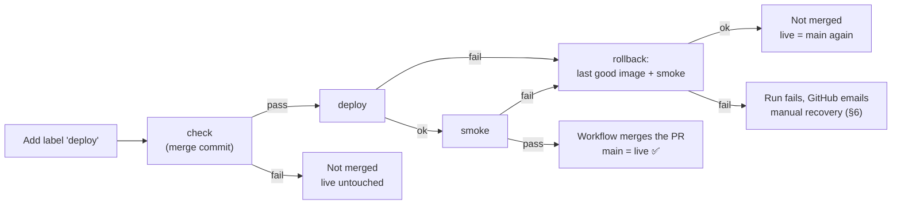
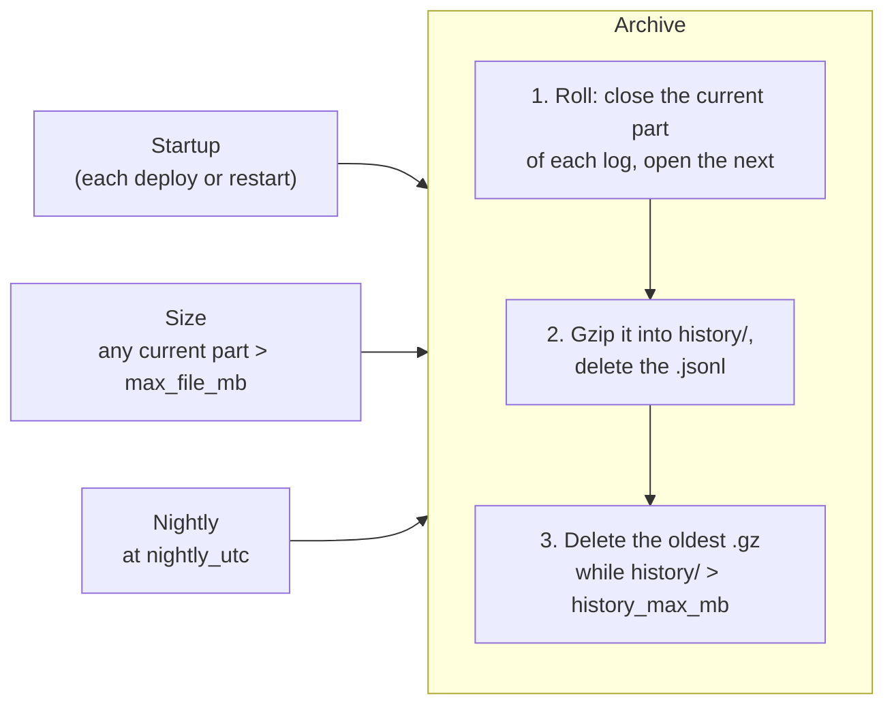

# Deployment

How the prototype is hosted and how changes reach it. The security and rate-limit design is in [design.md](design.md#4-security-and-operations).

## 1. Hosting

| | |
|---|---|
| Platform | [Fly.io](https://fly.io), org `personal` |
| App | `schematics-ai-tutor` |
| URL | https://schematics-ai-tutor.fly.dev |
| Region | `sjc` (San Jose) |
| Machine | one, shared-cpu-1x, 512 MB, always on |
| Config | [`fly.toml`](../fly.toml), [`Dockerfile`](../Dockerfile), [`.dockerignore`](../.dockerignore), [`ci.yml`](../.github/workflows/ci.yml), [`deploy.yml`](../.github/workflows/deploy.yml) |

- **One image, one origin.** The Dockerfile builds the frontend with `SCHEMATICS_PUBLIC=true`, a public build regardless of `config.yaml`. It then runs one uvicorn worker that serves `/api`, `/ws` and the built frontend. The browser talks to one origin, as it does through the Vite proxy locally.
- **Exactly one machine, always on.** The rate limits (except the day's Claude spend, kept on the volume), the task cache, the first-task pool and the reference solutions are in memory ([design.md](design.md#3-system-architecture)).
  - *Why:* a second machine would split that state, and a stopped machine would lose it and refill the first-task pool with new Claude calls on every cold start.
  - *Cost:* one small machine running around the clock. Scaling out would need a shared store such as Redis.
- **Rate limits:** [design.md](design.md#rate-limits), set in `ratelimiting.yaml`, which the image includes. Per-IP limits use the `Fly-Client-IP` header that Fly's proxy sets.
- **Health check:** Fly checks `GET /api/health` every 30 s. A deploy waits for it to pass, and Fly's proxy stops routing to a machine that fails it.

## 2. Secrets

| Secret | Where | Scope |
|---|---|---|
| `ANTHROPIC_API_KEY` | Fly secret on the app | Read by the backend at startup |
| `FLY_API_TOKEN` | GitHub repository secret | A deploy token for this app only, created in the Fly dashboard (app → Tokens) or with `fly tokens create deploy -a schematics-ai-tutor` by a user token allowed to create tokens |

- Neither one is ever in the repo or in the image; `.dockerignore` keeps `backend/keys/` and `.env` out of the build context.
- The GitHub token is a deploy token, not a personal or org token. A leak could deploy or read this one app, nothing else in the account.
- **Rotation:** `fly secrets set ANTHROPIC_API_KEY=...` restarts the machine with the new key. For the deploy token, create a new one, replace the GitHub secret, then revoke the old one with `fly tokens revoke`.

## 3. Continuous deployment

A pull request ships with the **`deploy` label**: the workflow checks it, deploys it, smoke tests it on the live URL, and merges it only when all of that passes. On any failure it rolls production back and leaves the PR open. So `main` and production stay in sync, except in the cases the failure table marks ❌ and after a Merge or deploy by hand.



### Workflows

- **[`ci.yml`](../.github/workflows/ci.yml): `check` only.** It runs `./check.sh` on every PR push and on pushes to `main`. It never deploys, so pushing to a PR costs nothing in Claude calls and doesn't touch production.
- **[`deploy.yml`](../.github/workflows/deploy.yml): shipping.** It starts when the `deploy` label is added to a PR, and its jobs show on the PR:

| Job | Does | On failure |
|---|---|---|
| `check` | `./check.sh` on GitHub's merge commit for the PR (`refs/pull/<n>/merge`: `main` plus the PR, the code the merge will produce). A draft PR fails here | Stop; nothing deployed |
| `record` | Records the live release, the rollback target: the machine's image and the commit `/api/health` reports | Stop; nothing deployed |
| `deploy` | `flyctl deploy --remote-only` of the merge commit with `SCHEMATICS_COMMIT` set | `rollback` |
| `smoke` | `./smoke.sh <url> <commit>`: the new commit must be the one answering (below) | `rollback` |
| `merge` | Merges the PR with `gh pr merge --match-head-commit <tested head>`, so a push made during the run is never merged untested | Production already runs the PR; see the failure table |
| `rollback` | Redeploys the recorded image with its commit and `main`'s `fly.toml`, then smoke tests it | Run fails; manual recovery (§6) |
| `report` | Always: removes the label and comments on the PR with the outcome, a ✅/❌ row per job, and a link to the run | — |

- **Rollback to the recorded image, not a rebuild.** A rebuild of `main` could differ from what ran (new base image, new package versions); the recorded image is byte-for-byte the release that was live before. `fly deploy --image <last good>` also skips the build, so production is back in about 30 s. That release is `main`, because only a passed ship changes production, unless someone deployed by hand (§6).
- **Retry:** fix the PR and add the label again. The label is always removed at the end, so adding it is always a fresh start.
- **One ship at a time:** `concurrency: deploy-production`. A second label waits for the first run to finish. Other labels also start the workflow (GitHub has no filter by label name), but every job skips, in a concurrency group of their own.
- **By hand:** `deploy.yml` keeps `workflow_dispatch`, which runs the same jobs for `main` without `merge` and `report`: check, record, deploy, smoke, and rollback on failure. Use it e.g. after a manual Merge.
- **Permissions:** the workflow's `GITHUB_TOKEN` gets `contents: write` and `pull-requests: write` to merge, edit the label and comment. GitHub doesn't start workflows from events made with that token, so `ci.yml` doesn't run again on the merge; the merged code already passed `check` as the merge commit.

### Failure cases

| Case | Live during the run | After the run | `main` = live? |
|---|---|---|---|
| `check` fails | Untouched | Untouched; PR open, comment | ✅ |
| Deploy fails before the machine is replaced (build, flyctl) | Old release | Rollback redeploys the same image: a restart, with the resets of §4; PR open | ✅ |
| New machine fails Fly's health check | **Down** | Rolled back; PR open | ✅ |
| Deploy succeeds, smoke fails | **Broken** | Rolled back; PR open | ✅ |
| Rollback fails | **Down or broken** | Run fails, GitHub emails you; manual recovery (§6) | ❌ until recovered |
| Smoke passes, merge fails (e.g. a conflict or a push during the run) | New release, healthy | PR open, comment; live runs the PR. Resolve the conflict or push the fix, then add the label again | ❌ until the PR ships again, or `main` is deployed by hand |

- **Exposure window:** at worst, production is broken from the moment the new machine starts until the rollback's smoke passes: up to ~60 s of smoke retries, plus ~30 s for the rollback.
- **Why not Fly's safer rollouts:** bluegreen and canary deploys start a second machine next to the old one, and Fly doesn't allow them for machines with volumes. With one machine, a broken release is visible until it's rolled back.

### Merge button

The Merge button still works, but it merges without deploying, and production falls behind `main`. GitHub Free can't block it on a private repo, so shipping with the label is a habit. After a manual Merge, run `deploy.yml` by hand from the Actions tab.

### Smoke test

`./smoke.sh [url] [commit]` checks a deployed app and exits non-zero on any failure. It defaults to the production URL and runs locally too. It doesn't call Claude, so it costs nothing.

- `GET /api/health` returns `"status": "ok"` and, with a commit given, that commit; retried for up to ~60 s while a fresh machine starts
- `GET /` serves the app's page, and its JS asset is served
- `http://` redirects to `https://`
- `/ws/session` accepts a WebSocket upgrade (`101`)

### Why this design

- **GitHub's merge queue** does this natively: a temporary branch of `main` plus the PR, checked before merging. It needs an organization-owned repo, and this one is private and personal. The merge commit and the label give the same flow.
- **GitHub Actions, not Fly's GitHub integration:** the workflows are in the repo and reviewed like code, and the deploy waits for `./check.sh`; Fly's dashboard integration does neither.

## 4. What a deploy resets

Every deploy replaces the one machine. Learners keep their progress, because it's in the browser's `localStorage`, but the server's in-memory state starts over:

| Lost on deploy | Effect |
|---|---|
| Open WebSocket sessions | The page reconnects and resumes from `localStorage` |
| Task cache and reference solutions | The next task is generated on request; the tutor has no `<reference>` for a resumed task |
| First-task pool | Refilled at startup: 2 task generations |
| Rate-limit counters | Start from zero |

Logs aren't lost: they're on the volume (§5), and the next startup archives the previous run's last part.

Each ship is a deploy, and a failed one is two (the rollback), so frequent ships add a little Claude cost and interrupt anyone mid-task. That's acceptable for the prototype.

## 5. Logs

Every log the backend writes survives deploys, is compressed, and stays within one size budget:

- the usage and cost log, `run-*` ([design.md](design.md#4-security-and-operations))
- the event log for measuring success, `events-*`: task started and solved, status changes, tutor calls, misconception labels (planned, [plan.md](plan.md#6-polishing))

Each log is a family of JSON-lines files with its own prefix, and the archive treats every family the same way.

### Storage

A deploy replaces the machine's filesystem, so the logs live on a **Fly volume**, `logs_data` (1 GB, `sjc`, encrypted, daily snapshots kept 5 days), attached to the one machine and mounted at `/data` (`[mounts]` in `fly.toml`).

| Path | Holds |
|---|---|
| `/data/logs/` | The current part of each log: `<log>-<run id>.<part>.jsonl`, e.g. `run-20261011-172121.003.jsonl` |
| `/data/logs/history/` | Archived parts of all logs, gzipped: `<log>-<run id>.<part>.jsonl.gz` |
| `/data/state/` | Not a log: the day's Claude spend, `claude-budget.json`, so a deploy doesn't reset the budget ([design.md](design.md#rate-limits)) |

- `SCHEMATICS_LOGS_DIR=/data/logs` (`[env]` in `fly.toml`) overrides `logs.dir` in `config.yaml`, and `SCHEMATICS_STATE_DIR=/data/state` overrides `claude_budget.state_dir` in `ratelimiting.yaml`. Locally the same code uses the repo's `logs/` and `state/` folders.
- A 1 GB volume is plenty: the history is capped well below it (`history_max_mb`), and it costs about $0.15 a month.
- File names sort in time order: the run id is the start time, and the part number grows within a run.

### Archive

One operation in the backend process ([`log_archive.py`](../backend/app/log_archive.py)); each run is itself logged as a `logs_archived` event (reason, files archived and deleted, history size):

1. Close the current part of each log and open the next one at once, so logging never pauses.
2. Gzip the closed parts into `history/`, then delete the uncompressed file. JSON lines compress about 10×.
3. Delete the oldest files in `history/`, across all logs, until it fits within `history_max_mb`. The parts just archived are never deleted.

Three triggers run it:



| Trigger | When | Why |
|---|---|---|
| Startup | The backend starts: every deploy, and every crash restart | Archives whatever the previous run left, even if it never shut down cleanly |
| Size | Any log's current part passes `max_file_mb` | The machine is always on, so one run can last weeks; this bounds a single file in busy periods |
| Nightly | Once a day at `nightly_utc` | Quiet periods: no day's log stays uncompressed. Done in the running server, so it never needs a deploy |

- **Why in the backend, not a deploy step or cron.** Fly's `release_command` runs on a temporary machine without the volume, and the image has no cron. There is one uvicorn worker, so exactly one process writes and archives.
- **Off the request path.** The size check is the byte count the writer already keeps, not a file stat. Compression and cleanup run in a background thread.
- **A run id seen before continues at its next part.** Locally, a code reload keeps `./start.sh`'s run id, so it goes on in a new part, and the startup archive compresses the previous one.
- **Settings**, in the `logs` section of `config.yaml` ([design.md](design.md#5-configuration)):

```yaml
logs:
  enabled: true
  dir: logs                   # overridden on Fly to /data/logs
  history_dir: history        # inside dir
  max_file_mb: 20             # roll the current part above this
  history_max_mb: 200         # compressed history of all logs; oldest files deleted first
  nightly_utc: "10:00"        # daily archive (3 am Pacific)
```

- **Reading the logs:** `fly ssh sftp get /data/logs/history/<file>` copies a file to your machine, and `zcat` reads it.

## 6. Manual operations

```sh
fly deploy                         # by hand: bypasses the deploy label, so main and live may differ; smoke test after
./smoke.sh                         # smoke test the production URL (or ./smoke.sh <url> [commit])
fly status                         # machine state and the current release
fly logs                           # live server output
fly releases --image               # past releases and their images
fly deploy --image <image>         # roll back to a past release's image
fly ssh console                    # shell on the machine
fly secrets list                   # names only, never values
fly ssh sftp get /data/logs/history/<file>   # copy an archived log (§5)
```

**Manual recovery,** when the automatic rollback fails:

1. `fly releases --image` and pick the newest release that ran `main`. The ship run's log names the image it recorded as the last good one.
2. `fly deploy --image <that image> --env SCHEMATICS_COMMIT=<main's commit>`
3. `./smoke.sh https://schematics-ai-tutor.fly.dev <main's commit>`
4. If no image works, deploy `main` from source: `deploy.yml` by hand from the Actions tab, or `git checkout main && fly deploy`.

## 7. Status

- [x] `Dockerfile`, `fly.toml`, `.dockerignore`; the backend serves the built frontend
- [x] Fly app created
- [x] `ANTHROPIC_API_KEY` set as a Fly secret
- [x] First deploy, by hand (2026-10-11): health, page, assets, HTTPS redirect and WebSocket upgrade checked
- [x] Playthrough in the browser on the public URL: a couple of tasks solved, task generation and the tutor working
- [x] Deploy token in GitHub secrets (2026-10-11)
- [x] `deploy.yml` workflow: `deploy` and `smoke` jobs after `check` passes on `main`; `./smoke.sh` (replaced by deploy before merge, below)
- [x] First automatic deploy, on the merge that adds `deploy.yml` (2026-10-11, release v2): `deploy` and `smoke` passed
- [x] Deploy before merge: `ci.yml` deploys and smoke tests each ready PR; `deploy.yml` restores `main` when a PR closes unmerged, or by hand; `/api/health` reports the commit (replaced by the `deploy` label, below)
- [x] First deploy from a PR: PR #28's own run (2026-10-11), smoke confirmed the merge commit live
- [x] Log archive designed (§5)
- [x] Fly volume `logs_data` created (2026-10-11); mounted at `/data`, with the log path override, in `fly.toml`
- [x] Archive: startup, size and nightly triggers; history cap (`log_archive.py`)
- [x] First deploy with the volume (2026-10-11, release v3): the machine was recreated with `logs_data` attached
- [x] Ship with the `deploy` label designed (§3): check, deploy, smoke, merge; rollback to the last good image on failure
- [x] `ci.yml` back to `check` only; `deploy.yml` ships on the label and rolls back; the `deploy` label created
- [x] First ship with the label: PR #29 (2026-10-11): check, record, deploy, smoke, merge; merged by the workflow, `2dc3ae1` live
- [x] Rate limits and the daily Claude budget: PR #30, shipped with the label (2026-10-11, `94c5276`); the budget's state on the volume
- [x] Rollback drill (2026-10-11, PR #31, closed unmerged): a changed page title failed `smoke`; `rollback` redeployed the recorded image of `94c5276`, and its smoke test passed 35 s after the failure
