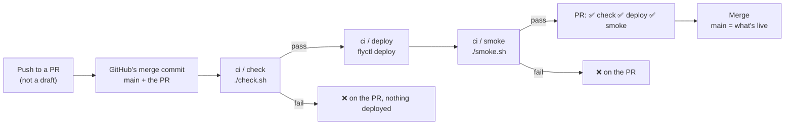
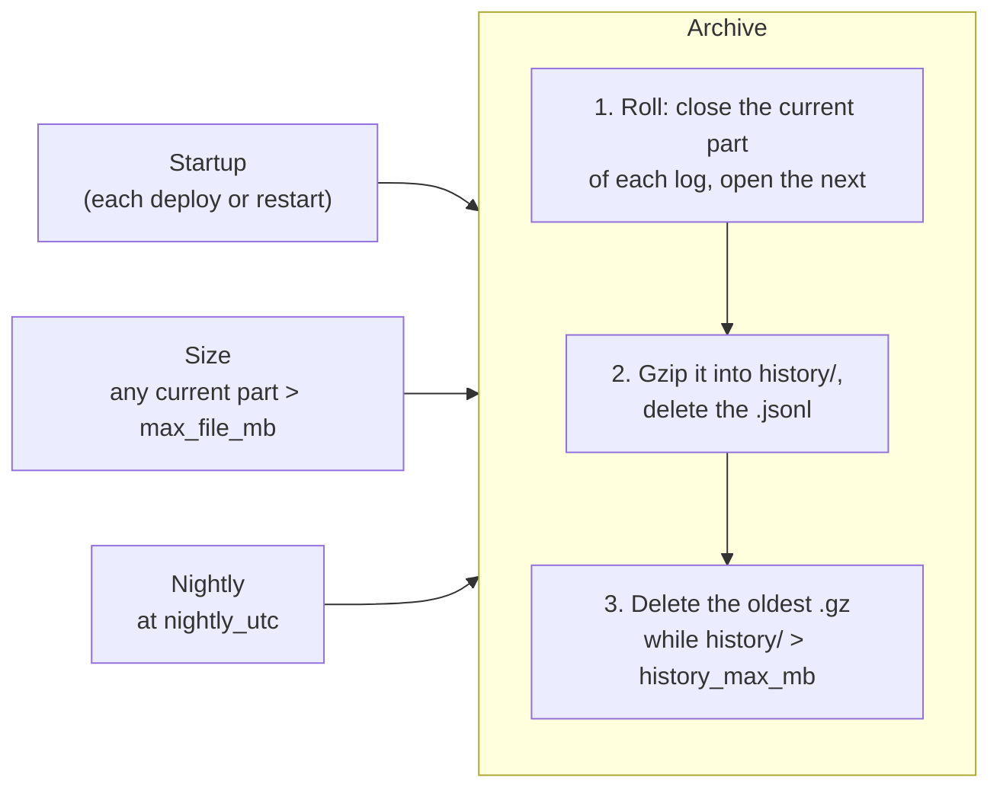

# Deployment

How the prototype is hosted and how changes reach it. The security and rate-limit design is in [design.md](design.md#4-security-and-operations).

## 1. Hosting

| | |
|---|---|
| Platform | [Fly.io](https://fly.io), org `personal` |
| App | `schematics-ai-tutor` |
| URL | https://schematics-ai-tutor.fly.dev |
| Region | `sjc` (San Jose) |
| Machine | one, shared-cpu-1x, 512 MB, always on |
| Config | [`fly.toml`](../fly.toml), [`Dockerfile`](../Dockerfile), [`.dockerignore`](../.dockerignore), [`ci.yml`](../.github/workflows/ci.yml), [`deploy.yml`](../.github/workflows/deploy.yml) |

- **One image, one origin.** The Dockerfile builds the frontend with `SCHEMATICS_PUBLIC=true`, a public build regardless of `config.yaml`. It then runs one uvicorn worker that serves `/api`, `/ws` and the built frontend. The browser talks to one origin, as it does through the Vite proxy locally.
- **Exactly one machine, always on.** The rate limits, the task cache, the first-task pool and the reference solutions are in memory ([design.md](design.md#3-system-architecture)).
  - *Why:* a second machine would split that state, and a stopped machine would lose it and refill the first-task pool with new Claude calls on every cold start.
  - *Cost:* one small machine running around the clock. Scaling out would need a shared store such as Redis.
- **Health check:** Fly checks `GET /api/health` every 30 s, and a machine that fails it is restarted.

## 2. Secrets

| Secret | Where | Scope |
|---|---|---|
| `ANTHROPIC_API_KEY` | Fly secret on the app | Read by the backend at startup |
| `FLY_API_TOKEN` | GitHub repository secret | A deploy token for this app only, created in the Fly dashboard (app → Tokens) or with `fly tokens create deploy -a schematics-ai-tutor` by a user token allowed to create tokens |

- Neither one is ever in the repo or in the image; `.dockerignore` keeps `backend/keys/` and `.env` out of the build context.
- The GitHub token is a deploy token, not a personal or org token. A leak could deploy or read this one app, nothing else in the account.
- **Rotation:** `fly secrets set ANTHROPIC_API_KEY=...` restarts the machine with the new key. For the deploy token, create a new one, replace the GitHub secret, then revoke the old one with `fly tokens revoke`.

## 3. Continuous deployment

A pull request is deployed and verified **before** it's merged, so the PR itself shows whether the change works live. Merging then changes nothing in production: `main` becomes what's already running.



- **One workflow on the PR,** [`ci.yml`](../.github/workflows/ci.yml), with three jobs that show on the PR one by one: `check`, then `deploy`, then `smoke`.
  - `check` runs `./check.sh` on every PR push, and on pushes to `main`.
  - `deploy` checks out GitHub's merge commit for the PR (`refs/pull/<n>/merge`, `main` plus the PR, the same code the merge will produce) and runs `flyctl deploy --remote-only`. The image builds on Fly's builders, so the runner needs no Docker. It passes the commit as `SCHEMATICS_COMMIT`, which `/api/health` reports.
  - `smoke` runs [`./smoke.sh`](../smoke.sh) on the public URL with that commit, so it fails if the old release is still answering.
- **Why the merge commit:** GitHub's merge queue does this natively (a temporary branch of `main` plus the PR, checked before merging), but it needs a repository owned by an organization. The merge commit gives the same "what `main` will be" without it.
- **Drafts:** a draft PR runs `check` only. Marking it ready for review deploys it.
- **Newer pushes win.** A newer push to the same PR cancels the older run, deploy included. `concurrency: deploy-production` keeps deploys from overlapping.
- **After the merge,** `ci.yml` runs `check` on `main` and doesn't deploy: with one open PR at a time, `main` is exactly the merge commit already live.
- **[`deploy.yml`](../.github/workflows/deploy.yml)** deploys `main` and smoke tests it in two cases:
  - by hand, from the Actions tab (`workflow_dispatch`)
  - when a PR closes **without** merging, to put `main` back live in place of the PR's code
- **Trade-offs**, accepted for a one-developer prototype:
  - While a PR is open, production runs its unmerged code.
  - Every push to a ready PR is a deploy: open sessions drop, and the first-task pool refill costs about $0.30 in Claude calls (§4).
  - GitHub Free can't make checks required on a private repo, so merging only on ✅ is a habit, not a rule.
- **No approval gate.** Marking a PR ready is the approval for deploying it; the merge is the approval for keeping it.
- **Smoke test.** `./smoke.sh [url] [commit]` checks a deployed app and exits non-zero on any failure. It defaults to the production URL and runs locally too. It doesn't call Claude, so it costs nothing.
  - `GET /api/health` returns `"status": "ok"` and, with a commit given, that commit; retried for up to ~60 s while a fresh machine starts
  - `GET /` serves the app's page, and its JS asset is served
  - `http://` redirects to `https://`
  - `/ws/session` accepts a WebSocket upgrade (`101`)
- **Why GitHub Actions, not Fly's GitHub integration:** the workflows are in the repo and reviewed like code, and the deploy waits for `./check.sh`; Fly's dashboard integration does neither.

## 4. What a deploy resets

Every deploy replaces the one machine. Learners keep their progress, because it's in the browser's `localStorage`, but the server's in-memory state starts over:

| Lost on deploy | Effect |
|---|---|
| Open WebSocket sessions | The page reconnects and resumes from `localStorage` |
| Task cache and reference solutions | The next task is generated on request; the tutor has no `<reference>` for a resumed task |
| First-task pool | Refilled at startup: 2 task generations |
| Rate-limit counters | Start from zero |
| Nothing in the logs | They're on the volume (§5); the next startup archives the previous run's last part |

Frequent merges add a little Claude cost and interrupt anyone mid-task. That's acceptable for the prototype.

## 5. Logs

Every log the backend writes survives deploys, is compressed, and stays within one size budget:

- the usage and cost log, `run-*` ([design.md](design.md#4-security-and-operations))
- the event log for measuring success, `events-*`: task started and solved, status changes, tutor calls, misconception labels (planned, [plan.md](plan.md#6-polishing))

Each log is a family of JSON-lines files with its own prefix, and the archive treats every family the same way.

### Storage

A deploy replaces the machine's filesystem, so the logs live on a **Fly volume**, `logs_data` (1 GB, `sjc`, encrypted, daily snapshots kept 5 days), attached to the one machine and mounted at `/data` (`[mounts]` in `fly.toml`).

| Path | Holds |
|---|---|
| `/data/logs/` | The current part of each log: `<log>-<run id>.<part>.jsonl`, e.g. `run-20261011-172121.003.jsonl` |
| `/data/logs/history/` | Archived parts of all logs, gzipped: `<log>-<run id>.<part>.jsonl.gz` |

- `SCHEMATICS_LOGS_DIR=/data/logs` (`[env]` in `fly.toml`) overrides `logs.dir` in `config.yaml`. Locally the same code uses the repo's `logs/` folder.
- A 1 GB volume is plenty: the history is capped well below it (`history_max_mb`), and it costs about $0.15 a month.
- File names sort in time order: the run id is the start time, and the part number grows within a run.

### Archive

One operation in the backend process ([`log_archive.py`](../backend/app/log_archive.py)); each run is itself logged as a `logs_archived` event (reason, files archived and deleted, history size):

1. Close the current part of each log and open the next one at once, so logging never pauses.
2. Gzip the closed parts into `history/`, then delete the uncompressed file. JSON lines compress about 10×.
3. Delete the oldest files in `history/`, across all logs, until it fits within `history_max_mb`. The parts just archived are never deleted.

Three triggers run it:



| Trigger | When | Why |
|---|---|---|
| Startup | The backend starts: every deploy, and every crash restart | Archives whatever the previous run left, even if it never shut down cleanly |
| Size | Any log's current part passes `max_file_mb` | The machine is always on, so one run can last weeks; this bounds a single file in busy periods |
| Nightly | Once a day at `nightly_utc` | Quiet periods: no day's log stays uncompressed. Done in the running server, so it never needs a deploy |

- **Why in the backend, not a deploy step or cron.** Fly's `release_command` runs on a temporary machine without the volume, and the image has no cron. There is one uvicorn worker, so exactly one process writes and archives.
- **Off the request path.** The size check is the byte count the writer already keeps, not a file stat. Compression and cleanup run in a background thread.
- **A run id seen before continues at its next part.** Locally, a code reload keeps `./start.sh`'s run id, so it goes on in a new part, and the startup archive compresses the previous one.
- **Settings**, in the `logs` section of `config.yaml` ([design.md](design.md#5-configuration)):

```yaml
logs:
  enabled: true
  dir: logs                   # overridden on Fly to /data/logs
  history_dir: history        # inside dir
  max_file_mb: 20             # roll the current part above this
  history_max_mb: 200         # compressed history of all logs; oldest files deleted first
  nightly_utc: "10:00"        # daily archive (3 am Pacific)
```

- **Reading the logs:** `fly ssh sftp get /data/logs/history/<file>` copies a file to your machine, and `zcat` reads it.

## 6. Manual operations

```sh
fly deploy                         # deploy the working tree by hand (first deploy, hotfix)
./smoke.sh                         # smoke test the production URL (or ./smoke.sh <url> [commit])
fly status                         # machine state and the current release
fly logs                           # live server output
fly releases --image               # past releases and their images
fly deploy --image <image>         # roll back to a past release's image
fly ssh console                    # shell on the machine
fly secrets list                   # names only, never values
fly ssh sftp get /data/logs/history/<file>   # copy an archived log (§5)
```

## 7. Status

- [x] `Dockerfile`, `fly.toml`, `.dockerignore`; the backend serves the built frontend
- [x] Fly app created
- [x] `ANTHROPIC_API_KEY` set as a Fly secret
- [x] First deploy, by hand (2026-10-11): health, page, assets, HTTPS redirect and WebSocket upgrade checked
- [x] Playthrough in the browser on the public URL: a couple of tasks solved, task generation and the tutor working
- [x] Deploy token in GitHub secrets (2026-10-11)
- [x] `deploy.yml` workflow: `deploy` and `smoke` jobs after `check` passes on `main`; `./smoke.sh` (replaced by deploy before merge, below)
- [x] First automatic deploy, on the merge that adds `deploy.yml` (2026-10-11, release v2): `deploy` and `smoke` passed
- [x] Deploy before merge: `ci.yml` deploys and smoke tests each ready PR; `deploy.yml` restores `main` when a PR closes unmerged, or by hand; `/api/health` reports the commit
- [ ] First deploy from a PR (this change's own PR)
- [x] Log archive designed (§5)
- [x] Fly volume `logs_data` created (2026-10-11); mounted at `/data`, with the log path override, in `fly.toml`
- [x] Archive: startup, size and nightly triggers; history cap (`log_archive.py`)
- [ ] First deploy with the volume: the machine is recreated with the mount, and the startup archive runs on it
- [ ] Learner experience collection (to be designed)
