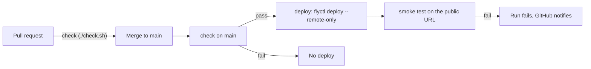

# Deployment

How the prototype is hosted and how changes reach it. The security and rate-limit design is in [design.md](design.md#4-security-and-operations).

## 1. Hosting

| | |
|---|---|
| Platform | [Fly.io](https://fly.io), org `personal` |
| App | `schematics-ai-tutor` |
| URL | https://schematics-ai-tutor.fly.dev |
| Region | `sjc` (San Jose) |
| Machine | one, shared-cpu-1x, 512 MB, always on |
| Config | [`fly.toml`](../fly.toml), [`Dockerfile`](../Dockerfile), [`.dockerignore`](../.dockerignore) |

- **One image, one origin.** The Dockerfile builds the frontend with `SCHEMATICS_PUBLIC=true`, a public build regardless of `config.yaml`. It then runs one uvicorn worker that serves `/api`, `/ws` and the built frontend. The browser talks to one origin, as it does through the Vite proxy locally.
- **Exactly one machine, always on.** The rate limits, the task cache, the first-task pool and the reference solutions are in memory ([design.md](design.md#3-system-architecture)).
  - *Why:* a second machine would split that state, and a stopped machine would lose it and refill the first-task pool with new Claude calls on every cold start.
  - *Cost:* one small machine running around the clock. Scaling out would need a shared store such as Redis.
- **Health check:** Fly checks `GET /api/health` every 30 s, and a machine that fails it is restarted.

## 2. Secrets

| Secret | Where | Scope |
|---|---|---|
| `ANTHROPIC_API_KEY` | Fly secret on the app | Read by the backend at startup |
| `FLY_API_TOKEN` | GitHub repository secret | A deploy token for this app only, created in the Fly dashboard (app → Tokens) or with `fly tokens create deploy -a schematics-ai-tutor` by a user token allowed to create tokens |

- Neither one is ever in the repo or in the image; `.dockerignore` keeps `backend/keys/` and `.env` out of the build context.
- The GitHub token is a deploy token, not a personal or org token. A leak could deploy or read this one app, nothing else in the account.
- **Rotation:** `fly secrets set ANTHROPIC_API_KEY=...` restarts the machine with the new key. For the deploy token, create a new one, replace the GitHub secret, then revoke the old one with `fly tokens revoke`.

## 3. Continuous deployment

A merge to `main` deploys automatically, but only after the same checks that every PR runs pass on `main`.



- **One workflow.** The `deploy` job lives in `.github/workflows/check.yml`, next to `check`. It sets `needs: check` and runs only for `push` events on `main`, so pull requests run the checks alone.
- **Remote build.** `superfly/flyctl-actions/setup-flyctl` installs the CLI, and `flyctl deploy --remote-only` builds the image on Fly's builders, so the runner needs no Docker.
- **One deploy at a time.** `concurrency: deploy-production` makes two quick merges deploy in order, not in parallel.
- **No approval gate.** A merge is the approval; a GitHub environment with required reviewers would add a click per merge to a fast build.
- **Smoke test.** After the rollout, the job checks the public URL and fails the run when the app isn't serving:
  - `GET /api/health` returns `{"status": "ok"}`
  - `GET /` returns the app's HTML page
  - It doesn't call Claude, so it costs nothing.
- **Why GitHub Actions, not Fly's GitHub integration:** the workflow is in the repo and reviewed like code, and it waits for `./check.sh`; Fly's dashboard integration does neither.

## 4. What a deploy resets

Every deploy replaces the one machine. Learners keep their progress, because it's in the browser's `localStorage`, but the server's in-memory state starts over:

| Lost on deploy | Effect |
|---|---|
| Open WebSocket sessions | The page reconnects and resumes from `localStorage` |
| Task cache and reference solutions | The next task is generated on request; the tutor has no `<reference>` for a resumed task |
| First-task pool | Refilled at startup: 2 task generations |
| Rate-limit counters | Start from zero |
| Usage log (`logs/run-*.jsonl`) | Written inside the machine; lost unless collected first |

Frequent merges add a little Claude cost and interrupt anyone mid-task. That's acceptable for the prototype.

## 5. Manual operations

```sh
fly deploy                         # deploy the working tree by hand (first deploy, hotfix)
fly status                         # machine state and the current release
fly logs                           # live server output
fly releases --image               # past releases and their images
fly deploy --image <image>         # roll back to a past release's image
fly ssh console                    # shell on the machine
fly secrets list                   # names only, never values
```

## 6. Status

- [x] `Dockerfile`, `fly.toml`, `.dockerignore`; the backend serves the built frontend
- [x] Fly app created
- [x] `ANTHROPIC_API_KEY` set as a Fly secret
- [x] First deploy, by hand (2026-10-11): health, page, assets, HTTPS redirect and WebSocket upgrade checked
- [x] Playthrough in the browser on the public URL: a couple of tasks solved, task generation and the tutor working
- [x] Deploy token in GitHub secrets (2026-10-11)
- [ ] `deploy` job with the smoke test in `.github/workflows/check.yml`
- [ ] Logs and learner experience collection (to be designed)
