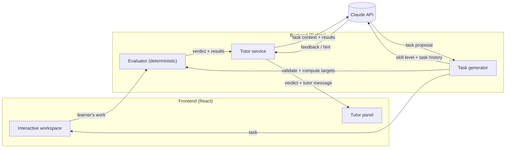

# Design

Major design decisions for the system as a whole. For the product, its workflow and its constraints, see [task.md](task.md). Domain-specific design (circuits, the grid, levels) is in [schematics.md](schematics.md).

## 1. Separate ground truth from tutoring

The system separates deterministic code from Claude, with strictly divided responsibilities:

| Engine | Responsibility | Nature |
|---|---|---|
| Evaluator | Decides what is correct: validates generated tasks, computes target values, grades the learner's work | Deterministic code |
| Task generator (Claude) | Proposes new tasks tailored to the learner | LLM; output validated |
| Tutor (Claude) | Decides how to teach: feedback, hints, assessment of the learner's direction | LLM |

**Why:** LLMs make calculation errors, and a tutor that is confidently wrong does more harm than no tutor. Deterministic evaluation also makes results reproducible and testable.

**Rules:**
- Claude never produces or overrides a verdict or a computed value. It receives the evaluator's output as input and reasons about the *learner*.
- Everything Claude produces is untrusted input. Generated tasks pass the same validator as the learner's work, and the system falls back to curated content when they fail.

## 2. The learner keeps agency

- The learner performs every action in the workspace. The tutor has no ability to modify it.
- Hints are given in response to learner actions or requests, not unprompted solutions.

## 3. System architecture



- **Frontend:** JavaScript + React. It owns the interactive workspace and displays the tutor's messages. It holds no secrets and does no grading.
- **Backend:** Python. It owns the evaluator and all Claude API calls.
- **Task flow:** Claude proposes a task. The evaluator validates it and computes its targets, and the frontend receives the resulting task. Details are in [schematics.md](schematics.md#3-task-flow).
- **Request flow:** the frontend sends the learner's work. The backend runs the evaluator, passes its result together with the task context to Claude, and returns both the verdict and the tutor message.
- **Transport:** REST for static resources (curated levels), and one WebSocket per learning session for the interactive loop: live evaluation on every board edit and validated tutor messages. Details are in [contract.md](contract.md).

## 4. Security and operations

- The Claude API key exists only on the backend, loaded from the environment.
- The deployed prototype is public and uses our API key, so the backend enforces the rate limits below. They protect the cost of Claude calls and the server. **Evaluation never depends on Claude**, so when a Claude limit is hit, the grid, the readings and the status keep working. Only the tutor goes quiet, or generation falls back to curated levels.

| Scope | Limit (default) | When exceeded |
|---|---|---|
| Tutor calls per session | 6 per minute (reactions and messages together) | Reactions are skipped silently. A learner message gets `error: rate_limited`, shown as "The tutor needs a moment; try again shortly". |
| Task generations per session | 1 in flight, 10 per hour | The curated level for the skill level is served |
| Board updates per session | 20 per second | Extra updates are dropped; only the latest board is evaluated |
| Grid size | at most 30 × 30 points, 40 components, 300 wire pieces | `error: bad_message`. This also bounds solver and validation time. |
| New sessions per IP | 10 per hour, 3 open at once | The connection is refused |
| REST requests per IP | 60 per minute | `429` |
| Global Claude budget | 5,000 calls per day | Tutor calls return `error: tutor_unavailable`; generation serves curated levels. Evaluation is unaffected. |

- **Implementation.** In-memory token buckets in the single backend process. Running several instances would need a shared store such as Redis; that is noted for scale, not built for the prototype.
- **Configuration.** All limits are settings in `config.yaml` (§5).
- **Message size.** No fixed limit yet; the grid size caps already bound it indirectly. Typical message sizes will be observed in practice before a limit is set.

## 5. Configuration

The Claude models and behavior knobs live in one YAML file, `backend/config.yaml`, not in code. That lets us switch models, for example Opus vs. Haiku for reactions, and tune thresholds without code changes. The API key is never in this file; it comes from the environment.

```yaml
claude:
  tutor_reaction:              # idle-triggered reactions
    model: claude-opus-5-5
    effort: low
    max_tokens: 16000
    timeout_s: 30
  tutor_request:               # learner message / hint
    model: claude-opus-5-5
    effort: medium             # rarer than reactions and matter more
    max_tokens: 16000
    timeout_s: 30
  task_generation:
    model: claude-opus-5-5
    effort: high
    max_tokens: 16000
    timeout_s: 120
    max_validate_calls: 5
    max_attempts: 2

tutor:
  idle_threshold_ms: 1500
  max_snapshots: 10
  history_turns: 6
  offer_hint_after_reactions: 3

task_generation:
  recent_tasks: 10

rate_limits:
  tutor_calls_per_session_per_min: 6
  task_generations_per_session_per_hour: 10
  board_updates_per_session_per_sec: 20
  grid_max_points: 30            # per side
  grid_max_components: 40
  grid_max_wires: 300
  sessions_per_ip_per_hour: 10
  open_sessions_per_ip: 3
  rest_requests_per_ip_per_min: 60
  claude_calls_per_day: 5000

evaluator:
  near_target_ratio: 0.10      # "near_target" when within 10% of every target
  resistor_max_power_w: 5      # above this, a resistor is "overcurrent"
```

The values above are the defaults, as described in [contract.md](contract.md).

## 6. Stack

| Layer | Choice | Status |
|---|---|---|
| Backend | Python | Decided |
| Frontend | JavaScript + React | Decided |
| Frontend ↔ backend transport | REST + WebSocket | Decided |
| Workspace rendering | three.js | Decided |
| Hosting | — | Open |

**Why three.js:** every component and wire is its own scene node, so the learner can select, move and edit any of them individually.

## Open decisions

- Hosting and deployment
