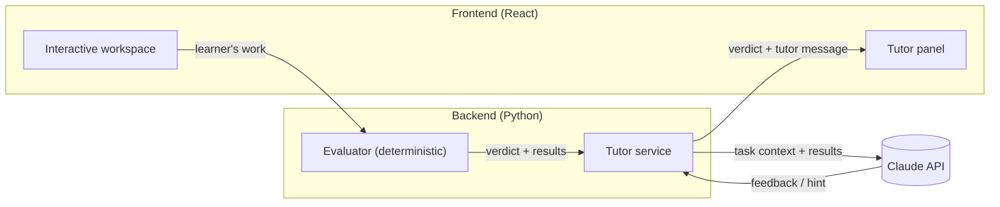

# Design

Major design decisions for the system as a whole. For the product, its workflow and its constraints, see [task.md](task.md). Domain-specific design (circuits, breadboard, levels) is in [schematics.md](schematics.md).

## 1. Separate ground truth from tutoring

The system has two engines with strictly separated responsibilities:

| Engine | Responsibility | Nature |
|---|---|---|
| Evaluator | Decides what is correct: computes results and checks them against the goal | Deterministic code |
| Tutor (Claude) | Decides how to teach: feedback, hints, assessment of the learner's direction | LLM |

**Why:** LLMs make calculation errors, and a tutor that is confidently wrong does more harm than no tutor. Deterministic evaluation also makes results reproducible and testable.

**Rule:** Claude never produces or overrides a verdict or a computed value. It receives the evaluator's output as input and reasons about the *learner*.

## 2. The learner keeps agency

- The learner performs every action in the workspace. The tutor has no ability to modify it.
- Hints are given in response to learner actions or requests, not unprompted solutions.

## 3. System architecture

- **Frontend:** JavaScript + React. It owns the interactive workspace and displays the tutor's messages. It holds no secrets and does no grading.
- **Backend:** Python. It owns the evaluator and all Claude API calls.
- **Request flow:** the frontend sends the learner's work. The backend runs the evaluator, passes its result together with the task context to Claude, and returns both the verdict and the tutor message.
- **Transport:** REST for static resources (levels), and one WebSocket per learning session for the interactive loop: live evaluation on every board edit and streamed tutor messages. Details are in [contract.md](contract.md).

## 4. Security and operations

- The Claude API key exists only on the backend, loaded from the environment.
- The backend applies basic rate limiting, since the deployed prototype is public.

## 5. Stack

| Layer | Choice | Status |
|---|---|---|
| Backend | Python | Decided |
| Frontend | JavaScript + React | Decided |
| Frontend ↔ backend transport | REST + WebSocket | Decided |
| Workspace rendering | three.js | Decided |
| Hosting | — | Open |

**Why three.js:** every component and wire is its own scene node, so the learner can select, move and edit any of them individually.

## Open decisions

- Tutor contract: what context Claude receives, when it responds, the hint escalation policy
- Hosting and deployment
