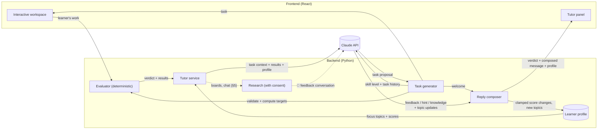
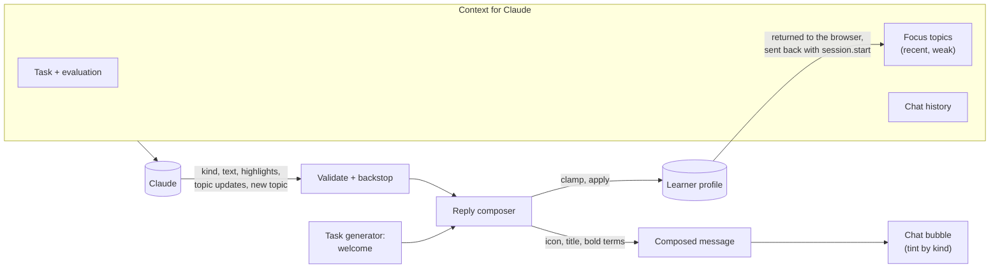
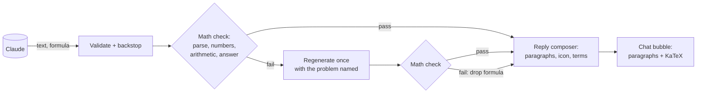
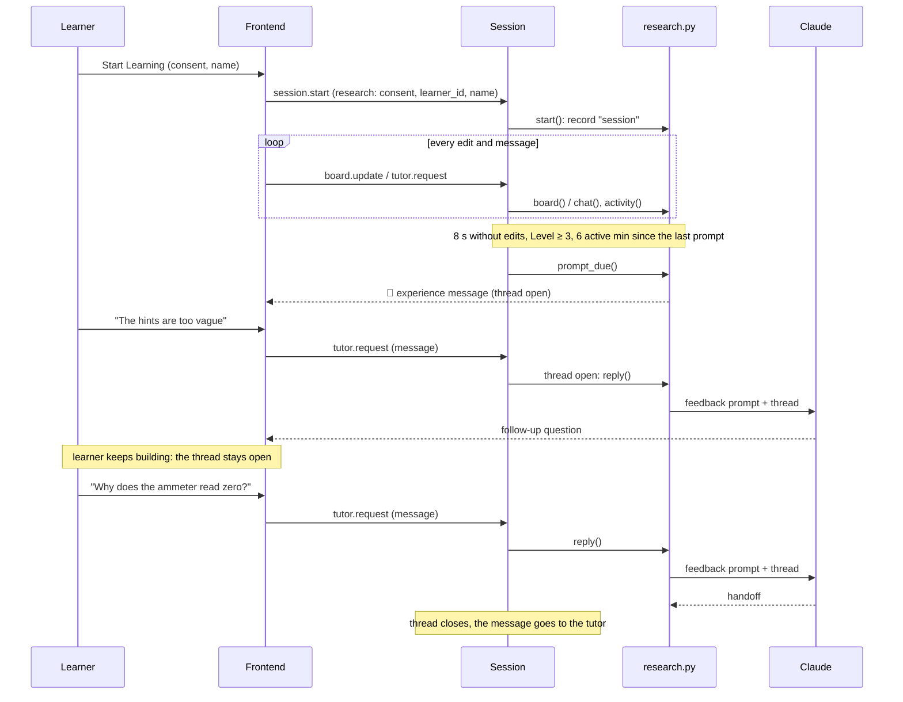
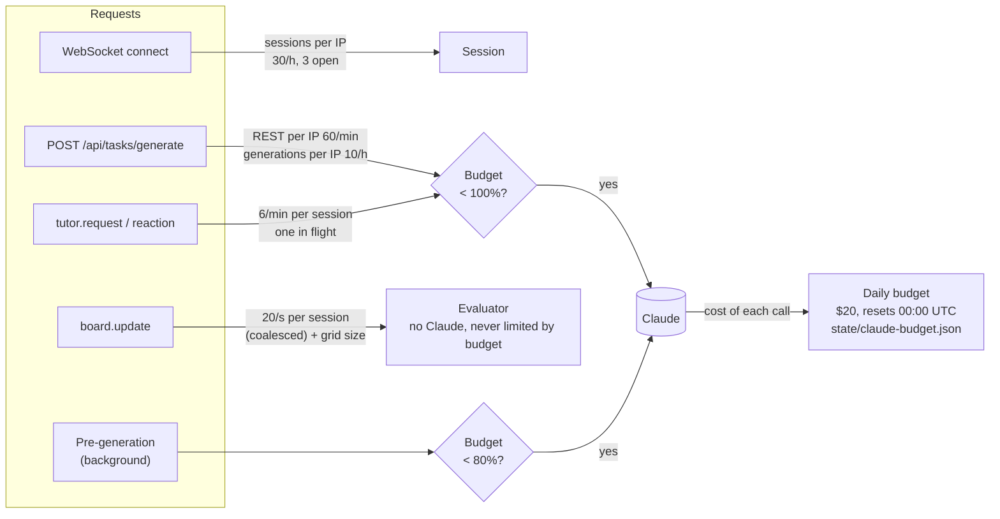

# Design

Major design decisions for the system as a whole. For the product, its workflow and its constraints, see [task.md](task.md). Domain-specific design (circuits, the grid, levels) is in [schematics.md](schematics.md).

## 1. Separate ground truth from tutoring

The system separates deterministic code from Claude, with strictly divided responsibilities:

| Engine | Responsibility | Nature |
|---|---|---|
| Evaluator | Decides what is correct: validates generated tasks, computes target values, grades the learner's work | Deterministic code |
| Task generator (Claude) | Proposes new tasks tailored to the learner, each with a welcome message | LLM; output validated |
| Tutor (Claude) | Decides how to teach: feedback, hints, knowledge, assessment of the learner's direction and understanding | LLM |
| Reply composer | Bounds Claude's changes to the learner profile and presents its messages (§4) | Deterministic code |

**Why:** LLMs make calculation errors, and a tutor that is confidently wrong does more harm than no tutor. Deterministic evaluation also makes results reproducible and testable.

**Rules:**
- Claude never produces or overrides a verdict or a computed value. It receives the evaluator's output as input and reasons about the *learner*. When a formula in a reply computes something, the reply composer recomputes it and drops it if it is wrong (§4).
- Claude's judgment of the learner (profile scores, new topics) is applied only through the reply composer, which clamps it (§4).
- Everything Claude produces is untrusted input. Generated tasks pass the same validator as the learner's work, and the system falls back to curated content when they fail (curated levels are planned; today a failed generation shows an error with a retry).

## 2. The learner keeps agency

- The learner performs every action in the workspace. The tutor has no ability to modify it.
- Hints are given in response to learner actions or requests, not unprompted solutions.

## 3. System architecture



- **Frontend:** JavaScript + React. It owns the interactive workspace and displays the tutor's messages. It holds no secrets and does no grading.
- **Backend:** Python. It owns the evaluator and all Claude API calls.
- **Task flow:** Claude proposes a task with a welcome message. The evaluator validates it and computes its targets, and the frontend receives the resulting task, with the welcome composed for the chat (§4). Details are in [schematics.md](schematics.md#3-task-flow).
- **Tasks are pre-generated and cached on the backend.** A generated task takes 20–90 s depending on the level (first tasks ~25 s, level 14 ~60 s at `high` effort), which is too long to wait at Start or Next.
  - *Cache by progress:* the cache key is the learner's progress (skill level and task history). A request for a progress gets the cached task at once; if that task is still being generated, it waits for the same generation instead of starting another; otherwise it generates one now. A task is removed from the cache when it's served, so the same progress later (e.g. after Restart Learning) gets a fresh task.
  - *Next task in the background:* after serving a task, the backend generates the next one, for the progress as if the served task is solved. By the time the learner presses Next it's usually ready. A resumed task (e.g. after a server restart, which empties the cache) does the same when its session starts, from the progress the browser sends with `session.start`.
  - *First-task pool:* for the start screen, the server keeps a small pool of ready first tasks, filled at startup and topped up as they are served, so even a first visit doesn't wait.
  - *Bounds:* the cache has a size cap and an expiry, and pre-generation counts against the daily Claude budget: it stops at 80% of it, leaving the rest for learners who are waiting (§6).
  - *Accepted loss:* the next task is generated before the current one is finished, so it doesn't know that task's hints or misconceptions. A wait at Next costs more.
  - *Why the backend, not the browser:* the browser stays a plain client (it calls the generate endpoint as before), the cache survives reloads because the same progress gets the same entry, and every decision to spend a Claude call is made on the server, next to the rate limits and the budget. The cost is in-memory server state, lost on restart and not shared between instances, which is acceptable for one prototype server.

  ```mermaid
  sequenceDiagram
      participant FE as Frontend
      participant BE as Backend
      participant C as Claude

      Note over BE,C: startup: fill the first-task pool
      FE->>BE: generate (progress: level 1)
      BE-->>FE: task A, from the pool (no wait)
      BE->>C: background: refill the pool
      BE->>C: background: task after A (progress: A solved)
      Note over FE: the learner solves A
      FE->>BE: generate (progress: A solved)
      BE-->>FE: task B, cached (no wait)
      BE->>C: background: task after B
  ```
- **Two feedbacks per edit, fast and slow.** Every finished edit is sent to the backend.
  - *Fast:* the evaluator runs at once, with no Claude call, and its readings and status reach the browser within a split second. The edit also clears Claude's highlights, which described the previous board.
  - *Slow:* when editing pauses, the backend passes the evaluator's results, the task context and the learner's profile to Claude, validates the reply, composes it (§4), and sends the composed message and new highlights.
  - *Why:* readings must feel like a real meter, and Claude takes seconds. A reply is tagged with the board it is about, so one that arrives after a newer edit never overwrites the fresh readings or draws highlights on a changed board ([contract.md](contract.md#1-frontend--backend)).
  - *Out-of-date reactions are dropped, unless they still hold:* a reaction that finishes after a newer edit isn't sent when it describes the old board (`question`, `nudge`, `feedback`): it would answer a board that's gone, sometimes questioning a gap the learner has just closed, right before the praise for solving. Two kinds still hold and are sent, as text only (the client drops an out-of-date reply's highlights and readings): `knowledge`, because a lesson stays true and counts toward the profile, and `praise` while the board is still `solved`; praise for a board broken since would contradict the vanished checkmark. The reaction to the newer board follows either way. A reply to the learner's own message or hint is always sent.
  - *No call when nothing changed:* Claude is called only when the circuit's graph differs from the one it last replied about. Moving a wire along the same connections, dropping a stray piece, or changing and undoing gives the same graph, so the same evaluation, and a reply would only repeat itself. After `tutor.react_after_unchanged` (4) such pauses in a row, Claude is called anyway with `unchanged_moves`, because a learner who keeps trying without progress needs more direct guidance. A pause, not an edit, is the unit: one drag can be several edits within a second.

  ```mermaid
  sequenceDiagram
      participant L as Learner
      participant FE as Frontend
      participant EV as Evaluator
      participant C as Backend + Claude

      L->>FE: edit (board #5)
      FE->>FE: clear Claude's highlights
      FE->>EV: board #5
      EV-->>FE: readings + status (#5), within a split second
      Note over FE,C: fast feedback ends here
      Note over L,FE: learner pauses
      Note over C: idle timer fires: reaction on board #5
      L->>FE: edit (board #6) while Claude thinks
      FE->>EV: board #6
      EV-->>FE: readings + status (#6)
      Note over C: reply about #5 is out of date: not sent
      Note over L,FE: learner pauses again
      Note over C: idle timer fires: reaction on board #6
      C-->>FE: reply about #6: text and highlights shown
  ```
- **Editor and inventory are one three.js widget.** The grid and the inventory are drawn in a single scene with a single camera, not as separate widgets.
  - *Why:* parts must look the same size in the inventory and on the board. With two widgets, each one's size depended on the other's (board scale → inventory size → editor width → board scale), and the layout kept resizing. In one scene they share a scale by construction.
  - *Scale:* the scene's bounds are computed once per task from its starting board (the inventory reserves the starting rows), so editing never rescales; only a window resize refits the camera.
  - Details are in [gui.md](gui.md#6-inventory).
- **Picking is by drawn shape, and one drag serves the inventory and the board.** Hit-testing walks the scene nodes' own meshes (planes, circles, rings), grown by 2 screen pixels, instead of slot rectangles or raycasts. A drag keeps the grab offset, so the element never jumps to the pointer.
  - *Why:* bounding boxes made empty space around symbols clickable, and a rectangular hotspot can't tell a thin wire from the gap next to it. One mechanism for every source keeps the inventory and the board behaving alike. Details are in [gui.md](gui.md#4-grid).
- **Reference solutions stay on the server.** When a task is generated, the backend keeps its complete board in memory by level ID (bounded). The tutor uses it as `<reference>`; the browser only ever receives the task board.
- **Transport:** REST for resources and task generation (`/api/tasks/generate`; `/api/levels` is planned with the curated levels), and one WebSocket per learning session for the interactive loop: live evaluation on every board edit and validated tutor messages. Details are in [contract.md](contract.md).

## 4. Tutoring experience: learning path, learner profile, reply composer

**Problem.** With only the task, the board and the evaluation, Claude can only coach the task, and every reply sounds the same: a question about the circuit. Claude doesn't know which ideas are new to the learner, which ones it has already explained, or which ones the learner has shown they understand. So it can't decide when to stop asking and teach a fundamental rule instead.

**Decision.** The learner gets a **profile** of the topics they have met, with two scores per topic. Claude reads the recent and weak topics with every call, decides what to teach, and reports how the scores change. A backend step, the **reply composer**, applies those changes within strict bounds and prepares the message for the chat.

### Learning path: topics

A **topic** is either a fundamental **principle** ("current needs a complete path") or a **term** ("ammeter", "resistance"). A catalog, `backend/data/topics.yaml`, lists the topics with an ID, name, type, a one-line definition, and where the learner first meets each one: a curriculum level, or a component type first seen on the board.

| Curriculum level | Principles | Terms |
|---|---|---|
| 1 Closed loop | `closed_loop` | circuit, current, voltage source, open circuit, short circuit |
| 2 Ohm's law | `ohms_law` | resistance, ohm, volt, ampere |
| 3 Ohm's law, more choices | — | resistor color code |
| 4 Series resistors | `series_voltage_division` | series, voltage drop, voltage divider |
| 5 Parallel resistors | `parallel_branches` | parallel, branch, junction |
| 6 Series–parallel | — | equivalent resistance |
| 7 Measuring right | `meter_usage` | measuring across, measuring in the loop |
| 8 Power and safety | `power_safety` | power, watt |
| First on the board | — | ammeter, voltmeter |

- The principles are the existing `meta.principle` labels ([tutor.md](tutor.md#5-labels)), so there is one list of principles.
- **Claude can add topics.** When a reply teaches something the catalog doesn't have (e.g. "conductor"), Claude can add it as a new topic: an ID, a name, a type and a one-line definition. Claude can also bring a catalog topic forward, e.g. "short circuit" when the learner makes one at level 1. Either way the topic joins this learner's profile only; the catalog doesn't change.

### Learner profile

The profile is the learner's knowledge list: every topic they have met, with two scores from 0 to 3.

| Field | Meaning |
|---|---|
| `id`, `name`, `type` | The topic (`principle` or `term`) |
| `introduced` | The skill level at which the learner met it; recency is measured from it |
| `understanding` | What the learner has shown: 0 not yet seen, 1 shaky, 2 mostly, 3 solid |
| `explained` | How much the tutor has explained it: 0 never, 1 mentioned, 2 explained, 3 explained more than once |
| `source` | `catalog` or `claude` |

- **Joining:** when a task starts, the topics of its curriculum level (and of earlier levels, if missing), and of any component type new on its board, join the profile with both scores at 0. Topics from Claude join when it adds them.
- **Stored with the session.** Like the progress and the chat, the profile is kept in the browser's `localStorage`, sent with `session.start`, and returned in the reply to it and with each tutor message. A reload or a server restart loses nothing.
- **Focus.** Claude doesn't get the whole profile, only up to 8 **focus topics**: the 5 most recently introduced, then older ones with `understanding` 0 or 1 (weakest first), then the rest. Each comes with `tasks_ago`, the skill levels since it was introduced. Recent topics are what the current tasks teach. Old weak ones are what keeps tripping the learner up.

### Rules for Claude

The system prompt gives Claude the rules for the scores and lets it decide what to do with them in each reply:

- **Raise `understanding`** (+1) only on evidence: the learner fixed a problem without a hint, answered a reflection question correctly, or explained the idea in their own words. **Lower it** (−1) when a mistake or a misconception shows a gap in that topic.
- **Raise `explained`** (+1) when this reply explains the topic.
- **Choosing the reply:**

  | Topic state | What the tutor does |
  |---|---|
  | `explained` 0, and the moment touches it | Teach it: a `knowledge` message, two sentences tied to what's on the grid ("An ammeter has almost no resistance, so current flows through it. That's why it goes in the loop.") |
  | `explained` ≥ 1, `understanding` ≤ 1 | Don't re-explain. Ask a question that tests it ("Do you need a larger or a smaller resistance?") |
  | `understanding` ≥ 2 | Keep it short: confirm, or praise the strategy, and move on |

- **Vary the kind:** the prompt describes each message kind and asks Claude to pick the one that fits the moment, so not every reply is a question.
- **Safety first:** for `short_circuit` and `overcurrent` the reply is about safety. A `knowledge` message waits until that's settled.
- **At most one topic** is taught per reply, and at most one new topic is added.
- The tutor's other rules don't change: physics, not placement; no invented numbers; the hint ladder ([tutor.md](tutor.md)).

### Reply composer

The tutor service validates Claude's reply and runs the backstop ([tutor.md](tutor.md#6-guardrails-physics-not-placement)). The reply composer then turns it into what the chat shows:

1. **Score changes:** each change must name a topic in the profile, or the topic Claude added. Changes are clamped to ±1 per reply and kept within 0–3, and `explained` never goes down. Anything else is dropped and logged.
2. **New topic:** its ID must be new and its name and definition short. It joins the profile with `source: claude`.
3. **Presentation:** it adds the icon for the message's kind and, for a `knowledge` message, the topic's name as a title. It also marks the first mention of each profile topic in the text ("voltage source" before "voltage", plurals included), and the chat shows those words in bold, so the learner sees the vocabulary they are building.
4. **Message:** it sends the composed chat message and the updated profile in `tutor.message`. A new task's welcome goes through steps 3 and 4 as well, without score changes (see Welcome message).

The composer is plain code, so it is unit tested like the evaluator. It is also the place for later changes to presentation and tone (e.g. not opening three replies in a row with a question), with no change to the prompt.

**Message kinds.** `knowledge` joins the existing kinds. Each kind has its own tint and icon, so a lesson, a hint and praise look different at a glance:

| Kind | Purpose | Tint | Icon |
|---|---|---|---|
| `praise` | Praise the strategy | green | 🎉 |
| `nudge` | Point at a misstep | orange | 👉 |
| `feedback` | Comment on the circuit | blue | 💡 |
| `question` | Ask the learner to reason | pink | ❓ |
| `knowledge` | Teach a principle or a term | gold | 📘 |
| `hint` | A step of the hint ladder | purple | 🔑 |



- **Why Claude decides and the code bounds it.** Judging evidence of understanding from a learner's edits and words is what Claude is good at. Code can't do it. But scores that drift by several points per reply, or topics added in bulk, would make the profile meaningless. So the backend clamps every change, the same split as for verdicts and readings (§1).

### Welcome message

Each new task opens with a tutor message in the chat, so the learner knows what's new before they start.

- **Written by the generator, not a tutor call.** The `TaskSpec` has a `welcome` field: one or two sentences linking to the learner's recent tasks and naming the new idea or part ("You've worked with one resistor. Now two share the source's push: how do they split it?"). It costs a few dozen output tokens on a call that is made anyway, and it's ready when the task is: tasks are pre-generated (§3). A separate tutor call would cost about as much as a reaction per task and arrive seconds later.
- **Checked like a tutor reply.** Location talk in `welcome` is a validation error, so the generator fixes it before answering. A cached task without one, or one that still fails the check, gets a plain line ("New task: …").
- **Composed when served.** The generate request carries the learner profile. The reply composer makes the welcome a `knowledge` message when the task brings topics new to the learner, else `feedback`, with the icon and the terms in bold. The frontend adds it to the chat when the task arrives, so a reload doesn't repeat it.
- **Accepted limit:** the welcome is written before the previous task is finished, so it knows the learner's history but not that task's chat. The first reaction after the learner's first edit has the full profile.

### Formulas and paragraphs

**Problem.** From curriculum Level 2 the learner does real math: Ohm's law, voltage division, equivalent resistance. The tutor can only describe that math in words, as one block of text, so a hint like "R2 must take a third of the 12 V…" is hard to follow, and complex circuits (Level 6 and up) get feedback the learner called "not sufficient". A hint also can't go further than "one step before the answer", so a learner who is stuck stays stuck.

**Decision.** Replies can carry a **formula**, shown under the text in proper math notation. A **math check** in the reply composer recomputes every step and drops a formula that is wrong or gives the answer too early. The hint ladder gets four rungs, ending in the full computation. Replies are split into **paragraphs**.

**Formula.**
- **Where it is:** an optional `chat.formula`, a list of 1 to `tutor.formula_max_lines` lines (default 8), each one line of LaTeX. It is separate from `chat.text`, so the text never has math markup in it, and the chat shows it as a block under the text.
- **From Level 2.** On curriculum Level 1 (closed loops and shorts, no numbers to compute) the composer drops any formula; `tutor.formulas_from_level` sets the level.
- **Symbolic or with numbers.** `V_{R2} = V \cdot \frac{R_2}{R_1 + R_2}` states the law; `4\,\mathrm{V} = 12\,\mathrm{V} \cdot \frac{R_2}{40\,\Omega + R_2}` puts the board's numbers in it. Which one a reply may use depends on the reply (below).
- **Catalog formulas.** A topic in `topics.yaml` can have a `formula`, e.g. `I = \frac{V}{R}` for `ohms_law`. Focus topics carry it to Claude, and a `knowledge` message about the topic uses it, so a law always looks the same.
- **LaTeX subset.** Symbols with subscripts (`R_2`, `V_{R1}`), numbers with units (`\,\Omega`, `\,\mathrm{k\Omega}`, `\,\mathrm{V}`, `\,\mathrm{mA}`, `\,\mathrm{A}`, `\,\mathrm{W}`), `+ - \cdot \times \frac{}{}`, parentheses, `=` and `\approx`. That is all the circuits here need, and the math check parses it. A line outside the subset fails the check.

**Math check (`formula.py`).** Claude writes the formula; plain code decides whether it is shown, the same split as for readings (§1). The tutor service runs it with the location-talk backstop, before the reply composer, so a failure can still be regenerated.

1. **Parse** each line; a line that doesn't parse fails.
2. **Numbers come from the board.** Every number is a part value (placed or in the inventory), a meter reading or a target on the current board, or the result of an earlier line of the same formula. Units count: `4 V` is not `4 Ω`. Whole numbers up to 10 without a unit are algebra (`1/R`, `2 R_2`) and always allowed.
3. **Arithmetic holds.** Wherever both sides of an `=` are numbers only, they agree within 1% (`\approx`: within 5%, for rounded values).
4. **No answer too early.** The answer is the value of a part the task removed (from the reference board) that the learner hasn't placed with that value yet. Only rung 4 of the hint ladder may show it, in `chat.formula` or in `chat.text`; anywhere else, a number with that value and unit fails the check.
5. **On failure:** the call is regenerated once with the problem named, as for location talk ([tutor.md](tutor.md#6-guardrails-physics-not-placement)). If it fails again, the formula is dropped (and, for an answer in the text, the safe generic message is sent). Dropped formulas go to the run log as `formula_dropped`.

**Which reply may use which formula:**

| Reply | Formula |
|---|---|
| Reaction, free chat | Optional. Symbolic, or with the board's numbers when it helps; no answer |
| `knowledge` | The topic's catalog formula, symbolic |
| Hint rung 1, text | None |
| Hint rung 2, formula | Symbolic only: no numbers from the board |
| Hint rung 3, partial numbers | The known values put in; the unknown stays a symbol; no answer |
| Hint rung 4, full computation | Rearrange, substitute, compute, up to 8 lines; the answer is allowed |

**Hint ladder: four rungs.** Text, formula, partial numbers, full computation ([tutor.md](tutor.md#3-hint-ladder)). The old "orient" and "focus" levels merge into the text rung. Rung 4 gives the value, but the learner still picks the part and places it, so the learner keeps the agency (§2). On curriculum Level 1 all four rungs are text: concept and where to look, the principle with the parts involved, walking the path, and the full explanation of what is wrong and why. `hints_used` in the task history becomes 0–4, so task generation sees who needed the full computation.

**Paragraphs.** Claude separates ideas with a blank line (`\n\n`). Hints, chat answers and `knowledge` messages over 2 sentences get paragraphs; reactions stay one paragraph. The composer collapses three or more line breaks into two and trims them at the ends. The chat shows each paragraph as a block with half a line between them; the bold terms' offsets still index the whole text.

**Rendering.** The chat draws `chat.formula` with KaTeX, a line per row, centered under the text; a line too wide for the chat scrolls sideways on its own. If KaTeX can't render a line, the line shows as plain monospace text.



### Status

- **Build status.** Built: the catalog, the profile (`learner_profile.py`), the reply composer (`reply_composer.py`), the prompt rules, the welcome message and the chat bubbles. Built too: formulas (`formula.py`), the four-rung hint ladder and paragraphs ([Formulas and paragraphs](#formulas-and-paragraphs)). Interfaces are in [contract.md](contract.md), the prompt rules in [tutor.md](tutor.md#teaching-from-the-learner-profile).
- **Later uses.** The profile is ready to feed task generation (target weak topics) and the Learning Path screen ([gui.md](gui.md#9-learning-path-screen-bonus)). Neither is built yet.

## 5. Learner experience research

**Goal.** Learn how real learners use the tutor: what they build, where they get stuck, how the tutor responds, and what they think of it. Only with their consent, and with no data ever public.

**Decision.** A separate backend module, `backend/app/research.py`, owns everything about research: consent, recording, the feedback prompt and the feedback conversation. `session.py` only calls its hooks, and with no consent every hook does nothing. The records are files on the server's volume, collected with a script over `fly ssh`; no HTTP endpoint serves them.

### Consent and identity

- **Opt-in on the start screen.** An unchecked checkbox in the window's bottom-left corner, "Share my learning experience with the authors", and, when checked, an optional name field. A blank name gets a generated one ("Curious Otter 42"). No email: the records hold no contact data.
- **Per session.** The choice is saved with the session in `localStorage`, `research: { consent, learner_id, name }`, and sent with `session.start`. There's no toggle elsewhere; Restart Learning wipes the session and returns to the start screen, where the learner chooses again.
- **`learner_id`** is a random UUID generated by the browser at Start Learning. It keys the records; the name is only a label. The server accepts only a well-formed UUID, so it can't be used to reach other paths.

### What is recorded

While consent is on, the server appends one JSON line per event to `research/<learner_id>/<date>.jsonl`. Every record has `ts` (UTC), `session_id` and `type`:

| `type` | Contents |
|---|---|
| `session` | name, the level (task), the learner profile, progress |
| `board` | `seq`, the board, its graph and its evaluation, after each edit |
| `chat` | a learner message, a tutor reply (kind, text, `meta` with highlights and topic changes) or a task's welcome |
| `experience` | the 🔔 prompt and every turn of the feedback conversation, marked `experience: true` |

- **Size:** a board with its graph is a few KB, so a session of a few hundred edits is around 1 MB. Writing stops at `max_mb_per_learner` (default 20 MB), with an event in the run log.
- **Nothing else:** no IP addresses, no headers; the usage log ([§6](#operations)) keeps its own, separate records.

### The 🔔 feedback prompt

From curriculum level 3 (the "Level 3" badge, after about four tasks), the tutor asks the learner for their thoughts every 6 minutes of active use. It was 10 at first, but learners aren't busy all the time (reading, thinking and breaks count at most a minute per gap), so 10 active minutes took far longer on the clock.

- **Active time:** the gaps between the learner's edits and messages are added up, each gap counting at most 60 s, so time away from the screen doesn't count. The count carries over from task to task (see Status).
- **When it's due:** consent is on, the curriculum level is at least `prompt_from_level`, `prompt_every_active_min` of active time have passed since the last prompt (or since the session started), the tutor isn't replying, and the status isn't `short_circuit`. The check runs after a real break: `prompt_idle_s` (8 s) without edits, and after the tutor's reaction to that pause, if one is running. A 1.5 s pause between two drops is the middle of a move; a prompt there would be closed by the next drop before it's read, as testing showed.
- **The message:** a new chat kind, `experience`, with a 🔔 icon and a teal tint: e.g. "Quick check-in: how is the tutor working for you so far? Anything confusing or annoying?"
- **The conversation:** the prompt opens an experience thread. While it's open, the learner's chat messages go to `research.reply()`, not to the tutor: a Claude call with its own short prompt that asks at most `max_followups` follow-up questions (default 2), never tutors, and ends by thanking the learner. Learners keep building while they read, so the thread stays open across board edits; only the learner's typed messages go to the thread. While a 🔔 question (the prompt or a follow-up) waits for an answer, tutor reactions are held, so they don't bury it; the board, the readings and the status still update live, and a hint request still reaches the tutor. The thread closes after the thanks, on a hint request, or after `thread_timeout_active_min` (3) of active time without a reply; then reactions resume. Ignoring the prompt is fine.
- **Kept in the browser:** an open thread (its turns, follow-up count and idle time) is part of the `research` state the browser keeps with the active time, so a reload, a reconnect or the next task doesn't end it. In testing, a reload a minute after the prompt sent the learner's answer to the tutor.
- **Handoff:** a message typed while the thread is open may be meant for the tutor ("why does the ammeter read zero?"). The feedback conversation's reply has a `handoff` field: when it's true, the thread closes and the same message goes to the tutor as a normal request. Feedback that mentions the circuit ("the hints don't help on level 6") stays in the thread. The learner's turn is recorded as `experience` either way, with `handoff: true` when handed off.
- **Recorded:** the prompt and every turn, learner and Claude, as `experience` records.



### Module interface

```python
class ResearchLog:                     # one per server: the files on disk
    def __init__(self, dir, max_mb_per_learner)
    def append(self, learner_id, record)   # research/<learner_id>/<date>.jsonl; stops at the cap

class Research:                        # one per learning session; inert without consent
    def __init__(self, log, config, claude, usage_log)
    def start(self, research, level, profile, progress)   # validates consent and learner_id
    def board(self, seq, board, graph, evaluation)
    def chat(self, role, message)      # learner turns, tutor replies, the welcome
    def activity(self)                 # an edit or a message: counts active time
    def prompt_due(self, curriculum_level, status) -> dict | None   # the 🔔 message, when due
    thread_open: bool                  # a feedback conversation is running
    async def reply(self, learner_text) -> dict   # a follow-up question, or thanks and close
    def close_thread(self)             # the learner went back to the board
```

### Configuration

The `research` block and `claude.experience` in `config.yaml` (§7): the folder, the size cap per learner, when the 🔔 prompt comes, how many follow-ups, and the feedback conversation's model.

### Collecting the data

- **Where:** on Fly, the `/data` volume ([deployment.md](deployment.md#5-logs)); locally, `research/` in the repo root. Both are gitignored and outside the image, and no endpoint reads them.
- **`research.sh pull`** downloads the volume's `research/` folder over `fly ssh` (a tar stream) into the local `research/` folder. It works only with the Fly credentials of the app's owner.
- **`research.sh delete <learner_id>`** removes one learner's records on the server, for a learner who asks.
- **`research.sh experience [--pull]`** turns the local records into `research/experience.md`: per learner, each 🔔 check-in with its time, level, every turn, handoffs, and how it ended. It reads only the local folder (`--pull` refreshes it first), and the report stays in the gitignored folder.
- **Costs:** recording is free, and so is the 🔔 prompt: its text is fixed. Each learner answer in the conversation is one Claude call at low effort, at most `1 + max_followups` per prompt, and it counts against the per-session tutor rate limit and the daily budget like any tutor call.

### Status

Built: `research.py` (`ResearchLog`, `Research`), its hooks in `session.py`, the start screen's consent and name, the `experience` chat kind and `research.sh`. Interfaces are in [contract.md](contract.md), the start screen and the chat kind in [gui.md](gui.md), collecting on Fly in [deployment.md](deployment.md#6-manual-operations).

- **Active time survives tasks.** Each task opens a new WebSocket session, and most tasks take a minute or two, so a count kept only in the server's session would never reach the prompt interval. The server sends `research: { active_s, last_ts, thread }` with every `evaluation` and tutor message; the browser keeps it with the consent and sends it back with `session.start`. `Research.start` continues the count from `active_s`, clamped to the prompt interval, and counts the gap since `last_ts`, the previous task's last activity, so the time spent reading a new task isn't lost. That gap is capped at 60 s like any other, so a stale or altered `last_ts` adds a minute at most.

## 6. Security and operations

- The Claude API key exists only on the backend, loaded from the environment or the gitignored `backend/keys/apikey.txt`.
- The deployed prototype is public and uses our API key, so the backend enforces the rate limits below. They protect the cost of Claude calls and the server. **Evaluation never depends on Claude**, so when a Claude limit is hit, the grid, the readings and the status keep working. Only the tutor goes quiet, or generation pauses.

### Rate limits

One module, [`rate_limits.py`](../backend/app/rate_limits.py), with its own configuration file, [`ratelimiting.yaml`](../ratelimiting.yaml) in the repo root. The backend reads it at startup, together with `config.yaml`.

| Scope | Limit (default) | When exceeded |
|---|---|---|
| Daily Claude budget | $20 of estimated spend per day, all calls; the day resets at 00:00 UTC | Pre-generation stops at 80% (`background_share`), keeping the rest for learners who are waiting. At 100%: tutor requests get `error: tutor_unavailable` ("the tutor has reached today's limit"), reactions are skipped, and generation gets `429`. Evaluation is unaffected. |
| Tutor calls per session | 6 per minute (reactions and messages together), one in flight | Reactions are skipped silently. A learner message gets `error: rate_limited`, shown as "The tutor needs a moment; try again shortly". |
| Task generations per IP | 10 per hour | `429` with "Task generation is paused; please try again in N min" and `Retry-After`. Curated levels will be served here once they exist. |
| WebSocket sessions per IP | 30 per hour (reconnects included), 3 open at once | The server sends `error: rate_limited` and closes with code `1008`; the client waits 30 s before reconnecting instead of 2 s |
| REST requests per IP | 60 per minute, except `/api/health` | `429` with `Retry-After` |
| Board updates per session | 20 per second | Coalesced: the latest board waits until the limit allows, then it's evaluated; older ones in between are dropped |
| Grid size | 30 × 30 points, 40 components, 300 wire pieces; learner boards and generated tasks | `error: bad_message` for a learner board; a generated task fails validation. This also bounds solver and validation time. |

Where each limit applies on the way to Claude: a per-session or per-IP rate first, then the shared daily budget. Evaluation has no budget gate.



- **Budget in dollars, not calls.** Calls differ a lot in cost (a generation turn costs about 2.5 times a reaction), so the budget counts the estimated spend that the usage log already computes from the `pricing` table in `config.yaml`. Every Claude call adds its cost as it completes. A call is only checked before it starts, so the last calls of the day can overshoot the cap slightly.
- **Pre-generation stops first.** Background generations (the first-task pool, the next task) need the budget under `background_share`; a learner waiting for a task or the tutor can use the rest.
- **The budget survives restarts.** The day's spend is kept in `state/claude-budget.json` (gitignored), on the Fly volume when deployed ([deployment.md](deployment.md#5-logs)), so a deploy doesn't reset it. All other counters are in memory and start from zero on a restart; that's harmless.
- **Per IP, where there's no session.** Generation is a REST call without a session ID, so it's limited per IP. The IP is the `Fly-Client-IP` header, set by Fly's proxy; locally, the socket's address.
- **Implementation.** Sliding windows per key and a daily budget, in memory in the single backend process. Running several instances would need a shared store such as Redis; that is noted for scale, not built for the prototype.

```yaml
claude_budget:
  usd_per_day: 20              # estimated spend of all Claude calls (pricing in config.yaml); resets 00:00 UTC
  background_share: 0.8        # pre-generation stops at this share, keeping the rest for waiting learners
  state_dir: state             # the day's spend survives restarts; SCHEMATICS_STATE_DIR overrides it (Fly: /data/state)

tutor:
  calls_per_session_per_min: 6   # reactions and learner requests together; one call in flight

task_generation:
  per_ip_per_hour: 10          # REST generation has no session, so it's counted per IP

sessions:
  per_ip_per_hour: 30          # WebSocket sessions, reconnects included
  open_per_ip: 3

rest:
  requests_per_ip_per_min: 60  # /api/*, except /api/health

board_updates:
  per_session_per_sec: 20      # beyond this, updates are coalesced: only the latest board is evaluated

grid:                          # learner boards and generated tasks; also bounds solver time
  max_points: 30               # per side
  max_components: 40
  max_wires: 300
```

### Operations

- **Usage and cost log.** When `logs.enabled` is on, the backend writes one JSON-lines log per run, `logs/run-<timestamp>.<part>.jsonl` (gitignored). It records server start and stop, every Claude call (purpose, model, learner session ID, token usage, estimated cost from the `pricing` table), each log archive, and a run summary with totals. Each `./start.sh` is one run; a code reload continues it in a new part. Earlier parts are gzipped into `logs/history/` within a size budget ([deployment.md](deployment.md#5-logs)).
- **Deployment.** Fly.io: one Docker image on one always-on machine, shipped from GitHub Actions with the `deploy` label: deployed, smoke tested live, then merged, or rolled back. Details are in [deployment.md](deployment.md).
- **Message size.** No fixed limit yet; the grid size caps already bound it indirectly. Typical message sizes will be observed in practice before a limit is set.

## 7. Configuration

The Claude models, behavior knobs, logging and pricing live in one YAML file, [`config.yaml`](../config.yaml) in the repo root, not in code. Rate limits have a file of their own, [`ratelimiting.yaml`](../ratelimiting.yaml) (§6). That lets us switch models, for example Opus vs. Haiku for reactions, and tune thresholds without code changes. The API key is never in this file; it comes from the environment.

```yaml
public: false                  # true for a public deployment: hides debug features
                               # (read by the frontend build; restart the dev server after a change;
                               # SCHEMATICS_PUBLIC overrides it, and the Dockerfile sets true)

logs:                          # archived at startup, by size and nightly (deployment.md §5)
  enabled: true                # usage and cost log per backend run
  dir: logs                    # SCHEMATICS_LOGS_DIR overrides it (Fly: /data/logs)
  history_dir: history         # gzipped earlier parts, inside dir
  max_file_mb: 20              # archive when a log's current part grows past this
  history_max_mb: 200          # history budget for all logs; oldest files deleted first
  nightly_utc: "10:00"         # daily archive (3 am Pacific)

pricing:                       # USD per million tokens, for cost estimates
  claude-opus-5-5: { input: 4.00, output: 20.00, cache_read: 0.20, cache_write: 5.00 }

claude:
  tutor_reaction:              # idle-triggered reactions
    model: claude-opus-5-5
    effort: low
    max_tokens: 16000
    timeout_s: 30
  tutor_request:               # learner message / hint
    model: claude-opus-5-5
    effort: medium             # rarer than reactions and matter more
    max_tokens: 16000
    timeout_s: 30
  skill_summary:               # bonus: Learning Path screen
    model: claude-opus-5-5
    effort: low
    max_tokens: 16000
    timeout_s: 30
  experience:                  # the 🔔 feedback conversation (research, docs/design.md §5)
    model: claude-opus-5-5
    effort: low
    max_tokens: 16000
    timeout_s: 30
  task_generation:
    model: claude-opus-5-5
    effort: high
    max_tokens: 16000
    timeout_s: 120
    max_validate_calls: 5        # validate_grid tool calls per attempt
    max_attempts: 2              # failed attempts before giving up and telling the learner

tutor:
  idle_threshold_ms: 1500
  max_snapshots: 10
  history_turns: 6
  offer_hint_after_reactions: 3
  react_after_unchanged: 4      # pauses with an unchanged circuit before Claude is called anyway
  formulas_from_level: 2       # curriculum level from which replies may carry a formula
  formula_max_lines: 8         # a formula's lines at most (rung 4 of the hint ladder needs the most)

task_generation:
  recent_tasks: 10

pregeneration:                 # tasks generated ahead of time and cached (§3)
  enabled: true
  first_task_pool: 2           # ready first tasks for new learners, filled at startup
  max_entries: 50              # cached or running generations, oldest dropped first
  ttl_s: 3600                  # a cached task older than this is dropped

research:                      # learner experience research, with consent (docs/design.md §5)
  enabled: true
  dir: research                # SCHEMATICS_RESEARCH_DIR overrides it (Fly: /data/research)
  max_mb_per_learner: 20
  prompt_from_level: 3         # curriculum level
  prompt_every_active_min: 6
  prompt_idle_s: 8              # the 🔔 prompt waits for this long a pause in editing
  thread_timeout_active_min: 3 # an unanswered feedback conversation closes after this much active time
  max_followups: 2

evaluator:
  near_target_ratio: 0.10      # "near_target" when within 10% of every target
  resistor_max_power_w: 5      # above this, a resistor is "overcurrent"
```

The values above are the defaults, as described in [contract.md](contract.md). The backend reads the file at startup, so changes need a restart (`./stop.sh && ./start.sh`).

## 8. Stack

| Layer | Choice | Status |
|---|---|---|
| Backend | Python, FastAPI + uvicorn | Decided |
| Frontend | JavaScript + React, built with Vite | Decided |
| Frontend ↔ backend transport | REST + WebSocket | Decided |
| Workspace rendering | three.js | Decided |
| Formulas in the chat | KaTeX | Decided |
| Hosting | Fly.io: one Docker image, one always-on machine ([deployment.md](deployment.md)) | Decided |

**Why three.js:** every component and wire is its own scene node, so the learner can select, move and edit any of them individually.

## 9. Repository layout

A snapshot of the repository; it is updated as the structure changes. Entries marked *(gitignored)* exist only locally.

```text
schematics-ai-tutor/
├── README.md                  project overview and how to run
├── LICENSE
├── config.yaml                models, knobs, logging, pricing (§7)
├── ratelimiting.yaml          rate limits and the daily Claude budget (§6)
├── Dockerfile                 production image: built frontend + backend (docs/deployment.md)
├── fly.toml                   Fly.io app: region, one always-on machine, health check
├── .dockerignore
├── start.sh                   start the backend and frontend in the background
├── stop.sh                    stop it
├── check.sh                   integrity checks: docs, config, layout, secrets, tests
├── test.sh                    backend tests: unit + api, or live (real Claude)
├── smoke.sh                   smoke test of a deployed app (docs/deployment.md)
├── research.sh                research records on Fly: list, pull into research/, delete one learner, experience report (§5)
├── .env.example               optional local overrides (copy to .env)
├── .gitignore
├── .github/
│   └── workflows/
│       ├── ci.yml             ./check.sh on every PR push and on main
│       └── deploy.yml         `deploy` label: check, deploy, smoke, merge; rollback on failure
├── scripts/
│   ├── check_integrity.py     docs, config, layout and secrets checks used by check.sh
│   └── research_experience.py the 🔔 feedback conversations from research records, as a Markdown report
├── docs/
│   ├── task.md                product, concept of operations, constraints
│   ├── design.md              system design (this file)
│   ├── contract.md            frontend ↔ backend and backend ↔ Claude interfaces
│   ├── schematics.md          grid and graph formats, task flow, evaluator, levels
│   ├── tutor.md               tutor behavior, hint ladder, guardrails
│   ├── gui.md                 screens, layout, interaction, learner journey
│   ├── deployment.md          hosting, secrets, continuous deployment, operations
│   ├── plan.md                build plan with checklist
│   └── images/
│       └── gui-layout.png     GUI layout sketch
├── backend/
│   ├── README.md
│   ├── pyproject.toml         FastAPI service and dependencies
│   ├── app/
│   │   ├── main.py            FastAPI app: REST endpoints, startup and shutdown
│   │   ├── config.py          loads the root config.yaml
│   │   ├── usage_log.py       per-run usage and cost log
│   │   ├── log_archive.py     log files in parts; gzip into history/, size cap, nightly
│   │   ├── rate_limits.py     rate limits and the daily Claude budget (ratelimiting.yaml)
│   │   ├── research.py        learner experience research: consent, records, the feedback prompt and conversation
│   │   ├── grid.py            grid format validation
│   │   ├── graph.py           grid → graph conversion, nets
│   │   ├── solver.py          DC modified nodal analysis
│   │   ├── evaluate.py        status, readings and issues
│   │   ├── task_spec.py       TaskSpec schema, validation stages, targets, task-grid derivation
│   │   ├── curriculum.py      skill level → curriculum level and task; level-fit and centering checks
│   │   ├── task_generation.py Claude task generation with the validate_grid tool
│   │   ├── task_cache.py      pre-generated tasks cached by progress; the first-task pool
│   │   ├── tutor.py           tutor call: context, TutorMessage schema, backstop
│   │   ├── learner_profile.py learner profile: topic catalog, sanitizing, topics joining per task, focus topics
│   │   ├── reply_composer.py  bounds Claude's profile changes; icon and title per message kind; paragraphs
│   │   ├── formula.py         math check for formulas in replies: LaTeX subset, board numbers, arithmetic, answer
│   │   ├── session.py         WebSocket learning session
│   │   └── jsonfmt.py         readable JSON formatting
│   ├── data/
│   │   ├── curriculum.yaml    curriculum levels: tasks per level, rules for generation
│   │   ├── topics.yaml        topic catalog: principles and terms per curriculum level and component type; formulas
│   │   └── examples/          example TaskSpecs for the generation prompt
│   ├── tests/
│   │   ├── conftest.py        examples and a fake Claude client
│   │   ├── unit/              pure logic, offline
│   │   ├── api/               endpoints with a fake Claude
│   │   └── live/              real Claude calls, opt-in (./test.sh live)
│   ├── keys/
│   │   ├── README.md
│   │   └── apikey.txt         Anthropic API key (gitignored)
│   └── .venv/                 Python virtualenv, created by start.sh (gitignored)
├── frontend/
│   ├── README.md
│   ├── package.json           React app; Vite for dev server and build, Vitest for tests
│   ├── package-lock.json
│   ├── vite.config.js         dev server on :5173, proxies /api and /ws to the backend; reads `public` from config.yaml
│   ├── index.html
│   ├── src/
│   │   ├── main.jsx           entry point
│   │   ├── App.jsx            screen switching, session, task fetching
│   │   ├── App.test.jsx
│   │   ├── public.test.jsx    a public build hides debug features
│   │   ├── index.css          layout and styles
│   │   ├── components/
│   │   │   ├── StartScreen.jsx
│   │   │   └── TutorScreen.jsx  learning screen layout (header, task, editor, inventory, chat)
│   │   ├── editor/
│   │   │   ├── GridEditor.jsx three.js renderer, camera fit, label layer
│   │   │   ├── scene.js       scene graph: one node per component and wire; the inventory region; outlines and highlights
│   │   │   ├── placement.js   where a dragged part or wire piece goes, whether it fits, the new board
│   │   │   ├── naming.js      captions and names of inventory parts (20 Ω, 4.7 kΩ)
│   │   │   ├── colorCode.js   resistor 4-band color code
│   │   │   ├── schematic-style.yaml  sizes and colors of the schematic (wires, pins, symbols)
│   │   │   └── style.js       loads the style file; grid spacing
│   │   └── lib/
│   │       ├── api.js         backend calls
│   │       ├── session.js     localStorage session
│   │       ├── names.js       generated names for learners who leave the research name blank
│   │       ├── tutorSession.js WebSocket session hook (chat, live evaluation)
│   │       ├── jsonfmt.js     readable JSON, same rules as the backend formatter
│   │       └── build.js       build-time settings from config.yaml (`public`)
│   ├── node_modules/          npm packages, installed by start.sh (gitignored)
│   └── dist/                  production build output (gitignored)
├── logs/                      usage and cost logs, one per run (gitignored)
├── state/                     state kept across restarts: the day's Claude spend (gitignored)
├── research/                  research records, with consent; pulled by research.sh (gitignored)
└── .run/                      PID files and server output from start.sh (gitignored)
```

### Conventions

- **Readable JSON.** JSON files in the repo, and JSON embedded in Claude prompts, are human-readable: indented, short arrays and objects on one line (`[5, 3]`), and arrays longer than 6 elements wrapped 6 per line. `backend/app/jsonfmt.py` implements it, and `./check.sh` enforces it for tracked `.json` files. Exceptions: JSONL logs (one event per line) and files written by tools in their own format (`package.json`, `package-lock.json`).

## Open decisions

None at the moment.
