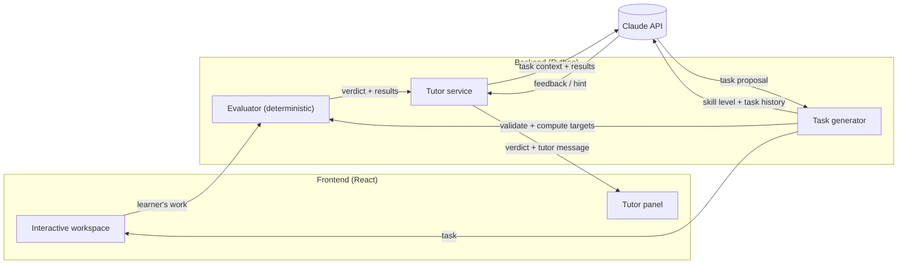

# Design

Major design decisions for the system as a whole. For the product, its workflow and its constraints, see [task.md](task.md). Domain-specific design (circuits, the grid, levels) is in [schematics.md](schematics.md).

## 1. Separate ground truth from tutoring

The system separates deterministic code from Claude, with strictly divided responsibilities:

| Engine | Responsibility | Nature |
|---|---|---|
| Evaluator | Decides what is correct: validates generated tasks, computes target values, grades the learner's work | Deterministic code |
| Task generator (Claude) | Proposes new tasks tailored to the learner | LLM; output validated |
| Tutor (Claude) | Decides how to teach: feedback, hints, assessment of the learner's direction | LLM |

**Why:** LLMs make calculation errors, and a tutor that is confidently wrong does more harm than no tutor. Deterministic evaluation also makes results reproducible and testable.

**Rules:**
- Claude never produces or overrides a verdict or a computed value. It receives the evaluator's output as input and reasons about the *learner*.
- Everything Claude produces is untrusted input. Generated tasks pass the same validator as the learner's work, and the system falls back to curated content when they fail.

## 2. The learner keeps agency

- The learner performs every action in the workspace. The tutor has no ability to modify it.
- Hints are given in response to learner actions or requests, not unprompted solutions.

## 3. System architecture



- **Frontend:** JavaScript + React. It owns the interactive workspace and displays the tutor's messages. It holds no secrets and does no grading.
- **Backend:** Python. It owns the evaluator and all Claude API calls.
- **Task flow:** Claude proposes a task. The evaluator validates it and computes its targets, and the frontend receives the resulting task. Details are in [schematics.md](schematics.md#3-task-flow).
- **Request flow:** the frontend sends the learner's work. The backend runs the evaluator, passes its result together with the task context to Claude, and returns both the verdict and the tutor message.
- **Transport:** REST for static resources (curated levels), and one WebSocket per learning session for the interactive loop: live evaluation on every board edit and validated tutor messages. Details are in [contract.md](contract.md).

## 4. Security and operations

- The Claude API key exists only on the backend, loaded from the environment or the gitignored `backend/keys/apikey.txt`.
- The deployed prototype is public and uses our API key, so the backend enforces the rate limits below. They protect the cost of Claude calls and the server. **Evaluation never depends on Claude**, so when a Claude limit is hit, the grid, the readings and the status keep working. Only the tutor goes quiet, or generation falls back to curated levels.

| Scope | Limit (default) | When exceeded |
|---|---|---|
| Tutor calls per session | 6 per minute (reactions and messages together) | Reactions are skipped silently. A learner message gets `error: rate_limited`, shown as "The tutor needs a moment; try again shortly". |
| Task generations per session | 1 in flight, 10 per hour | The curated level for the skill level is served |
| Board updates per session | 20 per second | Extra updates are dropped; only the latest board is evaluated |
| Grid size | at most 30 × 30 points, 40 components, 300 wire pieces | `error: bad_message`. This also bounds solver and validation time. |
| New sessions per IP | 10 per hour, 3 open at once | The connection is refused |
| REST requests per IP | 60 per minute | `429` |
| Global Claude budget | 5,000 calls per day | Tutor calls return `error: tutor_unavailable`; generation serves curated levels. Evaluation is unaffected. |

- **Implementation.** In-memory token buckets in the single backend process. Running several instances would need a shared store such as Redis; that is noted for scale, not built for the prototype.
- **Configuration.** All limits are settings in `config.yaml` (§5).
- **Usage and cost log.** When `logs.enabled` is on, the backend writes one JSON-lines file per run, `logs/run-<timestamp>.jsonl` (gitignored). It records server start and stop, every Claude call (purpose, model, learner session ID, token usage, estimated cost from the `pricing` table) and a run summary with totals. Each `./start.sh` is one run; code reloads append to the same file.
- **Message size.** No fixed limit yet; the grid size caps already bound it indirectly. Typical message sizes will be observed in practice before a limit is set.

## 5. Configuration

The Claude models, behavior knobs, logging and pricing live in one YAML file, [`config.yaml`](../config.yaml) in the repo root, not in code. That lets us switch models, for example Opus vs. Haiku for reactions, and tune thresholds without code changes. The API key is never in this file; it comes from the environment.

```yaml
logs:
  enabled: true                # usage and cost log per backend run
  dir: logs

pricing:                       # USD per million tokens, for cost estimates
  claude-opus-5-5: { input: 4.00, output: 20.00, cache_read: 0.20, cache_write: 5.00 }

claude:
  tutor_reaction:              # idle-triggered reactions
    model: claude-opus-5-5
    effort: low
    max_tokens: 16000
    timeout_s: 30
  tutor_request:               # learner message / hint
    model: claude-opus-5-5
    effort: medium             # rarer than reactions and matter more
    max_tokens: 16000
    timeout_s: 30
  skill_summary:               # bonus: Learning Path screen
    model: claude-opus-5-5
    effort: low
    max_tokens: 16000
    timeout_s: 30
  task_generation:
    model: claude-opus-5-5
    effort: high
    max_tokens: 16000
    timeout_s: 120
    max_validate_calls: 5        # validate_grid tool calls per attempt
    max_attempts: 2              # failed attempts before giving up and telling the learner

tutor:
  idle_threshold_ms: 1500
  max_snapshots: 10
  history_turns: 6
  offer_hint_after_reactions: 3

task_generation:
  recent_tasks: 10
  grid: { columns: 12, rows: 8 }   # grid size for generated tasks

rate_limits:
  tutor_calls_per_session_per_min: 6
  task_generations_per_session_per_hour: 10
  board_updates_per_session_per_sec: 20
  grid_max_points: 30            # per side
  grid_max_components: 40
  grid_max_wires: 300
  sessions_per_ip_per_hour: 10
  open_sessions_per_ip: 3
  rest_requests_per_ip_per_min: 60
  claude_calls_per_day: 5000

evaluator:
  near_target_ratio: 0.10      # "near_target" when within 10% of every target
  resistor_max_power_w: 5      # above this, a resistor is "overcurrent"
```

The values above are the defaults, as described in [contract.md](contract.md). The backend reads the file at startup, so changes need a restart (`./stop.sh && ./start.sh`).

## 6. Stack

| Layer | Choice | Status |
|---|---|---|
| Backend | Python, FastAPI + uvicorn | Decided |
| Frontend | JavaScript + React, built with Vite | Decided |
| Frontend ↔ backend transport | REST + WebSocket | Decided |
| Workspace rendering | three.js | Decided |
| Hosting | — | Open |

**Why three.js:** every component and wire is its own scene node, so the learner can select, move and edit any of them individually.

## 7. Repository layout

A snapshot of the repository; it is updated as the structure changes. Entries marked *(gitignored)* exist only locally.

```text
schematics-ai-tutor/
├── README.md                  project overview and how to run
├── LICENSE
├── config.yaml                models, knobs, rate limits, logging, pricing (§5)
├── start.sh                   start the backend and frontend in the background
├── stop.sh                    stop it
├── check.sh                   integrity checks: docs, config, layout, secrets, tests
├── test.sh                    backend tests: unit + api, or live (real Claude)
├── .env.example               optional local overrides (copy to .env)
├── .gitignore
├── .github/
│   └── workflows/
│       └── check.yml          runs ./check.sh on every PR and on main
├── scripts/
│   └── check_integrity.py     docs, config, layout and secrets checks used by check.sh
├── docs/
│   ├── task.md                product, concept of operations, constraints
│   ├── design.md              system design (this file)
│   ├── contract.md            frontend ↔ backend and backend ↔ Claude interfaces
│   ├── schematics.md          grid and graph formats, task flow, evaluator, levels
│   ├── tutor.md               tutor behavior, hint ladder, guardrails
│   ├── gui.md                 screens, layout, interaction, learner journey
│   ├── plan.md                build plan with checklist
│   └── images/
│       └── gui-layout.png     GUI layout sketch
├── backend/
│   ├── README.md
│   ├── pyproject.toml         FastAPI service and dependencies
│   ├── app/
│   │   ├── main.py            FastAPI app: REST endpoints, startup and shutdown
│   │   ├── config.py          loads the root config.yaml
│   │   ├── usage_log.py       per-run usage and cost log
│   │   ├── grid.py            grid format validation
│   │   ├── graph.py           grid → graph conversion, nets
│   │   ├── solver.py          DC modified nodal analysis
│   │   ├── evaluate.py        status, readings and issues
│   │   ├── task_spec.py       TaskSpec schema, validation stages, targets, task-grid derivation
│   │   ├── task_generation.py Claude task generation with the validate_grid tool
│   │   ├── tutor.py           tutor call: context, TutorMessage schema, backstop
│   │   ├── session.py         WebSocket learning session
│   │   └── jsonfmt.py         readable JSON formatting
│   ├── data/
│   │   └── examples/          example TaskSpecs for the generation prompt
│   ├── tests/
│   │   ├── conftest.py        examples and a fake Claude client
│   │   ├── unit/              pure logic, offline
│   │   ├── api/               endpoints with a fake Claude
│   │   └── live/              real Claude calls, opt-in (./test.sh live)
│   ├── keys/
│   │   ├── README.md
│   │   └── apikey.txt         Anthropic API key (gitignored)
│   └── .venv/                 Python virtualenv, created by start.sh (gitignored)
├── frontend/
│   ├── README.md
│   ├── package.json           React app; Vite for dev server and build, Vitest for tests
│   ├── package-lock.json
│   ├── vite.config.js         dev server on :5173, proxies /api and /ws to the backend
│   ├── index.html
│   ├── src/
│   │   ├── main.jsx           entry point
│   │   ├── App.jsx            screen switching, session, task fetching
│   │   ├── App.test.jsx
│   │   ├── index.css          layout and styles
│   │   ├── components/
│   │   │   ├── StartScreen.jsx
│   │   │   └── TutorScreen.jsx  learning screen layout (header, task, editor, inventory, chat)
│   │   └── lib/
│   │       ├── api.js         backend calls
│   │       ├── session.js     localStorage session
│   │       ├── tutorSession.js WebSocket session hook (chat, live evaluation)
│   │       └── jsonfmt.js     readable JSON, same rules as the backend formatter
│   ├── node_modules/          npm packages, installed by start.sh (gitignored)
│   └── dist/                  production build output (gitignored)
├── logs/                      usage and cost logs, one per run (gitignored)
└── .run/                      PID files and server output from start.sh (gitignored)
```

### Conventions

- **Readable JSON.** JSON files in the repo, and JSON embedded in Claude prompts, are human-readable: indented, short arrays and objects on one line (`[5, 3]`), and arrays longer than 6 elements wrapped 6 per line. `backend/app/jsonfmt.py` implements it, and `./check.sh` enforces it for tracked `.json` files. Exceptions: JSONL logs (one event per line) and files written by tools in their own format (`package.json`, `package-lock.json`).

## Open decisions

- Hosting and deployment
