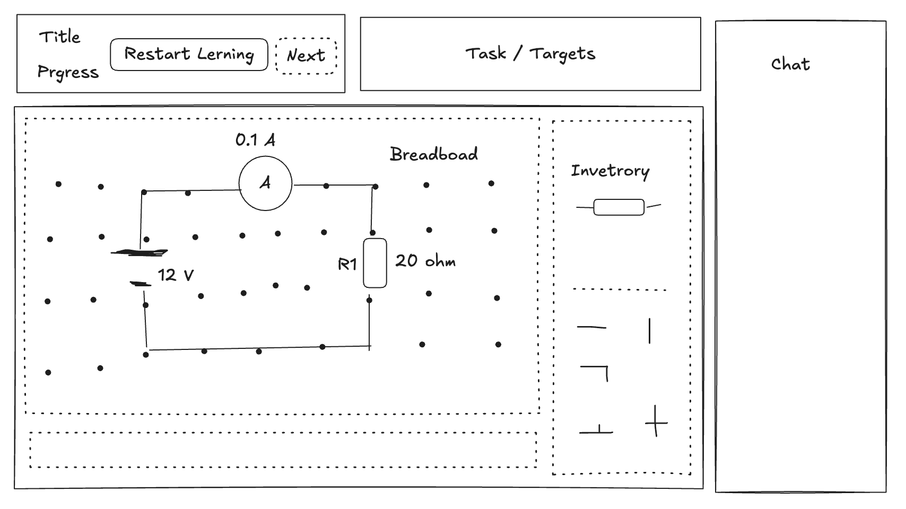
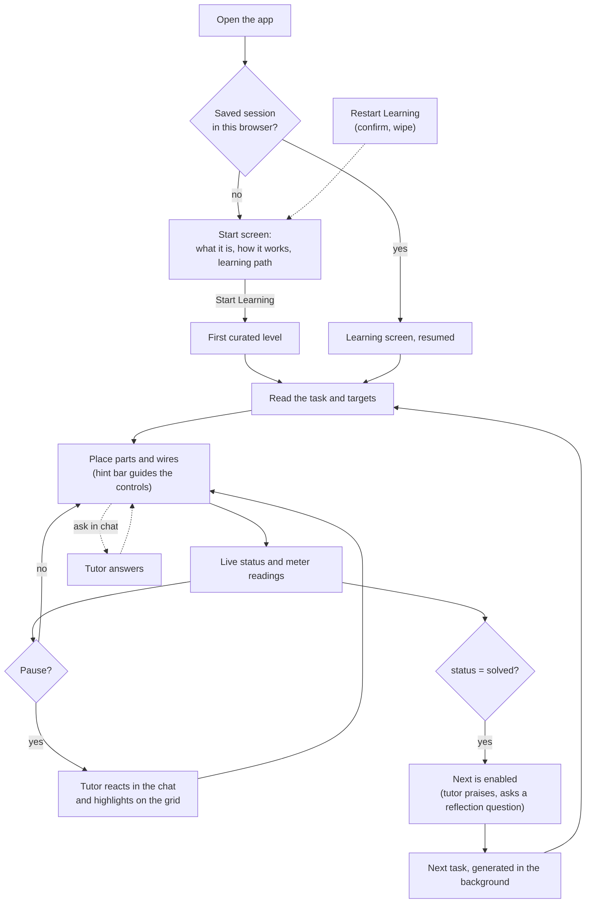

# GUI

The learner-facing interface and the learner's concept of operations. Data and messages are in [contract.md](contract.md); the tutor's behavior is in [tutor.md](tutor.md).

## 1. Screens and session

The app has three screens: the **start screen**, the **learning screen** (the tutor) and, as a bonus, the **Learning Path** screen (§9), reached from the header.

| Learner | Lands on |
|---|---|
| New: no saved session in this browser | Start screen. **Start Learning** opens the first curated level on the learning screen. |
| Returning, or after a page reload | The learning screen directly, resumed exactly where they left off. Showing the start screen would feel like lost progress. |
| After **Restart Learning** | Everything is wiped, then the start screen |

### Start screen

One static screen, with no sign-up and no backend call:

1. **What it is:** "Learn electronics by building real circuits, experimenting with components, and discovering how electricity works — with an AI tutor guiding you along the way."
2. **Your Learning Path:** 8 steps in one column of pills, each with a one-line note on what the learner discovers: Closed Loop, Measuring Voltage, Measuring Current, Ohm's Law, Series Circuits, Parallel Circuits, Power and Safety, Troubleshooting. The first step has a lightning icon (where the learner starts); the rest have a lock icon. Tasks adapt to the learner, so it is shown as a typical path, not a fixed sequence.
3. **One large, centered Start Learning button.**

Everything sits in one light card with rounded corners. Below the card, at the bottom left, an italic note reads "Tasks adapt to you, so your path may differ."

It also sets expectations about agency up front: the tutor asks rather than tells. That prevents "why won't it just tell me?" frustration, and it gives reviewers opening the URL cold the context in seconds.

### Session persistence

A reload or a closed tab must not lose anything. The browser saves the learner's session in `localStorage` after every change:

- `Progress`: skill level and task history
- the current `Level`
- the current grid
- the chat history

On load, if a saved session exists, the app opens the learning screen and sends it with `session.start` ([contract.md](contract.md#websocket-session)), and the backend resumes from it. The server-side reference solution is lost if the reconnect lands on a different server instance. Grading is unaffected, and the tutor works without the reference.

### Restart Learning

The **Restart Learning** button in the header:

1. asks for confirmation **in place**, with no browser popup: the header's Restart Learning and Next buttons are replaced by "Your progress will be lost." with a **Cancel** button and a red **Confirm** button below it (Esc also cancels)
2. on Confirm, clears the saved session from `localStorage` and closes the WebSocket session
3. shows the start screen

## 2. Learning screen layout

The sketch shows placement only; its values are placeholders.

| Region | Contents | Source of data |
|---|---|---|
| **Header** (top left) | Title, the current **skill level** (e.g. "Level 4"), tasks solved, **Restart Learning**, **Next**, and the **Learning Path** button (bonus) | `Progress` from `task.ready` |
| **Task / Targets** | The task text (`intro`), and each target with its live reading next to it, e.g. `AM1: 0.150 A → 0.200 A` | `Level` and the latest `evaluation` |
| **Grid** | The point grid with components as schematic symbols, wires, labels and live meter readings | The learner's edits, the latest `evaluation`, tutor highlights |
| **Hint bar** (under the grid) | One line of interaction help, depending on what the learner is doing | Generated by the frontend only (§5) |
| **Inventory** (right of the grid) | Top: parts available to place. Bottom: the wire palette. | `Level.board.inventory`, plus a fixed palette |
| **Chat** (right column, full height) | Tutor messages, a "tutor is thinking" indicator, and the learner's input box | `tutor.started`, `tutor.message`, `tutor.request` |

## 3. Header

- **Progress** shows the current skill level as a badge and the number of tasks solved.
- **Next** is disabled until the status is `solved`. Clicking it sends `task.next`; the skill level goes up by one and the next task appears.
- **Restart Learning** wipes all progress and history and returns to the start screen (§1).

## 4. Grid

Rendered with three.js in an orthographic, top-down view. Every grid point, component and wire piece is its own scene object, carrying its `id` (or point) for raycast picking.

**Symbols.** Components are drawn as flat schematic symbols, each labeled with its `id` and value:

| Component | Symbol | Label |
|---|---|---|
| `voltage_source` | Battery symbol (long and short plates); `positive` side marked | `V1 12 V` |
| `resistor` | Rectangle with its 4 color bands | `R1 20 Ω`, always shown |
| `ammeter` | Circle with **A** | Live reading above it, e.g. `0.200 A` |
| `voltmeter` | Circle with **V** | Live reading above it, e.g. `4.00 V` |

- **Resistor color bands.** Every resistor, on the grid and in the inventory, shows the standard 4-band color code for its value. The value label is always shown next to it, so the learner absorbs the code just by seeing both. There is no legend.

  | Band | Meaning |
  |---|---|
  | 1, 2 | Digits: black 0, brown 1, red 2, orange 3, yellow 4, green 5, blue 6, violet 7, grey 8, white 9 |
  | 3 | Multiplier: ×10ⁿ with the same colors (black ×1 … blue ×1M), gold ×0.1, silver ×0.01 |
  | 4 | Tolerance: always gold (±5%) |

  Examples: 20 Ω = red, black, black, gold; 60 Ω = blue, black, black, gold; 120 Ω = brown, red, brown, gold.
- **Solved.** When the status becomes `solved`, a big green checkmark appears over the grid and **Next** is enabled. The checkmark is a non-blocking overlay: semi-transparent and centered, and it ignores clicks, so the learner can still observe the readings and read the tutor's praise in the chat. Refinements are in polishing: fading out, and reacting when the solution is broken again.
- Meters show `--` when the reading is `null`.
- `fixed` parts show a small lock and cannot be moved.

**Selection and highlights**

- **Selection** is a state. The selected element is **editable**: it can be dragged, rotated and deleted. Only one element is selected at a time.
- **A highlight** is visual only: an outline (silhouette line) around the element's shape. Selection shows a highlight, but a highlight does not make an element selected or editable.
- **Highlight colors:**

| Highlight | Color | Meaning |
|---|---|---|
| Selection | Blue outline | The learner selected this element; it is editable |
| Drop target, valid | Blue, on the grid points nearest the element's pins | Where the element will connect if dropped |
| Drop target, invalid | Red, on those points | The spot is taken or off the grid; dropping snaps back |
| Tutor `attention` | Amber, pulsing outline | Claude draws attention here |
| Tutor `error` | Red outline | Claude points at a problem |
| Tutor `success` | Green outline | Claude points at what was done right |
| Net hover | Light grey, on points and pins | Everything electrically connected to the hovered point |

A tutor highlight lasts until the next tutor message, or until the learner edits the highlighted element.

**Interaction**

| Action | Behavior |
|---|---|
| Mouse down on an element | Selects it (blue outline). The same press can turn straight into a drag, with no separate click needed. |
| Drag from the inventory, the wire palette, or the grid | The grid points nearest the element's pins are highlighted, showing where it will connect |
| **R** while dragging | Rotates the element; the pin highlights follow the new orientation |
| **R** while selected | Rotates the element in place |
| Release on a valid spot | Drops the element onto the highlighted points. A new wire piece gets the next wire ID. |
| Release on an invalid spot | The element snaps back to where it came from: the inventory, the palette, or its previous position |
| **Esc** while dragging | Cancels the drag; the element snaps back |
| **Del** on the selection | A part goes back to the inventory; a wire piece is deleted |
| Click empty grid, or **Esc** | Deselects |
| Hover a point | Highlights every point and pin in the same net |

- **Fixed parts** can be selected, so they show the outline and the hint bar explains them, but they can't be dragged, rotated or deleted.
- **Sending edits.** Each finished edit (drop, rotate, delete) sends one `board.update`. Dragging stays local until the drop.

## 5. Hint bar

The frontend generates the hint text from the current UI state. Claude and the backend are not involved.

| UI state | Hint |
|---|---|
| Nothing selected | "Click or drag an element on the grid, or drag one from the inventory" |
| Part or wire selected | "Drag to move · R to rotate · Del to remove · Esc to deselect" |
| Fixed part selected | "This part is fixed and can't be moved" |
| Dragging a part | "Drop onto the highlighted points to connect · R to rotate · Esc to cancel" |
| Dragging a wire piece | "Drop onto the highlighted points · R to rotate · Esc to cancel" |
| Dragging over an invalid spot | "Can't place here: the spot is taken or off the grid" |

## 6. Inventory

| Section | Items | Behavior |
|---|---|---|
| Parts | The level's `inventory`: resistors, meters, sources | **Depleting.** A placed part leaves the inventory, and a removed part returns. |
| Wire palette | Straight horizontal, straight vertical, corner, T, + | **Never depletes.** Corner, T and + rotate with **R**. |

## 7. Chat

- The chat shows tutor messages, styled by `chat.kind`: nudge, praise, feedback and so on.
- While a call is running, it shows "tutor is thinking".
- The learner can type at any time. Sending creates a `tutor.request` with `action: "message"`.
- There is no separate Check button. The status updates live, and the tutor reacts when the learner pauses.

## 8. Concept of operations: the learner's journey

1. **First visit.** The start screen explains what the tutor offers and the typical learning path. **Start Learning** opens the first curated level, so there's no waiting.
2. **Read.** The task panel states the goal in plain words, and each target shows its live reading.
3. **Build.** The learner drags parts and wires onto the grid, and the hint bar explains the controls as they go.
4. **Observe.** After each finished edit the status and meter readings update immediately, so cause and effect are visible.
5. **Get feedback.** When the learner pauses, the tutor reacts: a nudge after a misstep and encouragement after progress, with highlights pointing at the spot. The learner can also ask questions in the chat at any time.
6. **Solve.** When every target is met, Next is enabled, and the tutor praises the strategy and asks one optional reflection question.
7. **Advance.** Next increases the skill level and loads the next task, which was generated in the background and suits the learner's history.
8. **Return.** The session is saved in the browser. A reload or a later visit resumes exactly where the learner left off.
9. **Restart.** Restart Learning wipes everything after confirmation and returns to the start screen.

## 9. Learning Path screen (bonus)

A bonus feature, built after everything else ([plan.md](plan.md#7-bonus)). It gives the learner a view of their own progress: what they're good at, what needs work, and what they've built.

**Skill summary from Claude**
- Requested on demand when the screen opens, through one Claude call ([contract.md](contract.md#23-skill-summary-call-bonus)).
- Three parts:
  - **Strengths:** what is going well
  - **Needs attention:** e.g. a misconception that keeps coming back
  - **Trends:** e.g. "solving faster, with fewer hints since level 3"
- Cached until the next task is solved, so reopening the screen is free.
- Same rules as the tutor: it talks about understanding and physics, and invents no numbers beyond the history.

**Solved tasks**
- A list of solved tasks, each with title, concept, difficulty and hints used.
- Clicking one shows its final grid in the normal grid view with editing turned off. Nothing can be selected or moved.

**Navigation:** a **Learning Path** button in the header opens the screen, and a **Back to tutor** button returns to the learning screen unchanged.

## 10. Visual style

**Neutral chrome, color for meaning.** Panels are white with thin grey borders on an off-white page, so color is reserved for what it means: tutor highlights, selection, status and readings. The grid's work area is a faint paper tint with a subtle dot lattice, like a workbench.

| Role | Color | Used for |
|---|---|---|
| Page / panels | `#f6f7f9` / `#ffffff`, borders `#d0d7de` | Layout |
| Canvas | `#fbfaf6` with `#d8d4c8` dots | The grid's work area |
| Accent | `#0969da`, tint `#eef4fc` | Primary actions (Start, Next), the level badge, selection, tutor chat bubbles |
| Success | `#1a7f37`, border `#4ac26b`, tint `#eaf7ee` | Solved, tutor `success`, the current learning-path step, and the background of the top boxes (header, task) |
| Attention | `#bf8700`, tint `#fff8e1` | Tutor `attention` |
| Error | `#cf222e`, tint `#ffebe9` | Tutor `error`, invalid drops, errors |
| Locked / disabled | `#8c959f` | Locked path steps, disabled controls |

- **One accent** marks actions, so the next step always looks like the next step.
- **Never color alone.** Meaning colors are paired with a shape or motion (pulse, icon, outline), so red/green colorblind learners lose nothing.
- **Contrast:** text meets WCAG AA; muted grey is only for secondary text.
- The colors are CSS variables in `frontend/src/index.css`, so the scheme can be tuned in one place.

## 11. Open points

- Where the overall status is shown, e.g. a badge in the Task / Targets panel or on the hint bar. The sketch has no dedicated place for it.
