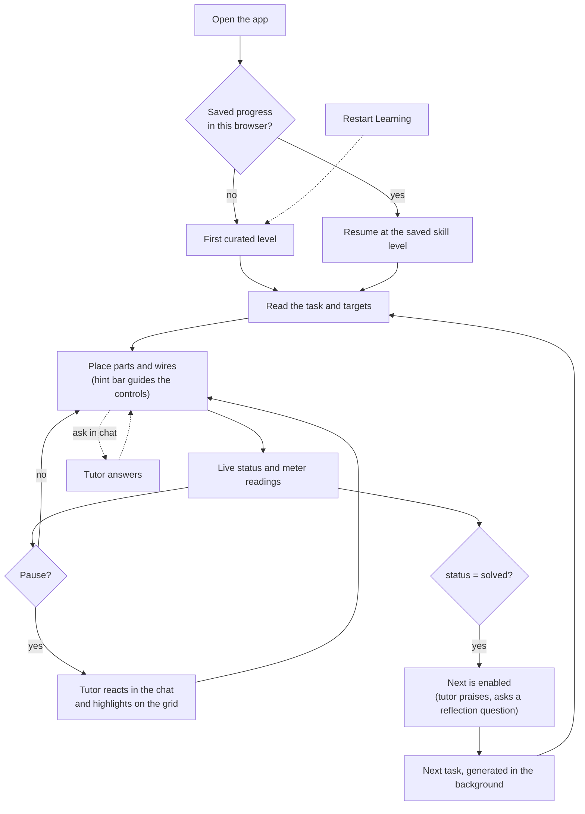

# GUI

The learner-facing interface and the learner's concept of operations. Data and messages are in [contract.md](contract.md); the tutor's behavior is in [tutor.md](tutor.md).

## 1. Layout

The sketch shows placement only; its values are placeholders.

| Region | Contents | Source of data |
|---|---|---|
| **Header** | Title, progress (skill level and tasks solved), **Restart Learning**, **Next** | `Progress` from `task.ready` |
| **Task / Targets** | The task text (`intro`), and each target with its live reading next to it, e.g. `AM1: 0.150 A → 0.200 A` | `Level` and the latest `evaluation` |
| **Grid** | The point grid with components as schematic symbols, wires, labels and live meter readings | The learner's edits, the latest `evaluation`, tutor highlights |
| **Hint bar** (under the grid) | One line of interaction help, depending on what the learner is doing | Generated by the frontend only (§4) |
| **Inventory** (right of the grid) | Top: parts available to place. Bottom: the wire palette. | `Level.board.inventory`, plus a fixed palette |
| **Chat** (right column) | Tutor messages, a "tutor is thinking" indicator, and the learner's input box | `tutor.started`, `tutor.message`, `tutor.request` |

## 2. Header

- **Progress** shows the skill level and the number of tasks solved.
- **Next** is disabled until the status is `solved`. Clicking it sends `task.next`; the skill level goes up by one and the next task appears.
- **Restart Learning** resets all progress, back to skill level 1 with an empty history, and loads the first curated level. It asks for confirmation first.

## 3. Grid

Rendered with three.js in an orthographic, top-down view. Every grid point, component and wire piece is its own scene object, carrying its `id` (or point) for raycast picking.

**Symbols.** Components are drawn as flat schematic symbols, each labeled with its `id` and value:

| Component | Symbol | Label |
|---|---|---|
| `voltage_source` | Battery symbol (long and short plates); `positive` side marked | `V1 12 V` |
| `resistor` | Rectangle | `R1 20 Ω` |
| `ammeter` | Circle with **A** | Live reading above it, e.g. `0.200 A` |
| `voltmeter` | Circle with **V** | Live reading above it, e.g. `4.00 V` |

- Meters show `--` when the reading is `null`.
- `fixed` parts show a small lock and cannot be moved.

**Interaction**

| Action | How |
|---|---|
| Place a part | Drag it from the inventory. While dragging, the pins it would snap to are highlighted. Drop to place it. |
| Rotate | Press **R** while dragging or while a part or wire piece is selected |
| Place a wire piece | Drag it from the wire palette and drop it onto a point. Each placement gets the next wire ID. |
| Select | Click a part or wire piece |
| Remove | Select it and press **Delete**. A part goes back to the inventory; a wire piece just disappears. |
| See connections | Hover a point to highlight every point and pin in the same net |

- **Sending edits.** Each finished edit (drop, rotate, remove) sends `board.update`. Dragging stays local until the drop.
- **Tutor highlights.** Components, wires and points in `meta.highlights` are drawn with their style:
  - `attention` pulses
  - `error` is a red outline
  - `success` is a green outline

  A highlight lasts until the next tutor message, or until the learner edits the highlighted element.

## 4. Hint bar

The frontend generates the hint text from the current UI state. Claude and the backend are not involved.

| UI state | Hint |
|---|---|
| Nothing selected | "Click an element to select it, or drag one from the inventory" |
| Part or wire selected | "Press R to rotate · Delete to remove" |
| Fixed part selected | "This part is fixed and can't be moved" |
| Dragging a part | "Drop onto the highlighted pins to connect · Press R to change orientation" |
| Dragging a wire piece | "Drop onto a point · Press R to rotate" |
| Drop not possible here | "Can't place here: the spot is taken or off the grid" |

## 5. Inventory

| Section | Items | Behavior |
|---|---|---|
| Parts | The level's `inventory`: resistors, meters, sources | **Depleting.** A placed part leaves the inventory, and a removed part returns. |
| Wire palette | Straight horizontal, straight vertical, corner, T, + | **Never depletes.** Corner, T and + rotate with **R**. |

## 6. Chat

- The chat shows tutor messages, styled by `chat.kind`: nudge, praise, feedback and so on.
- While a call is running, it shows "tutor is thinking".
- The learner can type at any time. Sending creates a `tutor.request` with `action: "message"`.
- There is no separate Check button. The status updates live, and the tutor reacts when the learner pauses.

## 7. Concept of operations: the learner's journey

1. **First visit.** The learner starts at skill level 1 with the first curated level, so there's no waiting.
2. **Read.** The task panel states the goal in plain words, and each target shows its live reading.
3. **Build.** The learner drags parts and wires onto the grid, and the hint bar explains the controls as they go.
4. **Observe.** After each finished edit the status and meter readings update immediately, so cause and effect are visible.
5. **Get feedback.** When the learner pauses, the tutor reacts: a nudge after a misstep and encouragement after progress, with highlights pointing at the spot. The learner can also ask questions in the chat at any time.
6. **Solve.** When every target is met, Next is enabled, and the tutor praises the strategy and asks one optional reflection question.
7. **Advance.** Next increases the skill level and loads the next task, which was generated in the background and suits the learner's history.
8. **Return.** Progress is saved in the browser, so a returning learner resumes at their skill level. Restart Learning starts over.

## 8. Open points

- Where the overall status is shown, e.g. a badge in the Task / Targets panel or on the hint bar. The sketch has no dedicated place for it.
