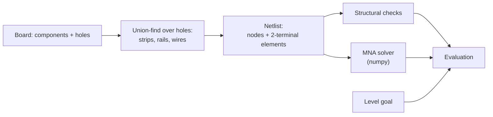

# Schematics

The domain-specific design: the breadboard, the components, how a board becomes a circuit, how the evaluator solves it, and the levels. Everything here is specific to electronics. The domain-independent architecture is in [design.md](design.md), and the data shapes are in [contract.md](contract.md).

## 1. Breadboard

A half-size breadboard with 30 columns.

| Area | Holes | Hole IDs | Internally connected |
|---|---|---|---|
| Upper terminal strips | rows `a`–`e` × columns 1–30 | `a1` … `e30` | The 5 holes `a`–`e` in one column form one strip |
| Lower terminal strips | rows `f`–`j` × columns 1–30 | `f1` … `j30` | The 5 holes `f`–`j` in one column form one strip |
| Center trench | — | — | Separates the upper and lower strips; nothing connects across it |
| Top rails | `+` and `−` × columns 1–30 | `top+:1` … `top-:30` | Each rail is one continuous node |
| Bottom rails | `+` and `−` × columns 1–30 | `bot+:1` … `bot-:30` | Each rail is one continuous node |

- **Rails are continuous.** Some real breadboards split the rails in the middle; that can come later as an advanced level.
- **Top and bottom rails are not connected to each other.** The learner must wire them, a classic beginner mistake.
- **One lead per hole.** The editor enforces this, and the backend rejects boards that break it.

## 2. Components

Every component has exactly two pins.

| Type | Value | Pins | Electrical model |
|---|---|---|---|
| `battery` | Volts (default 9 V) | `pins[0]` = `+`, `pins[1]` = `−` | Ideal voltage source, no internal resistance |
| `resistor` | Ohms, from the set 100, 220, 330, 470, 1k, 2.2k, 4.7k, 10k | Unpolarized | Ideal resistor |
| `wire` | — | Unpolarized | Ideal 0 Ω connection; merges two nodes |
| `voltmeter` | — | `pins[0]` = red probe, `pins[1]` = black probe | Ideal: infinite input resistance, so it doesn't affect the circuit. Reads V(red) − V(black). |

- The resistor values come from the standard E12 series, so learners meet real-world parts.
- Leads may span any two distinct holes. Unlike a real resistor, there is no minimum lead length.

## 3. From board to circuit

1. **Nodes.** A union-find over all holes:
   - Each strip's 5 holes are merged into one set.
   - All 30 holes of each rail are merged into one set.
   - Each `wire` merges the sets of its two holes.

   The resulting sets are the circuit's nodes.
2. **Elements.** Every non-wire component becomes an element between the nodes of its two pins.
3. **Ground.** The node of the battery's `−` pin is the reference, at 0 V.

## 4. Solver

A DC **modified nodal analysis (MNA)** over the netlist, solved with `numpy.linalg.solve`. Nothing beyond DC is in scope.

- Resistors contribute conductance terms. The battery contributes a voltage-source row, and its branch current is the circuit's total current.
- Voltmeters contribute nothing (infinite resistance) and are read after the solve.
- **Floating nodes**, connected to nothing that leads to the source, would make the matrix singular. A tiny conductance to ground (gmin = 1e‑12 S) keeps it solvable; those nodes then read 0 V and carry no current.
- Results per element: the voltage across it and the current through it, rounded for display to 3 significant figures.
- **Goal check:** `|actual − target| ≤ tolerance`.

## 5. Structural checks

These run before and alongside the solve, and fill `Evaluation.issues`.

| Code | Detection | Effect on `valid` |
|---|---|---|
| `no_source` | No battery on the board | `false` |
| `short_circuit` | The battery's `+` and `−` pins end up in the same node | `false` (the solve is skipped) |
| `same_strip` | A non-wire component has both pins in the same strip or rail, so it is bypassed | `true` (it reads 0 V and 0 A) |
| `floating_component` | A component pin's node connects to nothing else | `true` |
| `open_circuit` | The battery current is ~0 (below 1 µA) although a source exists | `true` |

## 6. Rendering and interaction (three.js)

- **Scene graph:** every hole, component and wire is its own scene object, carrying the component `id` for raycast picking.
- **Placing a part:** drag from the palette, then click two holes. Each pin snaps to the nearest free hole.
- **Wires:** click hole A, then hole B. The wire is drawn as a curved lead.
- **Colors:**
  - `+` rails are red and `−` rails are blue.
  - Resistors show real color bands, so the learner absorbs the color code.
  - Each voltmeter's live reading is shown above it, from the latest `evaluation`.
- **Highlights:** the components and holes in a `TutorMessage.focus` are outlined. Hovering a hole highlights its whole strip, which makes the hidden connections visible.

## 7. Levels (draft)

Each level teaches one concept and targets known beginner misconceptions. The tutor receives the concept and the misconception list for the current level.

| # | Title | Setup | Goal | Concept | Misconceptions to watch for |
|---|---|---|---|---|---|
| 1 | Close the loop | Battery on the rails, one resistor and a voltmeter across it; one wire missing | 9 V across R1 | A current needs a closed loop | "A single wire from the battery is enough"; "current flows out of + and is used up" |
| 2 | Hidden connections | Resistor placed with both leads in one strip | 9 V across R1 | Breadboard strips and rails | "Any two holes in a row are separate"; "the top and bottom rails are connected" |
| 3 | Ohm's law | Battery and an empty slot; choose a resistor | 4 mA ± 0.5 mA through R1 (9 V / 2.2k ≈ 4.1 mA) | V = I·R | "A bigger resistor means more current" |
| 4 | Voltage divider | Two resistors in series | 3 V ± 0.2 V across R2 | Series resistors share the voltage | "Each resistor gets the full battery voltage" |
| 5 | Measure it right | A working divider with no meter | Place a voltmeter that reads the voltage across R1 | Voltmeters go in parallel, across a part | "A meter goes in series like a wire" |
| 6 | Parallel paths | Battery and a resistor; add a second resistor in parallel | Total current doubles | Parallel branches each get the full voltage | "Adding a resistor always reduces current" |

## Open points

- Current goals (levels 3 and 6) read `Measurement.current` directly. The alternative is to add an `ammeter` component, which would teach series measurement and the "ammeter in parallel is a short" mistake, at the cost of one more part.
- The level order and exact values are to be validated by playtesting.
