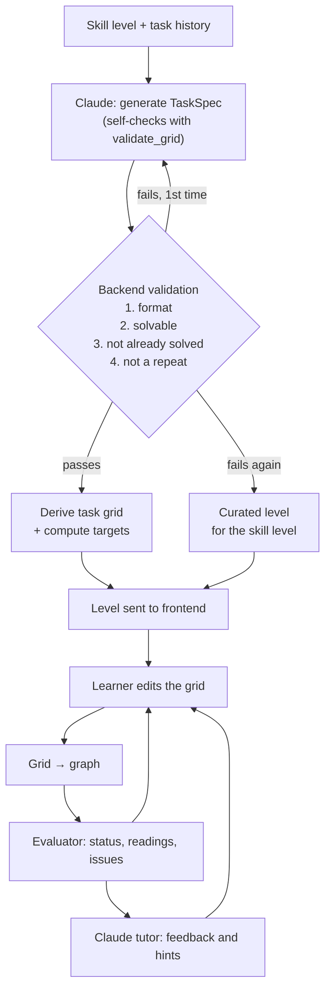
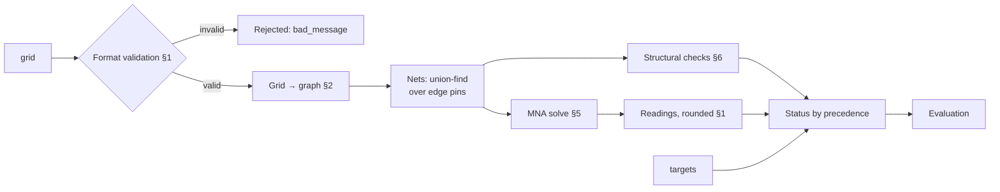

# Schematics

The domain-specific design: the grid and graph formats, the task flow, the evaluation pipeline, the solver, the structural checks, rendering, and the curated levels. Everything here is specific to electronics. The domain-independent architecture is in [design.md](design.md), and the data shapes are in [contract.md](contract.md).

## 1. Board format: the `grid` document

A board is one JSON document. The same shape describes a level's starting board and the learner's current board.

```json
{
  "grid": { "columns": 12, "rows": 8 },
  "components": [
    { "id": "V1", "type": "voltage_source", "value": 12, "fixed": true,
      "orientation": "N", "pins": { "positive": [1, 3], "negative": [1, 5] } },
    { "id": "R1", "type": "resistor", "value": 20, "fixed": false,
      "orientation": "W", "pins": { "a": [4, 1], "b": [6, 1] } }
  ],
  "inventory": [ { "id": "R3", "type": "resistor", "value": 50 } ],
  "wires": [
    { "id": "W1", "segments": [[[3, 1], [4, 1]]] },
    { "id": "W2", "segments": [[[1, 3], [1, 2]], [[1, 2], [1, 1]]] },
    { "id": "W3", "segments": [[[8, 2], [8, 3]], [[8, 3], [9, 3]], [[7, 3], [8, 3]]] }
  ],
  "targets": {
    "VM1": { "value": 4.0, "tolerance": 0.1 },
    "AM1": { "value": 0.2 }
  }
}
```

The example is abbreviated. A real document must also list `VM1` and `AM1` in `components` or `inventory`, as the validation rules below require.

### Coordinates

- A point is `[col, row]`, the same order as x and y in three.js.
- Points are 1-based: `col` runs from 1 to `grid.columns`, and `row` from 1 to `grid.rows`.
- Row 1 is the top row.

### Sections

| Key | Type | Meaning |
|---|---|---|
| `grid` | `{ columns, rows }` | Size of the pin grid |
| `components` | `Component[]` | Parts placed on the grid |
| `inventory` | `InventoryItem[]` | Parts available to the learner but not placed yet. Placing one moves it into `components` with the same `id`; removing a non-fixed part moves it back. |
| `wires` | `Wire[]` | Wire pieces on the grid |
| `targets` | `{ [meterId]: { value, tolerance? } }` | The level goal: the reading each named meter must show, in V for a voltmeter or A for an ammeter. See [Targets and readings](#targets-and-readings). |

### Components

| Field | Type | Meaning |
|---|---|---|
| `id` | string | Unique across `components` and `inventory` |
| `type` | `"voltage_source"`, `"resistor"`, `"voltmeter"` or `"ammeter"` | Kind of part |
| `value` | number | Volts for `voltage_source`, ohms for `resistor`; not used for meters |
| `fixed` | boolean | `true` means the learner cannot move or remove the part |
| `orientation` | `"N"`, `"E"`, `"S"` or `"W"` | The direction the first pin points, seen from the part's body |
| `pins` | object | Named pin positions, see below |

Pin names by type. The first pin listed is the one `orientation` points to.

| Type | Pins |
|---|---|
| `voltage_source` | `positive`, `negative` |
| `resistor` | `a`, `b` |
| `voltmeter` | `positive`, `negative` |
| `ammeter` | `positive`, `negative` |

**Geometry.** A part spans three points in a straight line, with its pins 2 apart and its body on the middle point. In the example, V1 points `N`, so `positive` [1, 3] lies directly above `negative` [1, 5], with the body at [1, 4].

### Wires

- A wire piece is an object with an `id` and a list of `segments`.
- **Wire IDs.** A wire gets a unique ID (`W1`, `W2`, …) when it is placed on the grid. The editor assigns the next number after the highest existing wire number. A new wire therefore never collides with an existing one, and existing IDs never change when other wires are added or removed.
- A segment is a pair of points `[[c1, r1], [c2, r2]]` that are orthogonal neighbors (a distance of exactly 1 apart).
- The segments of one piece must form one of four shapes:

| Shape | Segments | Rule |
|---|---|---|
| Straight | 1 | — |
| Corner | 2 | The two segments are perpendicular and share one point |
| T-junction | 3 | All three segments share one center point |
| +-junction | 4 | All four segments share one center point |

The shape is derived from the segments, so the format stores no explicit `type` field.

### Meters

Voltmeters and ammeters can appear in both `components` and `inventory`, depending on the level.

- **On the board:** pre-placed meters, usually `fixed`, are the ones the level's `targets` refer to. The learner must make them read the target values.
- **In inventory:** free meters for exploration. The learner can place them anywhere to probe voltages and currents and test their own understanding. They need no target, but their readings are shown live.

### Targets and readings

**Display resolution.** Each meter reads with a fixed resolution, like a real multimeter:

| Meter | Resolution |
|---|---|
| Voltmeter | 0.01 V |
| Ammeter | 0.1 mA (0.0001 A) |

**Rounding.** The evaluator rounds every reading to its meter's resolution before reporting it. A tiny solver residue such as 3.2e‑13 A therefore reads exactly `0`, and `-0` is normalized to `0`. The learner never sees meaningless near-zero numbers.

**Tolerance.** A target is met when `|reading − value| ≤ tolerance`.
- `tolerance` is absolute, in the meter's unit, and optional.
- If it's omitted, the default is `max(2% × |value|, resolution)`. Using the resolution as a floor keeps a target of `0` reachable.

### Connectivity

- Points conduct only through wire segments. There are no hidden internal connections.
- A component pin connects to whatever wires touch its point.
- Wire pieces connect to each other wherever their endpoints share a point.

### Format validation

The backend rejects a document that breaks any of these rules, before any electrical evaluation:

- Every point is inside the grid.
- `id`s are unique across components, inventory and wires, and every `targets` key names a meter in `components` or `inventory`.
- Pins match the type's pin names, lie 2 apart in a straight line, and agree with `orientation`.
- Every wire segment joins orthogonal neighbors, and every wire piece has one of the four shapes.
- No two components share a point: neither pins nor bodies may overlap. Components connect only through wires.

### Notes

- **Redundant pins:** pin positions are fully determined by the body point and `orientation`. Both are kept for now, and validation checks that they agree. This is to be revisited in an optimization step.

## 2. Graph format: the `graph` document

The graph is a distilled version of a grid. It drops all placement information (coordinates, orientation, wire shapes, `fixed`) and keeps only connectivity. The evaluator and Claude work on the graph; only the frontend works on the grid.

```json
{
  "components": [
    { "id": "V1", "type": "voltage_source", "value": 12, "pins": ["positive", "negative"] },
    { "id": "AM1", "type": "ammeter", "pins": ["positive", "negative"] },
    { "id": "R1", "type": "resistor", "value": 20, "pins": ["a", "b"] }
  ],
  "inventory": [ { "id": "R3", "type": "resistor", "value": 50 } ],
  "edges": [ ["V1.positive", "AM1.positive"], ["AM1.negative", "R1.a"] ],
  "targets": { "AM1": { "value": 0.2 } }
}
```

### Sections

| Key | Meaning |
|---|---|
| `components` | The graph's nodes: every placed component, with `id`, `type`, `value` and its pin names |
| `inventory` | Copied from the grid: the parts not yet placed |
| `edges` | Connections, each a pair of pins joined by wires |
| `targets` | Copied from the grid, in the same format |

A **pin reference** is the string `"<componentId>.<pinName>"`, for example `"R1.a"` or `"V1.positive"`.

The order of edges, and of the two pins within an edge, carries no meaning. Any sorting or normalization, for example to compare the learner's graph with the reference, happens inside the backend and is not part of the format.

### Grid → graph conversion

1. **Union-find over points.** Every wire segment merges its two points. The resulting sets are the electrically connected regions of the grid.
2. **Pins to groups.** Each component pin joins the set that contains its point. Sets with fewer than two pins are dropped.
3. **Emit edges:** for each group of connected pins, emit pin-pair edges that link every pin in the group. Two pins give one edge; three pins, as at a T-junction, give two edges.
4. **Pin location map.** The backend also keeps a map from each pin reference to its grid point. It is not part of the graph. It translates graph-level findings, such as an issue on `"AM1.negative"`, back to grid points so three.js can highlight them.

### Checks on the graph

The structural checks read connection patterns from the graph and its nets, for example a source whose two pins are connected. They are defined in §6.

## 3. Task flow

There are two data objects:

- **Grid:** the `grid` document from §1. It is what the learner sees and edits.
- **Graph:** the `graph` document from §2, the netlist (ratsnest) derived from a grid. The evaluator works only on the graph, never on the grid directly.



### Progression

- **Skill level.** The backend keeps the learner's skill level, an integer starting at 1, and adds 1 each time a task is solved. Nothing else changes it.
- **Claude chooses the task.** It receives the skill level and the task history, and picks the next task's concept and complexity itself. The aim is to build on what the learner has done and avoid repeating it.
- **Curated levels.** These hand-made levels are the very first task and the fallback when generation fails. Each is tagged with the skill level it suits.

### Generation: Claude proposes, the backend decides

Claude returns a `TaskSpec` ([contract.md](contract.md#22-task-generation-call)) with:

- a **complete board:** the solved circuit
- **removed IDs:** the parts the learner must place
- **decoys:** extra parts that aren't needed
- **target meter IDs:** the meters whose readings define the goal
- **difficulty** (1–5) and a one-sentence **rationale** for why the task suits this learner

Claude does **not** produce the task grid or any target value. The backend derives both:

1. **Task grid** = the complete board with `removed_ids` taken out.
2. **Inventory** = the removed parts plus the decoys, shuffled.
3. **Targets** = the readings of `target_meter_ids` from solving the complete board, rounded to meter resolution. Each tolerance is the default from §1.

### Validation stages

Every generated task passes the same validator that checks learner boards. All of Claude's output is treated as untrusted input.

| Stage | Checks |
|---|---|
| 1. Format | The §1 format rules hold for the complete board, and `removed_ids`, `decoys` and `target_meter_ids` refer to valid, unique IDs |
| 2. Solvable | Evaluated without targets, the complete board's graph has a source, no short circuit, a successful solve and **no issues at all** (no open loop, floating, bypassed or overloaded part, no meter misuse). Every target meter sits in the working circuit and reads a non-zero value. |
| 3. Not already solved | The task grid does **not** meet the targets. Removed parts are not `fixed`, and target meters are not removed. |
| 4. Not a repeat | The complete board's graph differs from the graphs of the learner's recent tasks: different component types and values, or different connections. |

### Grading

- A task is solved when every target reading is within tolerance on the learner's grid. **It is graded on readings only.**
- Any layout that meets the targets passes, even if it differs from the complete board.
- The complete board stays on the server as the tutor's reference. It is never sent to the frontend.

### Latency

- Generation takes seconds to tens of seconds.
- The backend generates the next task in the background as soon as the current one is delivered.
- The very first task is a curated level, so the learner never waits at the start.

## 4. Evaluation pipeline



1. **Validate** the grid against the §1 format rules.
2. **Convert** it to a graph (§2).
3. **Build nets.** A union-find over the pins in `edges` gives the nets. Each net is one electrical node, and every component sits between the nets of its two pins. A pin that appears in no edge gets its own single-pin net.
4. **Choose ground.** The net of the `negative` pin of the first `voltage_source`, by `id`, is the reference at 0 V.
5. **Check structure** (§6), then **solve** (§5), unless a blocking issue makes the circuit unsolvable.
6. **Report** one `status`, the readings of every placed meter (rounded to resolution) and all issues (§6).

## 5. Solver

A DC **modified nodal analysis (MNA)** over the nets, solved with `numpy.linalg.solve`. Nothing beyond DC is in scope.

| Component | MNA model | Reading |
|---|---|---|
| `voltage_source` | Ideal voltage source, V(positive) − V(negative) = `value`; adds one branch-current unknown | — |
| `resistor` | Conductance 1/`value` between its two nets | — |
| `ammeter` | Ideal ammeter: a 0 V source, which adds one branch-current unknown | The branch current, positive when current flows into `positive` and out of `negative` |
| `voltmeter` | Ideal voltmeter: infinite resistance, so it adds nothing | V(positive) − V(negative) |

- **Signed readings.** Reversed meter probes give negative readings, as on a real multimeter. That is a useful teaching moment, and the tutor sees it.
- **Floating nets** (not connected to ground through any element) would make the matrix singular. A tiny conductance to ground (gmin = 1e‑12 S) on every net keeps it solvable. Those nets read 0 V and carry no current, and after rounding the residue disappears (§1).
- **Unsolvable circuits.** Contradictory sources (two sources of different values in parallel) or a loop of sources and ammeters still make the matrix singular. The result is a `short_circuit` issue, with all readings `null`.

## 6. Structural checks and status

The evaluator returns one **status**, the **readings** of all placed meters, and a list of **issues**. These are what the UI and the tutor need to show and explain what is happening.

### Issues

Each check reads the graph and its nets. Each issue lists the pins involved, which the backend maps to grid points for highlighting (§2).

| Issue | Detection | Status |
|---|---|---|
| `short_circuit` | A source's `positive` and `negative` are joined through wires and ammeters only, so there is no resistance between them. Also raised when the solve is singular (contradictory sources). | `short_circuit` |
| `no_source` | No `voltage_source` in `components` | `no_source` |
| `overcurrent` | A resistor dissipates more than its power rating: I² · R > `evaluator.resistor_max_power_w` (default 5 W). A real resistor would overheat. | `overcurrent` |
| `ammeter_parallel` | An ammeter's two nets are exactly the two nets of a resistor, so the ammeter shorts that resistor | `meter_misuse` |
| `voltmeter_series` | The source current is ~0, and re-solving with a voltmeter replaced by a wire makes current flow: the voltmeter blocks the loop | `meter_misuse` |
| `open_circuit` | A source exists, but its current is below the ammeter resolution (0.1 mA), and no `voltmeter_series` explains it | `open_circuit` |
| `floating_part` | A component has a pin that is connected to no other pin | `floating_part` |
| `bypassed` | A component's two pins are in the same net, so it reads 0 V and carries 0 A | `bypassed` |

### Status precedence

The status is the most severe one that applies:

`short_circuit` › `no_source` › `overcurrent` › `meter_misuse` › `open_circuit` › `floating_part` › `bypassed` › `misplaced` › `near_target` › `solved`

- `meter_misuse` ranks above `open_circuit` because a voltmeter in series *produces* an open circuit. The more specific cause is the more useful one to report.
- The first seven statuses describe the circuit's wiring and apply with or without targets, including when the learner explores with meters from the inventory.
- If none of them applies, the readings are compared with the targets:

| Status | Rule |
|---|---|
| `solved` | Every target reading is within its tolerance (§1). |
| `near_target` | Not solved, but every target is within `evaluator.near_target_ratio` (default 10%) of its value. Lets the tutor say "almost there". |
| `misplaced` | At least one target is further off, or its meter isn't placed. |

A reversed meter gives a negative reading, so it counts as `misplaced`; the tutor sees the sign and can say so.

### Readings

- **Every placed meter.** Readings cover every voltmeter and ammeter in `components`, not only target meters, so the grid can show a live value on each one.
- **Rounding.** Readings are rounded to meter resolution (§1).
- **When unavailable.** They are `null` when the circuit can't be solved (`short_circuit`), and the UI shows "--". With `no_source` they are all `0`.

## 7. Rendering and interaction

The grid's rendering, symbols, interaction and highlights are defined in [gui.md](gui.md#4-grid).

## 8. Curated levels (draft)

Curated levels are the very first task and the fallback when generation fails (§3). Each is tagged with the skill level it suits, teaches one concept, and lists the beginner misconceptions the tutor should watch for. All use a 12 V source.

| Skill level | Title | Setup (task grid) | Inventory | Target | Concept | Misconceptions to watch for |
|---|---|---|---|---|---|---|
| 1 | Close the loop | V1, R1 and VM1 across R1, all fixed; one wire piece missing | Wires only | VM1 = 12.00 V | Current needs a closed loop | "One wire from the source is enough"; "current is used up along the way" |
| 2 | Ohm's law | V1 and AM1 in series, with a gap for a resistor | R 30 Ω, 60 Ω, 120 Ω | AM1 = 0.200 A (60 Ω) | I = V / R | "A bigger resistor means more current" |
| 3 | Voltage divider | V1, R1 = 40 Ω, VM1 across a gap for R2 | R 20 Ω, 40 Ω, 60 Ω | VM1 = 4.00 V (R2 = 20 Ω) | Series resistors share the voltage | "Each resistor gets the full source voltage" |
| 4 | Measure the current | V1 and R1 = 60 Ω, with a gap in the loop | AM1, wires | AM1 = 0.200 A | An ammeter goes in series | "A meter goes across a part, like a voltmeter" (`ammeter_parallel`) |
| 5 | Parallel paths | V1, AM1 in series, R1 = 60 Ω; room for a branch | R 30 Ω, 60 Ω, 120 Ω | AM1 = 0.400 A (R2 = 60 Ω in parallel) | Parallel branches each get the full voltage | "Adding a resistor always reduces current" |

The values in parentheses show the intended solution. Each target is reached only by that choice from the inventory.

## Open points

- The level layouts and exact values are to be validated by playtesting.
