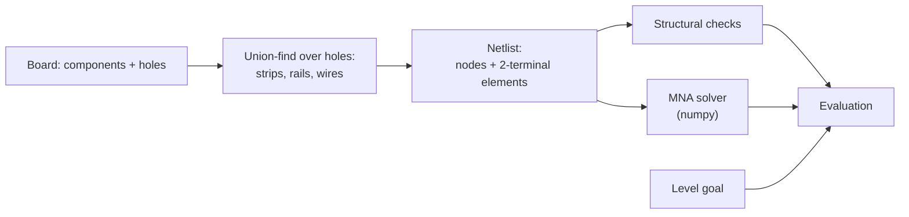

# Schematics

The domain-specific design: the board format, the components, how a board becomes a circuit, how the evaluator solves it, and the levels. Everything here is specific to electronics. The domain-independent architecture is in [design.md](design.md), and the data shapes are in [contract.md](contract.md).

## 1. Board format: the `grid` document

A board is one JSON document. The same shape describes a level's starting board and the learner's current board.

```json
{
  "grid": { "columns": 12, "rows": 8 },
  "components": [
    { "id": "V1", "type": "voltage_source", "value": 12, "fixed": true,
      "orientation": "N", "pins": { "positive": [1, 3], "negative": [1, 5] } },
    { "id": "R1", "type": "resistor", "value": 20, "fixed": false,
      "orientation": "W", "pins": { "a": [4, 1], "b": [6, 1] } }
  ],
  "inventory": [ { "id": "R3", "type": "resistor", "value": 50 } ],
  "wires": [
    [[[3, 1], [4, 1]]],
    [[[1, 3], [1, 2]], [[1, 2], [1, 1]]],
    [[[8, 2], [8, 3]], [[8, 3], [9, 3]], [[7, 3], [8, 3]]]
  ],
  "targets": {
    "VM1": { "value": 4.0, "tolerance": 0.1 },
    "AM1": { "value": 0.2 }
  }
}
```

### Coordinates

- A point is `[col, row]`, the same order as x and y in three.js.
- Points are 1-based: `col` runs from 1 to `grid.columns`, and `row` from 1 to `grid.rows`.
- Row 1 is the top row.

### Sections

| Key | Type | Meaning |
|---|---|---|
| `grid` | `{ columns, rows }` | Size of the pin grid |
| `components` | `Component[]` | Parts placed on the grid |
| `inventory` | `InventoryItem[]` | Parts available to the learner but not placed yet. Placing one moves it into `components` with the same `id`; removing a non-fixed part moves it back. |
| `wires` | `Wire[]` | Wire pieces on the grid |
| `targets` | `{ [meterId]: { value, tolerance? } }` | The level goal: the reading each named meter must show, in V for a voltmeter or A for an ammeter. See [Targets and readings](#targets-and-readings). |

### Components

| Field | Type | Meaning |
|---|---|---|
| `id` | string | Unique across `components` and `inventory` |
| `type` | `"voltage_source"`, `"resistor"`, `"voltmeter"` or `"ammeter"` | Kind of part |
| `value` | number | Volts for `voltage_source`, ohms for `resistor`; not used for meters |
| `fixed` | boolean | `true` means the learner cannot move or remove the part |
| `orientation` | `"N"`, `"E"`, `"S"` or `"W"` | The direction the first pin points, seen from the part's body |
| `pins` | object | Named pin positions, see below |

Pin names by type. The first pin listed is the one `orientation` points to.

| Type | Pins |
|---|---|
| `voltage_source` | `positive`, `negative` |
| `resistor` | `a`, `b` |
| `voltmeter` | `positive`, `negative` |
| `ammeter` | `positive`, `negative` |

**Geometry.** A part spans three points in a straight line, with its pins 2 apart and its body on the middle point. In the example, V1 points `N`, so `positive` [1, 3] lies directly above `negative` [1, 5], with the body at [1, 4].

### Wires

- A wire piece is a list of **segments**.
- A segment is a pair of points `[[c1, r1], [c2, r2]]` that are orthogonal neighbors (a distance of exactly 1 apart).
- The segments of one piece must form one of four shapes:

| Shape | Segments | Rule |
|---|---|---|
| Straight | 1 | — |
| Corner | 2 | The two segments are perpendicular and share one point |
| T-junction | 3 | All three segments share one center point |
| +-junction | 4 | All four segments share one center point |

The shape is derived from the segments, so the format stores no explicit `type` field.

### Meters

Voltmeters and ammeters can appear in both `components` and `inventory`, depending on the level.

- **On the board:** pre-placed meters, usually `fixed`, are the ones the level's `targets` refer to. The learner must make them read the target values.
- **In inventory:** free meters for exploration. The learner can place them anywhere to probe voltages and currents and test their own understanding. They need no target, but their readings are shown live.

### Targets and readings

**Display resolution.** Each meter reads with a fixed resolution, like a real multimeter:

| Meter | Resolution |
|---|---|
| Voltmeter | 0.01 V |
| Ammeter | 0.1 mA (0.0001 A) |

**Rounding.** The evaluator rounds every reading to its meter's resolution before reporting it. A tiny solver residue such as 3.2e‑13 A therefore reads exactly `0`, and `-0` is normalized to `0`. The learner never sees meaningless near-zero numbers.

**Tolerance.** A target is met when `|reading − value| ≤ tolerance`.
- `tolerance` is absolute, in the meter's unit, and optional.
- If it's omitted, the default is `max(2% × |value|, resolution)`. Using the resolution as a floor keeps a target of `0` reachable.

### Connectivity

- Points conduct only through wire segments. There are no breadboard strips or rails.
- A component pin connects to whatever wires touch its point.
- Wire pieces connect to each other wherever their endpoints share a point.

### Format validation

The backend rejects a document that breaks any of these rules, before any electrical evaluation:

- Every point is inside the grid.
- `id`s are unique, and every `targets` key names a meter in `components` or `inventory`.
- Pins match the type's pin names, lie 2 apart in a straight line, and agree with `orientation`.
- Every wire segment joins orthogonal neighbors, and every wire piece has one of the four shapes.
- No two components share a point: neither pins nor bodies may overlap. Components connect only through wires.

### Notes

- **Redundant pins:** pin positions are fully determined by the body point and `orientation`. Both are kept for now, and validation checks that they agree. This is to be revisited in an optimization step.

## 2. From board to circuit

> **Pending revision.** Sections 2–6 predate the `grid` format: they assume breadboard strips and rails, and a `battery` component. They will be updated when the evaluator is designed.



1. **Nodes.** A union-find over all holes:
   - Each strip's 5 holes are merged into one set.
   - All 30 holes of each rail are merged into one set.
   - Each `wire` merges the sets of its two holes.

   The resulting sets are the circuit's nodes.
2. **Elements.** Every non-wire component becomes an element between the nodes of its two pins.
3. **Ground.** The node of the battery's `−` pin is the reference, at 0 V.

## 3. Solver

A DC **modified nodal analysis (MNA)** over the netlist, solved with `numpy.linalg.solve`. Nothing beyond DC is in scope.

- Resistors contribute conductance terms. The battery contributes a voltage-source row, and its branch current is the circuit's total current.
- Voltmeters contribute nothing (infinite resistance) and are read after the solve.
- **Floating nodes**, connected to nothing that leads to the source, would make the matrix singular. A tiny conductance to ground (gmin = 1e‑12 S) keeps it solvable; those nodes then read 0 V and carry no current.
- Results per element: the voltage across it and the current through it, rounded for display to 3 significant figures.
- **Goal check:** `|actual − target| ≤ tolerance`.

## 4. Structural checks

These run before and alongside the solve, and fill `Evaluation.issues`.

| Code | Detection | Effect on `valid` |
|---|---|---|
| `no_source` | No battery on the board | `false` |
| `short_circuit` | The battery's `+` and `−` pins end up in the same node | `false` (the solve is skipped) |
| `same_strip` | A non-wire component has both pins in the same strip or rail, so it is bypassed | `true` (it reads 0 V and 0 A) |
| `floating_component` | A component pin's node connects to nothing else | `true` |
| `open_circuit` | The battery current is ~0 (below 1 µA) although a source exists | `true` |

## 5. Rendering and interaction (three.js)

- **Scene graph:** every hole, component and wire is its own scene object, carrying the component `id` for raycast picking.
- **Placing a part:** drag from the palette, then click two holes. Each pin snaps to the nearest free hole.
- **Wires:** click hole A, then hole B. The wire is drawn as a curved lead.
- **Colors:**
  - `+` rails are red and `−` rails are blue.
  - Resistors show real color bands, so the learner absorbs the color code.
  - Each voltmeter's live reading is shown above it, from the latest `evaluation`.
- **Highlights:** the components and holes in a `TutorMessage.focus` are outlined. Hovering a hole highlights its whole strip, which makes the hidden connections visible.

## 6. Levels (draft)

Each level teaches one concept and targets known beginner misconceptions. The tutor receives the concept and the misconception list for the current level.

| # | Title | Setup | Goal | Concept | Misconceptions to watch for |
|---|---|---|---|---|---|
| 1 | Close the loop | Battery on the rails, one resistor and a voltmeter across it; one wire missing | 9 V across R1 | A current needs a closed loop | "A single wire from the battery is enough"; "current flows out of + and is used up" |
| 2 | Hidden connections | Resistor placed with both leads in one strip | 9 V across R1 | Breadboard strips and rails | "Any two holes in a row are separate"; "the top and bottom rails are connected" |
| 3 | Ohm's law | Battery and an empty slot; choose a resistor | 4 mA ± 0.5 mA through R1 (9 V / 2.2k ≈ 4.1 mA) | V = I·R | "A bigger resistor means more current" |
| 4 | Voltage divider | Two resistors in series | 3 V ± 0.2 V across R2 | Series resistors share the voltage | "Each resistor gets the full battery voltage" |
| 5 | Measure it right | A working divider with no meter | Place a voltmeter that reads the voltage across R1 | Voltmeters go in parallel, across a part | "A meter goes in series like a wire" |
| 6 | Parallel paths | Battery and a resistor; add a second resistor in parallel | Total current doubles | Parallel branches each get the full voltage | "Adding a resistor always reduces current" |

## Open points

- Resolved: there is an `ammeter` component, and current targets are ammeter readings.
- The level order and exact values are to be validated by playtesting.
